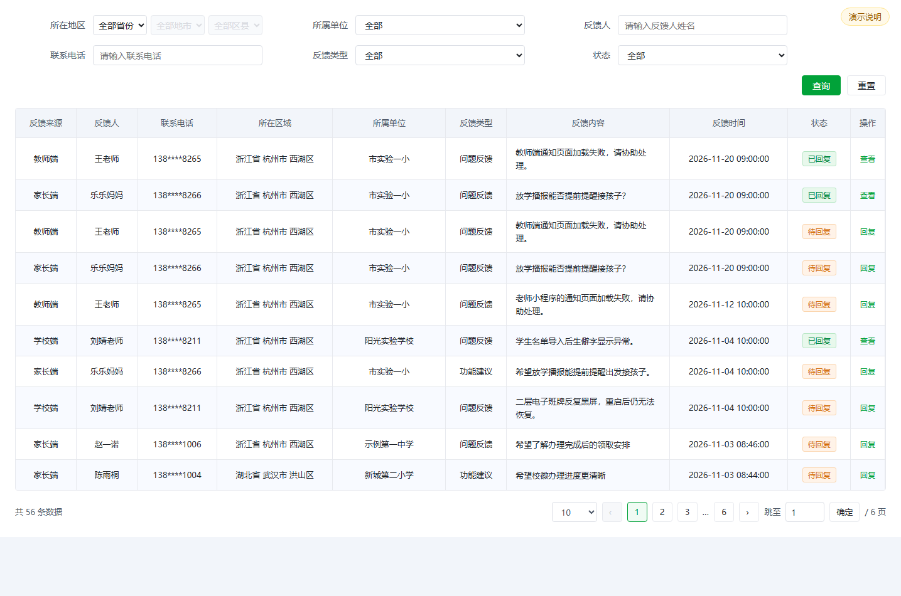
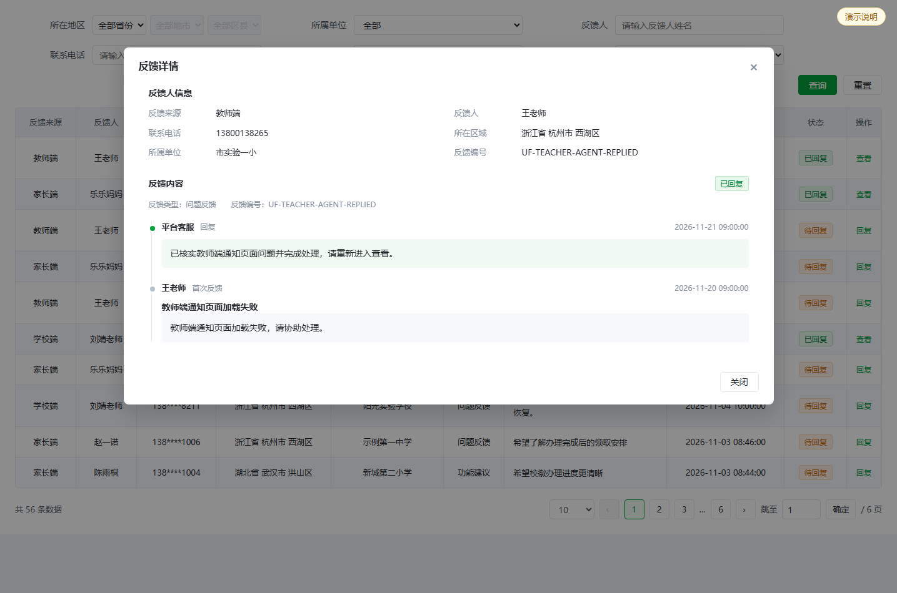
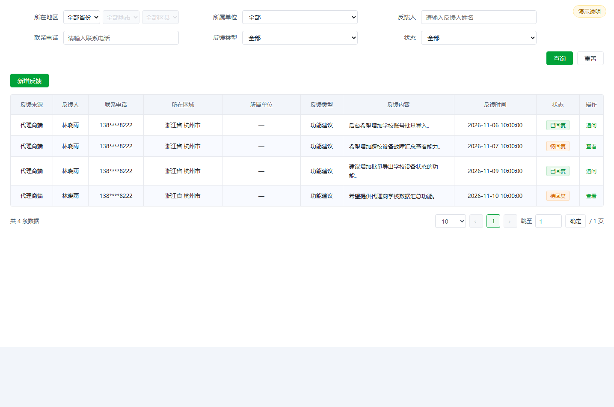
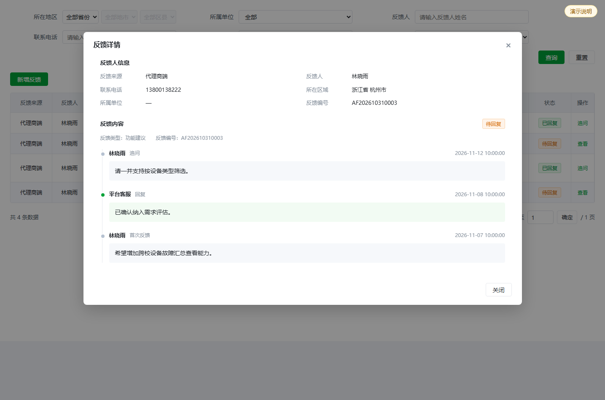
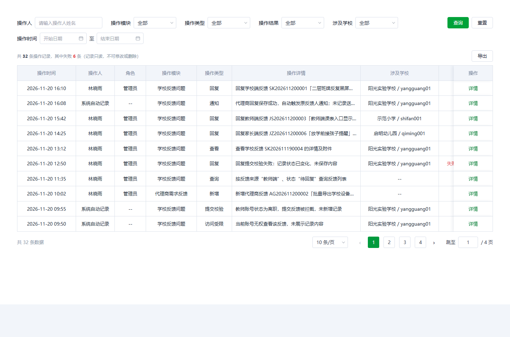

### 代理商 Web 客户反馈产品需求文档

| 文档项 | 内容 |
|---|---|
| 文档版本 | v2.9（评审候选，修改中、未定版） |
| 适用端 | 智小徽代理商管理后台 Web |
| 对应页面 | 校务管理 - 学校反馈；校务管理 - 问题反馈 |
| 规则依据 | 用户对第84—93项的最终确认及此前仍有效的代理商 Web 要求 |
| 本版核心 | 代理商只看负责学校的学校/教师/家长反馈；学校来源操作规则保持不变。代理商自有反馈由运营处理，双方可不限轮次严格一问一答；所有平台回复在时间线中统一署名“平台客服” |

#### 1. 需求背景与目标

##### 1.1 背景

代理商 Web 有两种不同的反馈记录。第一种是学校、老师或家长在代理模式下提交的问题，由负责该学校的代理商直接处理并回复原反馈人。第二种是代理商自己提交给运营的问题，由运营直接处理，运营的答复对象是代理商。两种记录的问答轮次不同，必须通过来源和当前状态判断允许的操作，避免把学校问题误当成代理商问题，或让运营绕过代理商直接答复学校。

本版把已提交反馈与回复设为只读：不能修改、删除或撤回。学校/老师/家长来源的记录完成一次答复后结束；代理商自有反馈可继续往返，但每次只能由当前等待的一方发一条消息，再等待另一方回复。

##### 1.2 目标

| 目标 | 页面应达到的结果 |
|---|---|
| 区分代理商处理与代理商自有问题 | “学校反馈”展示代理商负责且由代理模式受理的学校/老师/家长记录；“问题反馈”展示代理商自己提交给运营的记录 |
| 清楚提示下一步 | 学校/老师/家长来源待回复时只显示“回复”，已回复时只显示“查看”；代理商自有记录待运营回复时只显示“查看”，运营回复后只显示“追问”；操作日志统一从操作日志菜单进入 |
| 阻止问答顺序错乱 | 代理商自有反馈严格按代理商提问、运营答复交替；上一条问题没有答复时不能再提问 |
| 保留完整过程 | 详情展示当前记录全部消息，最新消息在最上；日志展示新增消息及自动通知触发记录 |
| 明确权限边界 | 代理商只处理自己负责范围内的代理模式记录；直营模式记录直接由运营处理 |
| 保持消息原样 | 所有已提交反馈和回复均不可修改；不提供删除、撤回、抄送运营或转达运营回复功能 |

##### 1.3 规则边界

本文只描述代理商 Web 客户反馈页面及其用户可见行为，不描述学校 Web、运营后台和小程序各自页面细节。学校、老师、家长从小程序或学校 Web 提交的记录，必须按学校配置的受理模式进入代理商或运营的一端处理；代理商自有反馈固定由运营处理。运营对代理商自有反馈的答复只回到代理商记录，不直接成为学校、老师或家长收到的回复。

#### 2. 一期范围

##### 2.1 范围清单

| 页面/功能 | 本版包含 | 不包含 |
|---|---|---|
| 学校反馈列表 | 负责范围内学校/老师/家长来源记录；地区、单位、反馈人、电话、类型、状态筛选；待回复只显示回复，已回复只显示查看；回复成功自动触发通知 | 直营模式记录；第二轮学校答复；追问、修改、删除、撤回、抄送、转达、列表内日志按钮 |
| 代理商问题反馈列表 | 代理商本人或当前代理组织提交给运营的记录；新增；待回复只显示查看，收到运营回复后只显示追问 | 学校/老师/家长来源记录；运营直接回复学校；多条连续提问或多条连续答复；列表内日志按钮 |
| 反馈详情 | 反馈人信息、状态、全部消息及每条消息的附件；时间线最新在上 | 消息编辑历史、删除/撤回状态、代理商与运营抄送/转达协作块 |
| 新增反馈与回复 | 必填正文、字数计数、选填图片附件；回复快捷回复 | 提交后的修改；不符合当前等待方向的回复或追问 |
| 回复通知与操作日志 | 回复成功自动触发统一固定文案；日志记录自动触发操作 | 手动通知入口、通知送达或失败状态、自动重试、通知回执及模板配置页面 |

##### 2.2 版本变化

| 变更项 | 本版规则 |
|---|---|
| 代理模式学校/老师/家长反馈 | 代理商直接回复反馈人一次；已答复后不再在该记录发起第二轮问题 |
| 直营模式学校/老师/家长反馈 | 由运营后台直接处理；代理商端不显示、不处理 |
| 代理商自有反馈 | 运营后台直接回复代理商；代理商收到答复后可在同一记录再提问，双方按一问一答交替，轮数不限 |
| 消息修改 | 所有已提交反馈和回复不可修改；不显示修改入口或修改标记 |
| 删除与撤回 | 不提供删除或撤回操作、确认弹窗、状态筛选或对应标记 |
| 协作功能 | 移除代理商抄送运营和转达运营回复的按钮、记录块及流程 |
| 排序 | 两个列表均按记录最近更新时间从新到旧；详情时间线按消息时间从新到旧 |
| 通知 | 每次成功回复自动触发一次；不展示送达状态，不自动重试 |

##### 2.3 页面与流程

| 编号 | 页面/弹窗 | 主流程 |
|---|---|---|
| AG-FB-01 | 学校反馈列表 | 按代理商负责范围查询；待回复直接回复，已回复只查看；回复成功自动通知；日志从系统管理下的操作日志菜单查看 |
| AG-FB-02 | 学校反馈详情 | 核对反馈人、问题和附件 → 查看逆序时间线 → 关闭返回原筛选和分页 |
| AG-FB-03 | 回复学校/反馈人 | 输入回复 → 可选附件或使用快捷回复 → 提交前校验记录仍待回复 → 新增唯一答复 |
| AG-FB-04 | 代理商问题反馈列表 | 查看代理商自有记录 → 新增一条首问；运营答复后对原记录继续提问 |
| AG-FB-05 | 新增代理商反馈/继续提问 | 首问或符合轮次条件的下一问 → 提交后等待运营答复 |
| AG-FB-06 | 回复通知文案 | 回复成功后通知原反馈提交账号及来源端；小程序消息和服务号消息使用同一固定文案 |
| AG-FB-07 | 操作日志 | 从系统管理下的操作日志菜单进入；查看时间、操作人、操作内容及消息正文；操作详情悬停显示全文 |

#### 3. 业务名词、数据来源与基础规则

##### 3.1 业务对象

| 名称 | 含义 | 展示规则 |
|---|---|---|
| 学校来源反馈 | 学校、老师或家长提出的问题，且学校配置为代理模式 | 在负责该学校的代理商“学校反馈”页面展示；来源角色及反馈人信息必须明确 |
| 代理商自有反馈 | 代理商账号或组织向运营提出的问题 | 在“问题反馈”页面展示；由运营后台直接回复代理商 |
| 当前问题 | 最近一条尚未获得另一方答复的消息 | 状态显示待回复；只能由接收方回复一次 |
| 当前答复 | 对最近一条问题的唯一答复 | 状态显示已回复；对代理商自有记录，代理商可以据此提出下一问 |
| 记录更新时间 | 该记录最近一条反馈、提问或答复的发生时间 | 列表据此倒序排序；查看详情或查看日志不改变更新时间 |
| 操作日志 | 对新增反馈、代理商继续提问、代理商回复及自动通知触发等操作的记录 | 按时间逆序展示；消息相关操作展示具体消息正文 |

##### 3.2 受理路由和角色边界

| 来源 | 学校受理模式/记录类型 | 代理商端处理规则 |
|---|---|---|
| 学校 | 代理模式 | 负责学校的代理商收到记录并回复学校一次 |
| 老师 | 代理模式 | 负责学校的代理商收到记录并回复原反馈老师一次 |
| 家长 | 代理模式 | 负责学校的代理商收到记录并回复原反馈家长一次 |
| 学校/老师/家长 | 直营模式 | 由运营后台直接处理；代理商页面不展示该记录 |
| 代理商 | 自有反馈 | 代理商提交，运营后台答复；只有此类记录允许不限轮次的一问一答交替 |

代理/直营受理模式由学校当前业务配置决定，不由代理商在回复页面改变。代理商只能查看当前负责范围内的学校来源记录。代理商在自有反馈页面提交的问题，不因代理商同时负责学校而变成学校来源记录。

##### 3.3 状态、按钮与问答轮次

| 页面与记录类型 | 当前状态/最近消息 | 状态与操作 | 操作后的等待方 |
|---|---|---|---|
| 学校反馈 | 待回复；最近消息来自学校、老师或家长 | 只显示回复；操作日志从系统管理下的操作日志菜单查看 | 代理商回复后为已回复 |
| 学校反馈 | 已回复；代理商已答复反馈人 | 只显示查看；通知已自动触发；操作日志从系统管理下的操作日志菜单查看 | 本条记录结束，不允许再次回复或追问 |
| 代理商自有反馈 | 待回复；最近消息来自代理商 | 只显示查看；不显示可继续提问入口 | 等待运营答复 |
| 代理商自有反馈 | 已回复；最近消息来自运营 | 只显示追问 | 代理商提交下一问后回到待回复 |

代理商自有反馈严格按“一问之后一答，一答之后一问”执行。同一方不能连续新增两条消息；代理商首问后必须等运营答复，运营答复后代理商才可继续提问。该规则没有轮数上限。学校/老师/家长来源记录不适用上述多轮规则，受理方完成一次回复后即结束。

##### 3.4 列表排序与时间线

| 场景 | 排序口径 |
|---|---|
| 学校反馈列表 | 按记录最近更新时间从新到旧。待回复期间新增其他记录时，新记录排前；某条旧记录后来收到答复后，该记录按答复时间重新排到前部 |
| 代理商问题反馈列表 | 首问、运营回复或代理商继续提问都会更新记录时间；最近有新消息的记录排前 |
| 列表时间列 | 展示首条反馈时间；列表排序仍使用最近更新时间，避免把创建时间误当成最近更新 |
| 详情时间线 | 按消息时间逆序，最新消息在最上方；同一时刻新增时，后提交消息在上 |
| 日志 | 操作时间从近到远；新增问题、答复和继续提问应显示对应正文，方便核对 |

##### 3.5 正文、附件和只读规则

代理商新增问题正文必填，限1—200字；标题必填，限1—50字。代理商回复和继续提问正文必填，限1—1000字。正文框显示“请输入回复内容”或“请输入追问内容”占位文字和实时字数计数，到达字数上限后不再接受输入。消息附件选填，仅支持 JPEG、JPG、PNG 图片；每条消息最多9张，每张不超过10MB。用户可在提交前移除选中的附件；一旦消息提交，正文和附件都不可更改。快捷回复只填入回复草稿，不直接发送。

##### 3.6 列表来源样例与字段回写

代理商“学校反馈”列表的评审样例覆盖“学校端”“教师端”“家长端”，每类均有待回复和已回复示例；直营模式记录不进入代理商受理列表。代理商“问题反馈”是代理商自有记录，单独展示待运营回复、运营已回复可继续提问、代理商追问后待回复及后续已回复等状态。

| 来源或记录 | 所属单位显示 | 所在地区显示 | 样例状态说明 |
|---|---|---|---|
| 学校端 | 提交反馈的学校名称 | 该学校所在地区 | 代理商待回复、代理商已回复 |
| 教师端 | 反馈提交时当前登录教师角色任职的学校 | 该学校所在地区 | 代理商待回复、代理商已回复 |
| 家长端 | 反馈提交时当前登录家长角色对应孩子的学校 | 该学校所在地区 | 代理商待回复、代理商已回复 |
| 代理商端自有反馈 | — | 回写代理商所在地区信息 | 待运营回复、已回复可提问、代理商新问待回复、多轮已回复 |

代理商没有所属学校或所属单位；代理商自有反馈所属单位显示“—”，所在地区字段回写代理商所在地区信息并显示。教师反馈所属单位取提交时当前登录教师角色任职的学校、所在地区取该校地区；家长反馈所属单位取提交时当前登录家长角色对应孩子的学校、所在地区取该校地区。家长关联学生仅针对家长来源；其他来源没有关联学生时显示“--”。样例数据按记录创建时的归属展示，不扩大真实账号权限。

##### 3.7 异常模拟开关

“演示说明”提供提交校验、无权限、记录已变化、查询异常四个互斥开关；切换即替换当前提示，点击“恢复默认”回到正常展示。异常模拟不写入记录，也不改变代理模式、直营模式或当前问答等待方。

| 开关 | 代理商端示例 | 页面结果 |
|---|---|---|
| 提交校验 | 回复/提问正文为空、全为空格、超字数，或附件格式/数量/大小不合规 | 阻止提交，说明原因；保留草稿和附件 |
| 无权限 | 记录不属于当前代理商负责学校，或已不在当前账号范围内 | 拒绝打开受保护记录或提交，提示权限失效 |
| 记录已变化 | 回复表单打开后已有新消息、处理路线变化或记录版本变化 | 阻止旧状态提交，保留输入并提示重新查看最新记录 |
| 查询异常 | 列表读取失败或加载超时 | 显示查询异常，保留已选筛选条件；由用户再次查询，不自动重试 |

代理商成功回复学校、教师或家长来源反馈后，自动向原反馈提交账号及来源端触发通知；小程序消息和服务号消息使用本文件约定的同一固定文案，不提供手动通知按钮。

#### 4. 原型、视觉与来源

##### 4.1 候选原型链接

代理商 Web v0.76 学校反馈列表：[学校反馈列表](https://guozi0718.github.io/codex-projects/customer-feedback-web/candidates/T-20261124-03/agent-v0.76/index.html?page=school-feedback&content=1)

代理商回复的学校来源记录详情：[反馈详情](https://guozi0718.github.io/codex-projects/customer-feedback-web/candidates/T-20261124-03/agent-v0.76/index.html?page=school-feedback&content=1&dialog=detail&id=UF-TEACHER-AGENT-REPLIED)

代理商自有问题反馈列表：[问题反馈列表](https://guozi0718.github.io/codex-projects/customer-feedback-web/candidates/T-20261124-03/agent-v0.76/index.html?page=agent-feedback&content=1)

收到运营答复的自有记录详情：[反馈详情](https://guozi0718.github.io/codex-projects/customer-feedback-web/candidates/T-20261124-03/agent-v0.76/index.html?page=agent-feedback&content=1&dialog=detail&id=AF202610310003)

系统管理菜单中的统一操作日志：[操作日志](https://guozi0718.github.io/codex-projects/customer-feedback-web/candidates/T-20261124-03/agent-v0.76/index.html?page=op-log&content=1)

##### 4.2 页面展示原则

| 展示点 | 规则 |
|---|---|
| 两个入口 | “学校反馈”处理代理模式下代理商负责的反馈；“问题反馈”处理代理商自己的运营往来；入口和记录不能混在一个协作记录块中 |
| 操作按钮 | 学校反馈待回复只显示回复、已回复只显示查看；代理商自有反馈待回复只显示查看、已回复只显示追问；不在反馈列表显示日志或通知按钮 |
| 详情信息 | 反馈人资料、状态、消息及附件左边界一致；信息分块不重复加边框 |
| 时间线 | 最新消息置顶；提问保留提交人姓名，代理商或运营发出的回复统一显示“平台客服”且不显示姓名；时间、正文、附件仍归属同一条消息 |
| 通知 | 回复提交成功后自动触发；页面不展示送达结果，不自动重试 |
| 只读消息 | 已提交反馈和回复不可修改；页面不显示修改、删除、撤回及对应标记 |

##### 4.3 依据与候选状态

本文以用户已确认的业务规则为准；代理区域、责任学校、反馈人及组织范围按代理商已有负责关系数据确定，不在本文件虚构字段名称。候选原型和本文均处于修改中、未定版状态；第4节每个原型链接后均直接嵌入 v0.76 候选的真实浏览器截图。

#### 5. 一期页面与功能清单

| 页面编号 | 页面 | 核心字段/操作 | 状态 |
|---|---|---|---|
| AG-FB-01 | 学校反馈列表 | 负责范围筛选、状态；待回复只显示回复、已回复只显示查看；回复成功自动通知 | 候选 |
| AG-FB-02 | 学校反馈详情 | 反馈人、类型、原文、状态、逆序消息及附件 | 候选 |
| AG-FB-03 | 代理商回复 | 1—1000字正文、快捷回复、选填图片、提交确认 | 候选 |
| AG-FB-04 | 代理商问题反馈列表 | 代理商来源记录、状态；待回复只显示查看、已回复只显示追问 | 候选 |
| AG-FB-05 | 新增代理商反馈/继续提问 | 类型、标题、正文、选填附件、状态校验 | 候选 |
| AG-FB-06 | 回复后自动通知 | 原反馈提交账号、来源端、统一固定文案 | 候选 |
| AG-FB-07 | 操作日志 | 操作时间、操作人、操作内容 | 候选 |

#### 6. 功能详细说明

##### 6.1 学校反馈列表

###### 6.1.1 筛选字段和列表字段

| 区域 | 字段/控件 | 规则 |
|---|---|---|
| 筛选 | 所在地区 | 选项来自代理商负责区域及其负责学校所在区域的合集；不负责的地区不提供下拉选项；无可选地区时不展示无效地区项 |
| 筛选 | 所属单位 | 只显示当前代理商有权处理的负责学校；更改地区后单位选项同步收窄 |
| 筛选 | 反馈人、联系电话 | 支持按姓名和电话查询；页面按当前号码脱敏规则展示电话 |
| 筛选 | 反馈类型、状态 | 类型为功能建议/问题反馈；状态为全部/待回复/已回复 |
| 列表 | 来源、反馈人、电话、区域、单位、类型、内容、反馈时间、状态 | 仅返回代理商负责范围且由代理模式受理的学校/老师/家长反馈 |
| 操作 | 回复、查看 | 学校反馈待回复只显示回复、已回复只显示查看；无列表内日志和手动通知按钮 |

###### 6.1.2 ACT-AG-01 查询、重置与分页

用户选择地区、单位或其它条件后点击查询，列表只显示所有条件均匹配且当前仍由本代理商负责的记录。重置清空自填条件、恢复默认选择并回到第1页。地区变化后清空不再适用的下级地区和单位选择。筛选、分页、打开详情或日志不会改变记录更新时间。结果为空时显示“暂无符合条件的反馈”，不把无负责关系的记录混入结果。

###### 6.1.3 ERR-AG-01—06 列表异常

| 编号 | 场景 | 提示与页面处理 |
|---|---|---|
| ERR-AG-01 | 查询没有匹配记录 | 显示空结果和当前筛选条件，不报系统错误 |
| ERR-AG-02 | 查询或列表刷新失败 | 保留已填写筛选条件和当前页面，不显示过期数据为新结果；用户可重试 |
| ERR-AG-03 | 当前页数据变化后变为空 | 回到有效页码并提示列表已更新 |
| ERR-AG-04 | 代理商负责区域或学校关系变化 | 不再展示失去负责权的记录；提示负责范围已更新并重新查询 |
| ERR-AG-05 | 记录已转为直营受理 | 代理商不再打开或回复；提示记录当前由运营处理 |
| ERR-AG-06 | 记录编号缺失、无效或无权 | 不展示空详情；提示记录不可访问并保持列表可用 |

##### 6.2 学校反馈详情与回复

###### 6.2.1 详情字段和消息归属

详情显示反馈来源、反馈人、联系电话、所在区域、所属学校、反馈编号、反馈类型、当前状态、标题、正文和消息附件。时间线中每条消息分别显示发送人、发送时间、消息性质、正文与本条附件。家长来源只展示当前业务有明确关联的反馈人信息，不把不同消息的附件合并展示。运营内部的代理商自有记录不在此页面显示。

###### 6.2.2 ACT-AG-02 查看详情

时间线最新消息在顶部。图片点击后可预览原图；单张图片不可打开时，其它正文和附件仍可查看。关闭详情回到原列表的筛选、页码和滚动位置。查看详情或日志不改变状态，不把记录重新排序。

###### 6.2.3 ACT-AG-03 回复反馈人

只有待回复的学校来源记录可回复。回复弹窗需显示反馈人、来源、编号、反馈正文和历史消息，避免把回复写到错误记录。回复正文必填，限1—1000字；显示占位文字、当前字数/1000；超过上限不允许继续输入。快捷回复只用于填入草稿。附件可选，最多9张合规图片，每张不超过10MB。提交前再次检查本代理商是否仍负责该学校、记录是否仍为代理模式、最近消息是否仍等待代理商回复。成功后新增一条代理商答复，状态改为已回复，更新时间更新；该学校/老师/家长来源记录不再允许第二次提问或回复。

###### 6.2.4 ERR-AG-07—15 回复异常与校验

| 编号 | 场景 | 提示 | 处理结果 |
|---|---|---|---|
| ERR-AG-07 | 正文为空或只有空格 | 请填写回复内容 | 不提交；保留已选附件和正文内容 |
| ERR-AG-08 | 回复正文超过1000字 | 回复内容不能超过1000字 | 不截断；阻止继续输入及提交 |
| ERR-AG-09 | 附件不是JPEG/JPG/PNG图片 | 仅支持JPEG、JPG、PNG图片 | 拒绝问题附件，保留正文及其它有效附件 |
| ERR-AG-10 | 附件超过9张 | 最多选择9张图片 | 不加入超出的文件，已选有效附件保留 |
| ERR-AG-11 | 单张图片超过10MB | 单张附件不能超过10MB | 拒绝该图片，不清空正文和其它附件 |
| ERR-AG-12 | 图片正在读取或读取失败 | 附件尚未准备完成/读取失败 | 未完成时阻止提交；失败项可移除后重选 |
| ERR-AG-13 | 打开弹窗后另一位代理商已回复 | 记录状态已变化，请刷新后查看 | 不重复写入答复；提示并显示最新记录 |
| ERR-AG-14 | 提交前代理商失去学校负责权或记录改为直营 | 当前记录已不属于代理商处理范围 | 不提交、不泄露新受理方信息；关闭后刷新列表 |
| ERR-AG-15 | 回复保存失败或提交状态不确定 | 回复未能确认保存，请刷新记录后核实 | 不自动重复新增；刷新后按当前消息状态决定是否仍可回复 |

##### 6.3 代理商问题反馈列表

###### 6.3.1 字段和查询

| 区域 | 字段 | 规则 |
|---|---|---|
| 筛选 | 代理商自有记录范围 | 只返回当前登录代理商本人或当前代理组织有权查看的记录 |
| 筛选 | 反馈类型、状态、反馈时间 | 类型为功能建议/问题反馈；状态仅全部、待回复、已回复 |
| 列表 | 来源、反馈人、电话、区域、单位、类型、内容、首问时间、状态 | 来源显示代理商端；排序按记录最近更新时间逆序，不按首问时间排序 |
| 操作 | 查看、追问 | 代理商自有反馈待回复只显示查看；已回复只显示追问；日志从操作日志菜单统一查看 |

###### 6.3.2 ACT-AG-04 新增代理商反馈

代理商从“问题反馈”新增记录时，选择反馈类型、填写标题和正文，可添加图片附件。提交前校验当前登录代理商/组织身份、反馈类型、标题1—50字、正文1—200字和附件上限。成功后生成新的代理商反馈编号，第一条消息为代理商提问，状态为待回复，接收方为运营后台。提交后不能修改、删除或撤回。运营端答复只出现在这条代理商记录中，不直接回复学校、老师或家长。

###### 6.3.3 ACT-AG-05 运营答复后继续提问

运营已回复后，列表显示“追问”入口。点击后在原记录上新增一条代理商问题，不创建新记录编号。继续提问正文必填，限1—1000字，可附最多9张合规图片。提交成功后，该记录改为待回复并等待运营答复。收到运营新答复后，代理商才可再次提问；不设最大轮数。追问按钮不是独立的新追问子流程，也不另建记录。

###### 6.3.4 ERR-AG-16—25 新增和继续提问异常

| 编号 | 场景 | 提示 | 处理结果 |
|---|---|---|---|
| ERR-AG-16 | 未选择反馈类型 | 请选择反馈类型 | 不提交，保留标题、正文和附件 |
| ERR-AG-17 | 标题为空或只有空格 | 请输入反馈标题 | 不提交并定位标题字段 |
| ERR-AG-18 | 标题超过50字 | 标题不能超过50字 | 不截断，显示计数并阻止提交 |
| ERR-AG-19 | 首问正文为空 | 请输入反馈内容 | 不提交并定位正文 |
| ERR-AG-20 | 首问正文超过200字 | 反馈内容不能超过200字 | 不截断，保留输入并阻止提交 |
| ERR-AG-21 | 继续提问正文为空或超1000字 | 请填写1—1000字追问内容 | 不提交并保留草稿 |
| ERR-AG-22 | 运营尚未答复，代理商尝试连续提问 | 请等待运营回复后再继续提问 | 不新增消息；原记录保持待回复 |
| ERR-AG-23 | 代理商刚提交问题，重复点击或并发提交 | 当前记录已提交，请刷新查看 | 同一轮只保存一条代理商消息，不重复新增 |
| ERR-AG-24 | 记录在弹窗打开后已被运营答复或状态变化 | 记录状态已更新，请刷新后继续 | 重新读取最新消息；根据最新一条消息方向决定是否可继续提问 |
| ERR-AG-25 | 当前账号不再有该自有记录权限 | 当前记录不可访问 | 不提交，不显示其它代理商信息，返回可访问列表 |

##### 6.4 回复通知与操作日志

###### 6.4.1 回复后自动通知

每次受理方回复成功保存后，消息中心立即向原反馈提交账号及该反馈来源端触发一次通知。代理商回复学校、教师、家长来源记录时，通知发给原反馈提交账号及其来源端；运营回复代理商自有反馈时，通知发给代理商提交账号及代理商端。代理商自有反馈允许多轮，因此运营每次回复成功保存后都独立触发一次通知。小程序消息与服务号消息使用完全相同的固定文案。

代理商端不提供手动通知按钮、确认弹窗或重复发送入口。回复提交失败、当前记录已变化、失去权限或反馈正文/附件校验失败时，不新增回复，也不触发通知。回复成功后，通知触发不改变记录问答状态。

###### 6.4.2 小程序消息与服务号共用文案

模板名称：反馈回复提醒。小程序消息和服务号消息共用相同固定文案：

> 您提问的“{{首条反馈信息前五个字}}”问题已有回复，请查看。

| 模板内容 | 变量或来源 | 展示规则 |
|---|---|---|
| 您提问的“{{首条反馈信息前五个字}}”问题已有回复，请查看。 | 首条反馈正文 | 从左到右取前五个字符；不足五个字符时显示全部正文；不取标题、追问或回复 |

示例：首条反馈正文“二层电子班牌反复黑屏”，变量显示“二层电子班”。两类消息始终显示相同句子及变量值。本期不增加文案配置页面，消息中心继续负责现有发送方式。

###### 6.4.3 通知结果与异常处理

通知渠道不可用、接收条件不足或消息发送未完成时，已保存的回复仍保持有效；页面不显示送达、失败或已读状态，不自动重试。通知发起操作由消息中心按现有规则留存，反馈页面不提供手动补发。

###### 6.4.4 操作日志

反馈相关操作日志统一位于左侧最后一个一级菜单“系统管理”下的“操作日志”二级菜单；学校反馈和代理商自有反馈列表均不显示行内日志按钮。日志只读并按操作时间逆序展示操作时间、操作人、角色、操作模块、操作类型、操作内容、涉及学校和结果。操作详情单行显示，超出列宽后省略；鼠标停留显示完整内容，详情查看时完整内容可读。消息类日志写入具体消息摘要，不能只显示“回复”或“追问”。自动通知日志只表示触发发送，不显示送达、失败或已读状态，也不自动重试。查看日志不改变反馈记录更新时间、状态或列表排序；没有记录时显示“暂无操作记录”。

日志样例至少覆盖以下情况：

| 场景 | 日志内容示例 | 结果 |
|---|---|---|
| 学校端/教师端/家长端反馈 | 来源角色、记录编号、问题内容摘要、提交时间 | 进入代理商负责范围后由代理商回复 |
| 代理商回复反馈人 | 记录编号、回复内容摘要、提交人、提交时间 | 回复成功并自动触发通知 |
| 代理商自有反馈新增 | 代理商提交账号、记录编号、问题摘要 | 等待运营回复 |
| 运营回复代理商 | 记录编号、运营回复内容摘要 | 状态更新为已回复并触发通知 |
| 代理商继续提问 | 当前轮次、追问正文摘要、提交时间 | 状态回到待回复 |
| 自动通知 | 关联记录编号、通知已触发 | 不显示送达或失败状态，不重试 |
| 回复提交校验失败 | 正文为空、超长或附件不合规等原因 | 不新增回复，不触发通知 |
| 状态变化或无权限 | 记录已被处理、超出代理商负责范围等原因 | 阻止操作并保留当前页面填写内容 |
| 查询异常 | 无匹配记录或查询失败 | 显示对应结果，保留筛选条件 |

###### 6.4.5 ERR-AG-26—28 通知和日志异常

| 编号 | 场景 | 提示与处理 |
|---|---|---|
| ERR-AG-26 | 回复正文、附件或权限校验失败 | 保留表单输入，不新增回复，不触发通知 |
| ERR-AG-27 | 回复提交时记录已变化 | 提示刷新后重新核对；不新增重复回复，不触发通知；保留正文和附件供复制 |
| ERR-AG-28 | 回复已保存，但通知发送条件不足或渠道不可用 | 回复仍成功；不显示送达结果、不阻止后续操作、不自动重试 |
##### 6.5 通用表单、身份和上下文

###### 6.5.1 计数、附件与离开提醒

所有正文框显示对应占位文字和实时计数。达到字数限制后停止输入；若粘贴内容超限，保留已有合法文本并提示超限，不静默截断。选择文件前后保持附件与正文的对应关系。表单未提交时关闭或切换页面，应二次提醒用户离开；选择继续编辑时保留当前输入和附件，确认离开则丢弃未提交内容。

###### 6.5.2 账号与记录状态变化

打开表单时和提交前均检查当前登录角色、代理组织、负责学校、来源模式、当前记录状态及最新消息方向。前端按钮状态只用于提示，最终是否允许提交以点击提交时重新读取的记录为准。任何规则不满足时不新增消息，保留当前输入供用户复制或核对，并展示清楚的原因。

#### 7. 数据、权限与跨端一致性要求

##### 7.1 代理商端可见与可操作范围

| 当前身份/记录 | 可查看 | 可新增 | 不允许 |
|---|---|---|---|
| 代理商处理人员—代理模式学校来源 | 当前代理商负责学校的学校/老师/家长反馈及完整时间线 | 待回复时对该反馈人答复一次；回复成功后自动触发通知 | 处理直营记录；对同一学校来源记录再追问；修改、删除、撤回、抄送或转达 |
| 代理商提交人—代理商自有反馈 | 本人或组织有权查看的代理商来源记录和时间线 | 新增首问；收到运营答复后在同一记录继续下一问 | 运营未答复前连续发问；修改、删除、撤回消息；把运营回复直接发给学校 |
| 代理商无关组织或失去范围 | 无权查看对应记录 | 无 | 通过列表、详情或旧链接查看和操作 |

代理商负责范围以当前业务责任关系为准。区域下拉选项由代理商负责区域及负责学校的地区信息组成；代理商不能查询不属于其负责范围的学校反馈。负责关系变化后，页面刷新并按新范围处理。

##### 7.2 跨端状态与消息一致性

| 记录来源 | 代理商端动作 | 对方可见结果 | 状态规则 |
|---|---|---|---|
| 学校/老师/家长，代理模式 | 代理商答复一次 | 原反馈人对应端显示代理商回复 | 代理商答复后已回复并结束当前记录 |
| 学校/老师/家长，直营模式 | 代理商无操作 | 由运营端答复并由对应反馈人端查看 | 代理商端不展示该记录 |
| 代理商自有反馈 | 代理商提问 | 运营后台收到代理商问题 | 待回复 |
| 代理商自有反馈 | 运营答复 | 代理商问题反馈记录显示运营答复 | 已回复，代理商可提下一问 |
| 代理商自有反馈 | 代理商继续提问 | 同一记录追加一条代理商问题 | 回到待回复，等待运营下一次答复 |

代理商自有反馈只有运营后台处理。运营回复始终只写入该代理商记录，不会直接出现在学校、老师或家长的原始反馈记录。学校来源的处理回复由代理商直接作答，不经运营抄送或转达。

##### 7.3 不可修改与记录保留

已提交反馈、追问和回复均为固定记录。详情与时间线按提交时内容展示；不出现编辑历史、已修改、已删除或已撤回状态。提交前的输入和附件可编辑或移除，点击提交后不提供任何改写入口。日志只读并保留消息操作的时间、人员和正文。

#### 8. 需求验收标准

| 编号 | 验收场景 | 合格结果 |
|---|---|---|
| AT-AG-01 | 代理商打开学校反馈列表 | 只显示负责范围内且代理模式受理的学校/老师/家长记录 |
| AT-AG-02 | 代理商地区筛选 | 仅出现代理商负责区域及负责学校地区合集；未负责地区无下拉选项 |
| AT-AG-03 | 待回复学校/教师/家长来源记录 | 只显示回复；回复尚未保存时不触发通知；日志从操作日志菜单查看 |
| AT-AG-04 | 已回复学校/教师/家长来源记录 | 只显示查看；回复成功后已自动触发通知，不出现列表日志按钮、通知按钮或第二次回复 |
| AT-AG-05 | 直营模式来源记录 | 代理商页面不展示该记录；运营后台处理 |
| AT-AG-06 | 代理商新增自有反馈 | 运营后台收到同一代理商来源记录，状态为待回复 |
| AT-AG-07 | 代理商收到运营回复 | 自有反馈状态为已回复，出现继续提问入口 |
| AT-AG-08 | 代理商连续提问 | 当前轮没有运营答复时阻止新增；提示等待运营回复 |
| AT-AG-09 | 代理商多轮往返 | 一问一答交替、无轮数上限、沿用同一反馈编号 |
| AT-AG-10 | 运营回复代理商自有反馈 | 回复仅进入代理商记录，不直接回复原学校、老师或家长 |
| AT-AG-11 | 消息提交后检查 | 不存在修改、删除、撤回按钮和相应状态标记 |
| AT-AG-12 | 字段与附件边界 | 首问标题1—50字、正文1—200字；回复/继续提问1—1000字；附件最多9张、单张≤10MB |
| AT-AG-13 | 输入计数 | 各输入框显示占位文字和计数；到达上限后无法继续输入 |
| AT-AG-14 | 列表排序 | 新增消息或收到答复的记录按最近更新时间移动至最前 |
| AT-AG-15 | 详情时间线 | 最新消息在最上；每条正文和附件对应到同一消息 |
| AT-AG-16 | 回复后自动通知 | 每次成功回复触发一次统一文案；不展示送达成功/失败，不自动重试 |
| AT-AG-17 | 操作日志 | 首问、答复、每次继续提问和自动通知触发记录可按时间、人员、内容核对 |
| AT-AG-18 | 失去负责范围或记录状态变化 | 提交前复核并阻止越权、重复或方向错误的消息 |
| AT-AG-19 | 查看学校反馈或代理商自有反馈时间线 | 代理商和运营发出的全部回复作者统一显示“平台客服”，不显示姓名；保留“回复”字样、原字体和正文样式 |

#### 9. 客户反馈编号规则

| 来源 | 编号前缀 | 规则 |
|---|---|---|
| 学校反馈 | SK | 学校的首条反馈创建唯一编号，代理商的唯一回复沿用原编号 |
| 教师/家长反馈 | UF | 来源记录沿用提交时生成的唯一编号；代理商回复不另建编号 |
| 代理商自有反馈 | AF | 代理商首问生成唯一编号；不限轮次的代理商提问和运营回复均沿用同一编号 |

编号遵循代理商 Web 主项目当前编号展示规则。列表、详情、日志和通知引用同一个反馈编号；不得因下一问或下一答创建新反馈编号。

#### 10. 文档边界与交付说明

##### 10.1 文档边界

本文说明代理商用户在反馈页面中可以查看和执行的操作，以及记录状态、字段、权限、校验和异常处理。运营后台、学校 Web 和小程序的页面规则分别由各自文档说明。代理商负责范围、受理模式、登录角色和通知渠道依照平台现有业务资料；本文件不补造尚未确认的业务规则。

##### 10.2 候选交付物

| 交付物 | 状态 |
|---|---|
| 代理商 Web v0.76 候选原型 | 修改中，未定版 |
| 本 PRD v2.9 | 修改中，未定版；第4节每个原型链接后均直接嵌入 v0.76 候选的真实浏览器截图 |
| 浏览器页面截图 | 当前候选页面已真实截图并紧跟各原型链接嵌入 |

##### 10.3 版本保留

本候选已发布至 GitHub 候选路径供评审，但不覆盖代理商 Web 当前活动主原型。用户确认后，按代理商 Web 主项目的发布流程另行形成正式版本。
