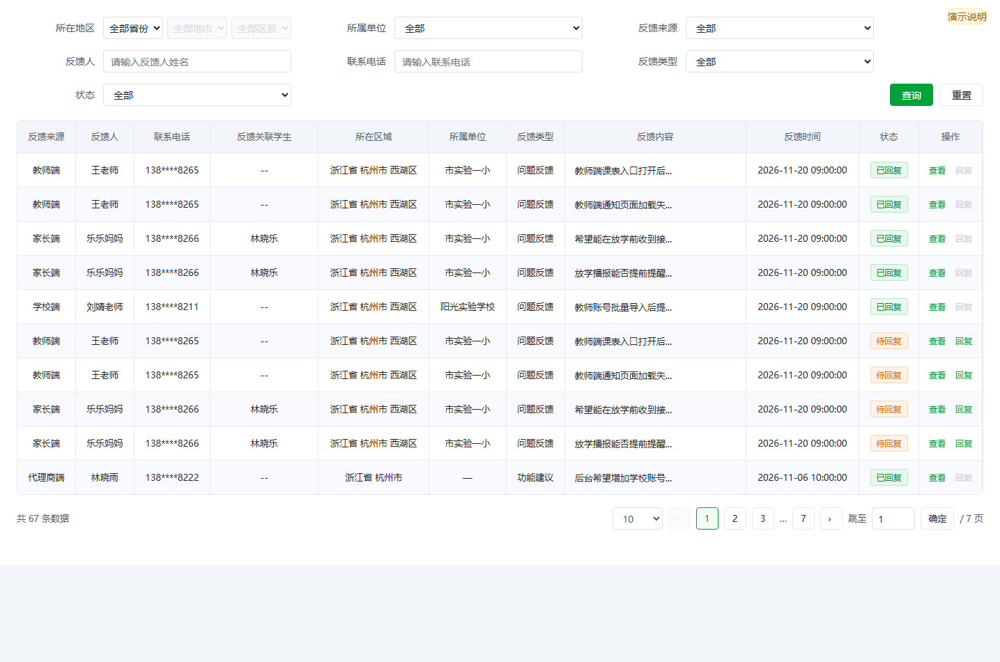
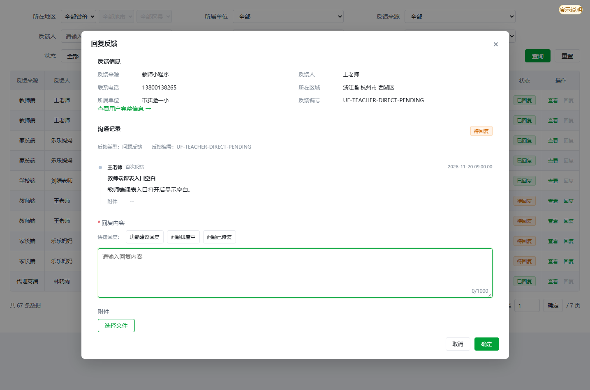
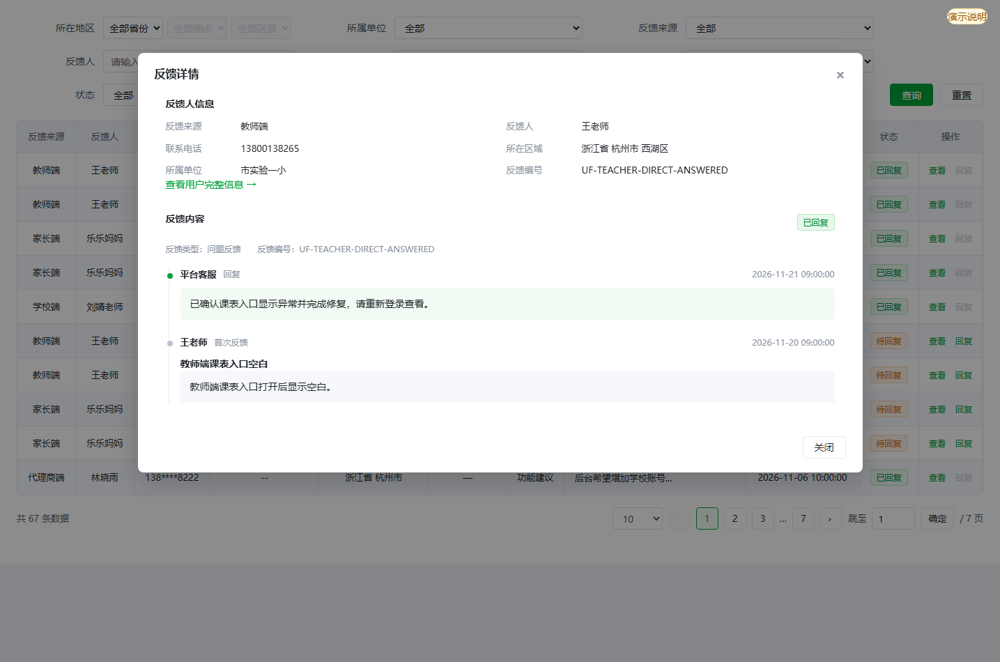
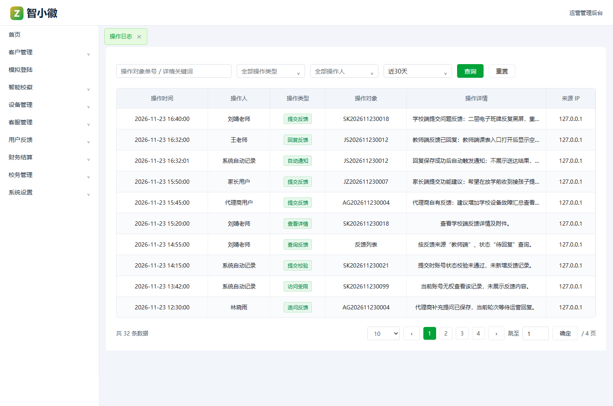

### 运营后台客户反馈产品需求文档

| 文档项 | 内容 |
|---|---|
| 文档版本 | v1.19（评审候选，修改中，未定版） |
| 适用端 | 智小徽运营管理后台 Web |
| 对应页面 | 用户反馈 - 反馈回复；用户数据查询 - 反馈信息 |
| 规则依据 | 用户对 84—93 项的最终确认及此前仍有效的 Web 端要求 |
| 本版核心 | 运营后台可查看全部来源记录，操作列固定为“查看+回复”；回复按当前最新消息轮次启用或置灰。学校/老师/家长来源只答复一次；代理商自有反馈可不限轮次严格交替问答 |

#### 1. 需求背景与目标

##### 1.1 背景

运营后台需要处理直营模式下学校、老师、家长提交的问题，也需要直接回复代理商提交的问题。此前把追问、删除、撤回、抄送及转达等多类操作叠加到一条记录中，导致不同来源的处理边界和状态判断不清。本版按来源角色区分对外会话轮次：学校、老师、家长来源只完成一次提问和一次答复；代理商提交给运营的问题可持续往返，但每一轮都必须先问后答。

##### 1.2 目标

| 目标 | 页面应达到的结果 |
|---|---|
| 准确找到待处理记录 | 可按页面现有筛选条件查询；仅展示运营有权处理的反馈 |
| 操作入口明确 | 每条记录始终显示“查看+回复”；当前轮待平台答复时“回复”可用，已有平台答复时“回复”置灰并说明原因；操作日志统一从操作日志菜单进入 |
| 防止重复或越界回复 | 提交时再次检查当前状态、来源角色和处理权限；一条待回复记录只能有一条当前答复 |
| 保留沟通依据 | 详情展示消息及附件；时间线按时间逆序；日志记录提交、回复及自动通知触发 |
| 通知口径简单 | 回复提交成功后自动触发通知；不提供手动通知按钮，也不展示送达结果或自动重试 |

##### 1.3 规则边界

本需求是产品需求文档，描述页面、字段、用户可见行为、权限、校验和异常处理。客服管理、通知配置、账号权限、菜单结构及跨系统接口仍由各自归属项目维护。当前为候选版本，不代表用户已定版。

#### 2. 一期范围

##### 2.1 范围清单

| 页面/功能 | 本版包含 | 不包含 |
|---|---|---|
| 反馈回复列表 | 查询、重置、分页；所有来源、所有状态均显示“查看+回复”；按当前轮次启用或置灰回复；回复成功自动触发通知 | 消息修改、删除、撤回、追问学校/老师/家长、抄送运营、转达学校、列表内日志按钮 |
| 反馈详情 | 来源身份、反馈原文、回复、附件、状态、时间线 | 删除/撤回标识、消息编辑入口、代理商协作记录块 |
| 运营回复 | 必填正文、字数计数、可选图片附件、快捷回复、提交校验 | 已提交回复修改、对学校/老师/家长来源进行第二轮追问 |
| 代理商来源会话 | 运营答复代理商；代理商收到答复后可继续提问，运营再答复 | 运营直接回复学校、老师或家长；轮次硬上限 |
| 通知与日志 | 固定共用通知文案；回复成功自动触发通知；查看自动触发记录 | 手动通知入口、送达/失败结果、回执、自动重试及模板配置页面 |
| 用户数据查询 | 保持既有搜索入口与页面框架；反馈页签显示关联学生 | 改动其它用户、订单或退款资料 |

##### 2.2 版本变化

| 变更项 | 本版规则 |
|---|---|
| 学校/老师/家长来源 | 受理方完成一次回复后，本条对话结束；反馈人端不能再追问 |
| 代理商来源 | 仅代理商提交给运营的记录可多轮；必须按代理商提问、运营答复、代理商再问、运营再答复交替 |
| 消息操作 | 所有反馈及回复提交后不可修改；不提供删除和撤回，也不显示对应状态标记 |
| 协作功能 | 完全移除抄送运营、转达回复及其按钮、记录块和处理逻辑 |
| 排序 | 列表按记录最近一次新增消息的时间逆序；时间线按消息时间逆序 |
| 通知 | 每次回复成功自动触发一次；不展示送达状态，不自动重试 |

##### 2.3 页面与流程

| 编号 | 页面/弹窗 | 主流程 |
|---|---|---|
| OPS-FB-01 | 反馈回复列表 | 筛选 → 查询全部来源记录；操作列始终显示查看+回复，当前轮次可回复时启用；回复成功自动触发通知 |
| OPS-FB-02 | 反馈详情 | 核验来源与正文 → 按逆序查看消息及附件 → 关闭返回原筛选上下文 |
| OPS-FB-03 | 回复弹窗 | 填写正文 → 可选附件/快捷回复 → 提交前复验 → 新增一条回复 |
| OPS-FB-04 | 统一通知文案 | 回复提交成功后向原反馈提交账号及来源端触发通知；小程序消息和服务号消息使用同一文案 |
| OPS-FB-05 | 操作日志 | 查看时间、操作人和操作内容，包含对应消息内容 |
| OPS-UD-01 | 用户数据查询 | 直接搜索或由家长详情入口带条件进入 → 查看基础、订单、退款、反馈四个页签 |

#### 3. 业务名词、数据来源与基础规则

##### 3.1 业务对象

| 名称 | 含义 | 产品展示要求 |
|---|---|---|
| 反馈记录 | 一次反馈及其后续允许的消息 | 每条记录有独立编号、来源、反馈人、类型、内容、状态和更新时间 |
| 首条反馈 | 学校、老师、家长或代理商发起的问题 | 作为时间线最早消息，正文和附件提交后不可修改 |
| 回复 | 受理方对当前待回复问题给出的唯一当前答复 | 与对应问题组成一问一答；正文和附件提交后不可修改 |
| 代理商追问 | 代理商在运营答复后追加的下一轮问题 | 只用于代理商自有反馈；对应同一记录，不新建编号 |
| 操作日志 | 记录重要新增和自动通知触发 | 按时间逆序展示操作时间、操作人、操作内容 |
| 反馈关联学生 | 与该反馈对应的学生姓名 | 家长来源取提交反馈时登录家长对应的孩子；其他来源显示“--” |

##### 3.2 反馈来源与受理路由

| 来源 | 受理模式 | 本端处理边界 | 本轮答复对象 |
|---|---|---|---|
| 学校 | 代理模式 | 代理商负责日常处理；运营后台仍可查看全部记录，并可在当前轮待回复时直接回复 | 回复原反馈人；任一平台先完成答复后本轮结束 |
| 学校 | 直营模式 | 运营后台处理 | 回复原反馈人；本轮只能成功答复一次 |
| 老师/家长 | 代理模式 | 代理商负责日常处理；运营后台仍可查看全部记录，并可在当前轮待回复时直接回复 | 回复原反馈人；任一平台先完成答复后本轮结束 |
| 老师/家长 | 直营模式 | 运营后台处理 | 回复原反馈人；本轮只能成功答复一次 |
| 代理商 | 固定由运营处理 | 仅此来源允许多轮，且每轮严格交替 | 运营只回复代理商 |

代理模式或直营模式仍决定代理商的日常受理页面；运营后台跨来源可见全部记录，并可在当前轮次等待回复时答复原反馈人。代理商来源是独立业务路径，其多轮答复对象始终是代理商本人。

##### 3.3 状态与问答交替

| 最近一条有效消息 | 记录状态 | 运营后台允许操作 | 说明 |
|---|---|---|---|
| 最近一条消息来自反馈人/代理商 | 待回复 | 显示“查看+回复”；回复可用 | 所有来源均可见；提交前复核当前消息仍等待平台答复 |
| 最近一条消息来自平台客服 | 已回复 | 显示“查看+回复”；回复置灰，并提示当前轮次已有答复 | 学校/老师/家长来源不再开启新轮；代理商来源等待代理商下一问后可开启下一轮 |

对所有来源，运营只能回复当前等待平台答复的最新一问；最近一条消息已经是平台客服答复时，运营回复置灰。学校/老师/家长来源答复后结束；代理商自有反馈在运营答复后由代理商发起下一问，状态再回到待回复。

##### 3.4 排序与时间

| 场景 | 排序口径 |
|---|---|
| 列表 | 按记录更新时间从新到旧；新增反馈、回复或代理商追问后，记录排到对应筛选结果前部 |
| 列表时间列 | 显示首条反馈时间；排序依据仍为最近更新时间，避免把创建时间误认为排序时间 |
| 详情时间线 | 消息按时间逆序，最新消息在最上；同一秒新增时，新提交的消息在上 |
| 分页 | 当前页数据按同一排序口径；筛选条件变化后回到第1页 |

##### 3.5 正文、附件和通知共用规则

正文去除首尾空白后计数字符；空正文不能提交。回复正文限1—1000字，显示“当前字数/1000”和占位文字“请输入回复内容”，达到1000字后停止输入。附件为选填，仅支持 JPEG、JPG、PNG 图片，单条消息最多9张，每张不超过10MB。快捷回复只填入正文草稿，不直接发送。通知不需要单独操作；回复保存成功后自动触发，通知不改变记录状态。

##### 3.6 列表来源样例与字段回写

三端来源在 Web 页面中的显示名称统一为“学校端”“教师端”“家长端”。运营反馈列表的样例覆盖这三类来源的待回复、已回复记录；学校、教师、家长样例均按直营路由进入运营处理列表，代理模式记录仍由代理商处理。代理商自有反馈另外展示问答交替状态样例。

| 来源或记录 | 所属单位显示 | 所在地区显示 | 反馈关联学生显示 |
|---|---|---|---|
| 学校端 | 提交反馈的学校名称 | 该学校所在地区 | — |
| 教师端 | 反馈提交时当前登录教师角色任职的学校 | 该学校所在地区 | — |
| 家长端 | 反馈提交时当前登录家长角色对应孩子的学校 | 该学校所在地区 | 对应孩子姓名；无匹配学生时显示“--” |
| 代理商端自有反馈 | — | 回写代理商所在地区信息 | — |

反馈回复列表在联系电话列后展示“反馈关联学生”。没有对应学生的来源统一显示“--”；代理商没有所属单位，所属单位显示“—”。学校、教师、家长来源的单位和地区按提交时对应学校信息回写；家长来源的反馈关联学生取该登录家长角色对应的孩子。代理商反馈列表的所在地区字段回写代理商所在地区信息并显示。历史记录展示提交时的归属信息，不按后来变更的任职学校、孩子关联或地区自动改写；不以反馈人姓名、电话反查替代。

##### 3.7 异常模拟开关

“演示说明”中提供四个互斥异常模拟开关；每次只显示一种情形，选择其他开关即切换，点击“恢复默认”返回正常列表。模拟只改变原型显示，不提交或修改反馈记录。

| 开关 | 示例情形 | 页面结果 |
|---|---|---|
| 提交校验 | 回复正文为空、全为空格或超过限制 | 阻止提交，说明需要修正的字段；保留当前表单和附件 |
| 无权限 | 当前账号不再有该记录处理权限 | 不展示受保护正文或提交入口，提示当前账号无权处理 |
| 记录已变化 | 回复表单打开后，记录已被其他处理人更新 | 阻止过期提交，保留草稿，提示重新查看最新记录 |
| 查询异常 | 反馈列表读取失败 | 显示查询失败提示并保留筛选条件；由用户再次查询，不自动重试 |

异常示例中的通知规则：回复保存失败不触发通知；保存成功即交由消息中心按统一模板触发，不展示送达结果，也不自动重试。

#### 4. 原型、视觉与来源

##### 4.1 候选原型链接

运营后台 v0.77 反馈列表：[反馈回复列表](https://guozi0718.github.io/codex-projects/customer-feedback-web/candidates/T-20261124-03/ops-v0.77/index.html?page=feedback.replies&content=1)

待回复记录的回复弹窗：[回复反馈](https://guozi0718.github.io/codex-projects/customer-feedback-web/candidates/T-20261124-03/ops-v0.77/index.html?page=feedback.replies&content=1&dialog=reply&id=UF-TEACHER-DIRECT-PENDING)

已回复记录详情（平台回复作者显示“平台客服”）：[反馈详情](https://guozi0718.github.io/codex-projects/customer-feedback-web/candidates/T-20261124-03/ops-v0.77/index.html?page=feedback.replies&content=1&dialog=detail&id=UF-TEACHER-DIRECT-ANSWERED)

统一操作日志：[操作日志](https://guozi0718.github.io/codex-projects/customer-feedback-web/candidates/T-20261124-03/ops-v0.77/index.html?page=legacy.operationLog)

##### 4.2 页面展示原则

| 展示点 | 规则 |
|---|---|
| 表单对齐 | 标签左侧、字段左侧和上下内容区统一对齐；回复框宽度适中，不延伸占满不必要空间 |
| 信息分组 | 详情信息按内容分组，不用多层边框把每块重复框起 |
| 时间线 | 最新在上；每条消息显示作者、角色、时间、正文和自己的附件 |
| 状态文案 | 仅显示待回复、已回复；不出现已删除、已撤回等标识 |
| 操作按钮 | 用当前状态决定可见操作，不提供已确认移除的功能 |

##### 4.3 依据与版本状态

本文以用户明确确认的业务规则为准；本文件仅约定通知文案和触发规则，消息中心负责现有发送方式。原型和本文均为评审候选，尚未定版。

#### 5. 一期页面与功能清单

| 页面编号 | 页面 | 核心字段/操作 | 状态 |
|---|---|---|---|
| OPS-FB-01 | 反馈回复列表 | 条件筛选、结果列表、状态与操作列、分页 | 候选 |
| OPS-FB-02 | 反馈详情 | 反馈人信息、反馈原文、时间线、图片附件 | 候选 |
| OPS-FB-03 | 回复反馈 | 回复正文、计数、快捷回复、附件、提交 | 候选 |
| OPS-FB-04 | 回复后自动通知 | 原反馈提交账号、来源端、共用文案；无手动通知入口 | 候选 |
| OPS-FB-05 | 操作日志 | 操作时间、操作人、操作内容 | 候选 |
| OPS-UD-01 | 用户数据查询 | 基础信息、订单、退款、反馈四个信息页签 | 保持既有范围，字段按本版关联学生规则更新 |

#### 6. 功能详细说明

##### 6.1 页面进入和权限

运营人员从用户反馈菜单进入反馈回复列表。只有被路由到运营后台的反馈才进入本页；代理模式学校来源由代理商处理。打开记录前检查当前账号是否仍有运营处理权限。无权记录不得通过手工修改地址查看。

##### 6.2 反馈回复列表

###### 6.2.1 查询条件与结果字段

| 区域 | 字段/控件 | 规则 |
|---|---|---|
| 筛选 | 所在地区 | 全范围选项；省、市、区县逐级关联，无下级数据时置灰 |
| 筛选 | 所属单位 | 按运营后台可见范围筛选 |
| 筛选 | 反馈来源 | 全部、学校端、教师端、家长端、代理商端 |
| 筛选 | 反馈人、联系电话 | 支持输入查询；电话按当前页面既有脱敏展示规则显示 |
| 筛选 | 反馈类型、状态 | 类型为功能建议/问题反馈；状态为全部/待回复/已回复 |
| 列表 | 来源、反馈人、电话、反馈关联学生、区域、单位、类型、内容、反馈时间、状态 | 反馈内容保持单行，前10个字符后显示省略号；悬停可查看全文，详情与回复页显示全文；排序按最近更新时间 |
| 操作 | 查看、回复 | 每行始终显示查看和回复；未有当前轮平台答复时回复启用，已答复时置灰并展示禁用原因；日志从操作日志菜单查看 |

###### 6.2.2 ACT-OPS-01 查询、重置和分页

点击查询时使用当前筛选条件；筛选条件为空时返回运营后台可见的全部反馈记录。重置清空输入并恢复默认选项，页码回到1。每页条数按现有分页控件选择。没有匹配数据时显示“暂无符合条件的反馈”，不显示旧结果冒充查询结果。筛选、分页和打开详情不改变记录更新时间。

###### 6.2.3 ERR-OPS-01—05 列表异常

| 编号 | 场景 | 提示与页面处理 |
|---|---|---|
| ERR-OPS-01 | 查询失败 | 提示查询未完成，保留筛选条件，用户可重新查询 |
| ERR-OPS-02 | 结果为空 | 展示空结果提示和当前筛选，不报系统错误 |
| ERR-OPS-03 | 当前页已无数据 | 回到仍有效的页码并提示结果已变化 |
| ERR-OPS-04 | 权限在列表刷新前失效 | 不显示失权记录；提示权限变化并刷新列表 |
| ERR-OPS-05 | 记录参数缺失或编号无效 | 不打开空详情；提示记录不存在并保持菜单可用 |

##### 6.3 反馈详情和时间线

###### 6.3.1 信息字段

详情展示反馈来源、反馈人、电话、所在区域、所属单位、反馈编号、反馈类型、当前状态、原始标题/内容以及全部沟通消息。家长来源显示反馈关联学生；没有匹配学生时显示“--”。每条消息单独显示发送人、角色、时间、正文与附件。

###### 6.3.2 ACT-OPS-02 查看详情

详情按消息时间逆序排列，最新一条在最上方。图片附件点击后查看大图；一个附件加载失败不隐藏正文、其他消息或其他附件。关闭详情返回原列表筛选、页码和滚动位置。

###### 6.3.3 ERR-OPS-06—08 详情异常

| 编号 | 场景 | 提示与页面处理 |
|---|---|---|
| ERR-OPS-06 | 记录已被移除或不可见 | 提示无法查看，并返回列表，不泄露其他组织数据 |
| ERR-OPS-07 | 时间线部分读取失败 | 保留已加载消息并标明暂未加载完整；不生成新消息 |
| ERR-OPS-08 | 附件无法打开 | 仅标明该图片无法预览，保留消息正文和其它附件 |

##### 6.4 回复反馈

###### 6.4.1 字段与限制

| 字段 | 必填 | 长度/内容规则 | 交互 |
|---|---|---|---|
| 回复内容 | 是 | 去空格后1—1000字 | 占位“请输入回复内容”；右下角显示计数；达到上限不能继续输入 |
| 快捷回复 | 否 | 使用当前配置的快捷回复 | 点击后填入草稿，可继续编辑；不自动提交 |
| 附件 | 否 | JPEG/JPG/PNG；最多9张；单张≤10MB | 显示图片缩略图、名称和选择文件入口；按钮与缩略图留出间距 |

###### 6.4.2 ACT-OPS-03 提交回复

打开回复弹窗时显示反馈身份、编号、原始内容及完整时间线。运营后台可处理所有来源；提交前复核记录仍存在、当前账号有权限、最新消息仍来自反馈人或代理商且当前轮尚无平台答复。校验通过后新增一条平台客服回复，答复对象为该记录原反馈人；状态更新并触发一次通知。学校、老师、家长来源答复后结束；代理商自有记录收到答复后可由代理商开始下一轮。若代理商或运营已先答复当前轮，另一方不得重复答复。

###### 6.4.3 ERR-OPS-09—16 回复异常与提交校验

| 编号 | 场景 | 提示 | 处理结果 |
|---|---|---|---|
| ERR-OPS-09 | 正文空或只有空格 | 请填写回复内容 | 不提交；保留附件和弹窗内容 |
| ERR-OPS-10 | 正文超过1000字 | 回复内容不能超过1000字 | 阻止继续输入或提交，不截断已输入文字 |
| ERR-OPS-11 | 附件格式错误 | 仅支持JPEG、JPG、PNG图片 | 标出对应附件，不新增回复 |
| ERR-OPS-12 | 超过9张图片 | 最多选择9张图片 | 超出的文件不加入，已有有效附件保留 |
| ERR-OPS-13 | 单张附件超过10MB | 单张附件不能超过10MB | 阻止该附件加入，正文与其它有效图片保留 |
| ERR-OPS-14 | 图片读取中或读取失败 | 附件尚未准备完成/读取失败 | 未准备完成时不能提交；用户可移除失败项并重新选择 |
| ERR-OPS-15 | 弹窗打开后记录被另一位处理人员答复 | 记录状态已更新，请刷新后查看 | 不重复新增；保留已填写正文与附件供复制或再次核对 |
| ERR-OPS-16 | 点击提交时权限失效或记录不存在 | 当前记录不可处理 | 不写入；保留草稿内容并返回可访问页面 |

##### 6.5 回复后自动通知

###### 6.5.1 通知对象和触发时机

受理人员的回复正文及附件通过页面校验、当前记录状态和权限复核，并成功保存后，系统立即触发一次通知，接收方为原反馈提交账号及该记录的来源端。运营回复代理商自有反馈时，通知发给代理商提交账号及代理商端；学校、教师、家长来源由实际受理方回复时，通知发给原反馈提交账号及对应来源端。代理商自有反馈允许多轮，因此运营每一次回复成功保存后都各自触发一次通知。小程序消息与服务号消息使用完全相同的固定文案。

页面不提供手动通知按钮、通知确认弹窗或再次发送入口。回复提交失败、状态已变化、无权限、记录不存在、正文或附件校验失败时，不触发通知。通知触发不改变反馈状态和更新时间排序规则。

###### 6.5.2 小程序消息与服务号共用文案

模板名称：反馈回复提醒。小程序消息和服务号消息共用同一份固定文案，不按渠道改写。

| 模板内容 | 变量或来源 | 展示规则 |
|---|---|---|
| 您提问的“{{首条反馈信息前五个字}}”问题已有回复，请查看。 | 首条反馈正文 | 从左到右取前五个字符；不足五个字符时显示全部正文；不取标题、追问或回复 |

示例：首条反馈正文“二层电子班牌反复黑屏”，变量显示“二层电子班”。文案固定写入本期产品需求，不新增运营后台模板配置页面；现有消息中心负责实际发送。
###### 6.5.3 通知结果和异常处理

回复保存成功后即触发消息中心发送操作。消息渠道不可用或接收条件不足时，不阻止已保存回复；页面不展示通知送达、失败或已读状态，不自动重试。发送操作按现有消息中心规则留存，不要求反馈页面提供手动补发。

| 编号 | 场景 | 处理 |
|---|---|---|
| ERR-OPS-17 | 回复提交校验失败或保存失败 | 回复不新增，通知不触发；保留可修正内容 |
| ERR-OPS-18 | 提交时记录已被其他处理人员答复或权限已变化 | 不新增重复回复，不触发通知；保留草稿供复制或核对 |
| ERR-OPS-19 | 回复已保存，但通知渠道不可用或没有接收条件 | 回复保持成功；不展示送达结果，不阻止后续查看，不自动重试 |
| ERR-OPS-20 | 同一次提交因页面重复操作 | 同一条已保存回复只触发一次通知，不生成重复回复或通知 |
##### 6.6 操作日志

反馈相关操作日志统一从运营后台已有的“操作日志”菜单进入；反馈列表操作列不显示“日志”按钮，也不另开反馈专属日志弹窗。操作日志页面保留运营后台现有的查询、操作类型、操作人和时间筛选，以及原有表格框架。记录按操作时间从新到旧显示，字段包括操作时间、操作人、操作类型、操作对象编号、操作详情和来源 IP。日志只读；查看或筛选日志不改变反馈更新时间、状态或排序。

操作详情在表格中保持单行；超过列宽时省略显示，鼠标停留在该行详情上时显示完整文字。打开详情后也要能读到全文。消息类详情写入具体消息摘要或正文，不能只写“提交”或“回复”。样例包括学校端、教师端、家长端和代理商端记录的提交、运营回复、自动通知触发、查看详情、反馈列表查询、代理商自有反馈新增及继续提问；还包括提交校验失败、记录状态已变化、查询无匹配记录、查询失败和当前账号无权查看等异常场景。未成功保存的回复不能记为成功回复，也不能生成“通知已触发”日志。自动通知日志仅说明已触发发送，不记录送达、失败、已读或自动重试状态。

| 日志样例 | 操作详情说明 | 页面结果 |
|---|---|---|
| 提交反馈 | 记录编号、来源角色及提交结果 | 成功后新增记录；失败时说明原因且不写成功记录 |
| 回复反馈 | 记录回复对象、回复结果及消息内容摘要 | 回复成功后增加回复并触发通知 |
| 自动通知 | 记录关联反馈编号及“已触发发送” | 不展示是否送达，不自动重试 |
| 查看详情、查询反馈 | 记录查看对象或本次查询条件摘要 | 只读查看，不改变反馈更新时间 |
| 提交校验失败、记录已变化 | 记录被拦截原因 | 不新增消息、不触发通知 |
| 访问受限、查询失败或无匹配结果 | 记录受限对象或查询结果 | 不展示无权查看的反馈正文；可重新查询 |

##### 6.7 代理商来源的多轮处理

运营只能回复当前代理商记录，收件人是代理商；不得将运营回复直接作为学校/老师/家长已收到的答复。运营看到代理商在当前轮提出的问题及该代理商记录中已有的消息。代理商答复后可再次提问；每次代理商提问后运营只能答复一次。该类记录不设轮次上限，列表状态只反映当前等待哪一方。

##### 6.8 用户数据查询的反馈关联信息

用户数据查询保持原有“家长详情进入”和“直接搜索”两种入口及原页面风格。无论从哪个角色带条件进入，页面结构保持基础信息、订单信息、退款信息、反馈信息四个页签；按当前查询角色显示对应基础资料框架，缺资料时显示“暂无数据”。反馈页签字段“反馈关联孩子”改为“反馈关联学生”；在反馈回复列表的电话字段后增加“反馈关联学生”，家长来源按反馈时登录家长对应孩子关联，其它角色无对应学生时显示“--”。

#### 7. 数据、权限与跨端一致性要求

##### 7.1 可见范围与处理权限

| 角色/记录 | 可查看 | 可新增消息 | 不可执行 |
|---|---|---|---|
| 运营处理人员 | 全部学校、老师、家长、代理商来源反馈 | 当前轮等待平台答复时可回复一次；运营后台始终可查看全部 | 当前轮已有答复时重复回复；编辑、删除或撤回消息 |
| 运营处理人员-代理商来源 | 代理商提交的自有反馈 | 代理商提问后运营回复；代理商再问后继续回复，轮数不限 | 代理商尚未提问时连续答复；编辑、删除或撤回消息 |
| 运营查询人员 | 授权的用户数据资料 | 无 | 修改用户、订单、退款和反馈历史 |

运营后台的反馈列表覆盖全部来源记录；代理商端仍按负责学校范围限制学校/教师/家长记录，学校端只显示学校自身提交记录。提交消息前都要复验账号当前权限和记录的最新状态。

##### 7.2 统一字段

反馈编号、来源角色、反馈人、电话、所属单位、区域、类型、标题、正文、附件、创建时间、更新时间、当前状态、消息时间、消息作者和操作日志在详情和列表间保持一致。记录时间以当前业务提交时间为准；不使用浏览器本地草稿时间伪造业务时间。

##### 7.3 跨端状态口径

运营后台与代理商 Web 对同一记录按当前轮次使用相同状态：反馈人/代理商最后发言为待回复，平台客服最后答复为已回复。学校、老师、家长来源仅答复一次；代理商自有反馈允许问答交替、轮数不限。运营后台对所有记录显示查看+回复；仅当前轮无答复时可点回复。三端时间线中，所有运营或代理商发出的平台回复作者统一显示“平台客服”，不显示客服姓名；“回复”字样、字体和正文样式保持原样。附件跟随消息显示。消息提交后不可修改；没有删除或撤回动作及对应标识。

#### 8. 需求验收标准

| 编号 | 验收场景 | 合格结果 |
|---|---|---|
| AT-OPS-01 | 代理模式学校/教师/家长来源进入运营列表 | 运营可查看；当当前轮尚无平台答复时可回复原反馈人 |
| AT-OPS-02 | 任意来源待回复记录 | 操作列同时显示查看、回复；回复启用，提交后同轮回复按钮置灰 |
| AT-OPS-03 | 学校/老师/家长收到运营回复 | 状态已回复；本记录不再显示第二轮追问入口 |
| AT-OPS-04 | 代理商来源待回复 | 运营可回复代理商，提交后状态已回复 |
| AT-OPS-05 | 代理商再问、运营再答 | 同一编号下消息交替增加；无固定轮数上限；不得连续两问或两答 |
| AT-OPS-06 | 任意提交后查看时间线 | 最新消息置顶；正文、作者、时间和对应附件一致；所有平台回复作者均显示“平台客服”，不显示姓名，回复字样与字体不变 |
| AT-OPS-07 | 回复空值、超限及错误附件 | 按错误场景阻止提交，保留正文和有效附件 |
| AT-OPS-08 | 两位人员同时处理一条待回复记录 | 后提交方提交前复验状态，不能新增重复答复 |
| AT-OPS-09 | 回复提交后通知 | 每次成功回复只触发一次；失败回复不触发；不展示送达状态、不自动重试 |
| AT-OPS-10 | 反馈列表中新增回复或代理商追问 | 记录按更新时间移动到筛选结果前部 |
| AT-OPS-11 | 查看用户数据查询两个入口 | 两入口保持同一四页签框架；无资料显示“暂无数据” |
| AT-OPS-12 | 家长及非家长来源查看关联学生 | 家长显示反馈时关联孩子；老师、学校、代理商显示“--” |
| AT-OPS-13 | 页面搜索删除/撤回/修改操作 | 不存在对应按钮、弹窗、状态筛选或标记 |
| AT-OPS-14 | 当前轮已由代理商或运营答复 | 查看保持可用；回复按钮仍显示但置灰，悬停说明当前轮已有答复 |
| AT-OPS-15 | 代理商自有记录收到运营回复后又追问 | 状态回到待回复；运营回复按钮重新启用，仍不能重复答复同一轮 |

#### 9. 客户反馈编号规则

| 来源 | 编号前缀 | 展示规则 |
|---|---|---|
| 学校 | SK | 详情和列表使用同一编号 |
| 代理商 | AF | 多轮问题继续沿用同一记录编号 |
| 老师/家长 | UF | 编号对应一条反馈；回答后不另建追问记录 |

编号由反馈记录创建时生成且不因回复次数变化。具体编号长度和重复校验沿用所属主项目当前规则；前端不允许手工编辑编号。

#### 10. 文档边界与交付说明

##### 10.1 文档边界

本文说明运营人员在反馈相关页面中能看到什么、可以做什么，以及出现异常时页面如何提示与保留当前操作内容。学校 Web、代理商 Web 和小程序页面分别由各自文档说明；未确认的业务口径不作假设。

##### 10.2 候选交付物

| 交付物 | 状态 |
|---|---|
| 运营后台 v0.77 候选原型 | 修改中，未定版 |
| 本 PRD v1.19 | 修改中，未定版；第4节已直接嵌入 v0.77 候选的真实浏览器截图 |
| 反馈图片附件示例 | 使用候选原型内置示例，不代表真实业务图片 |

##### 10.3 版本保留

本候选已发布至 GitHub 候选路径供评审，但不覆盖当前活动主原型。用户确认后，再按运营后台主项目的正式发布流程办理版本同步和发布。
