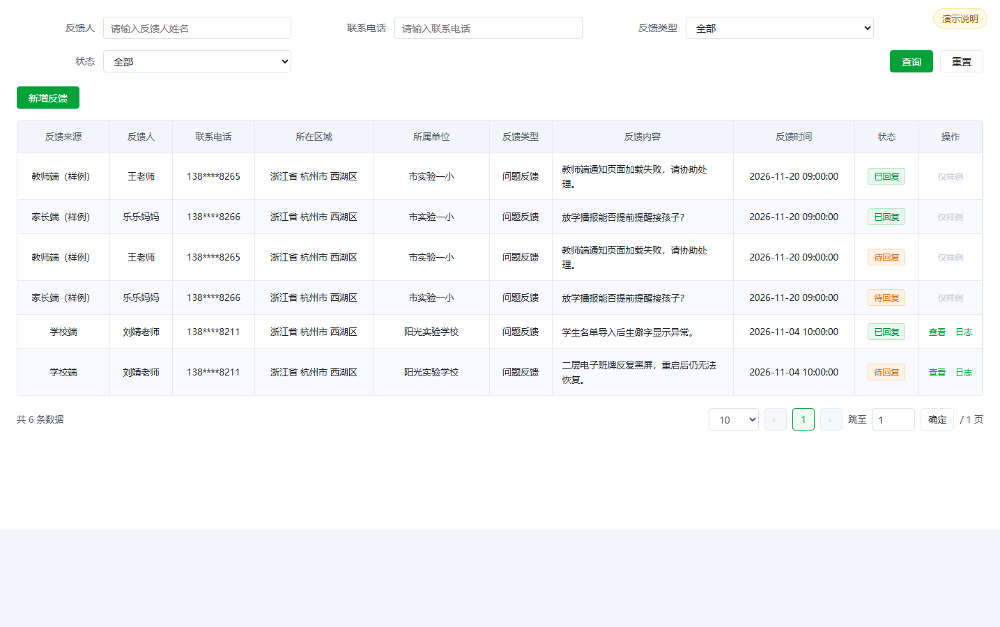

### 学校 Web 客户反馈产品需求文档

| 文档项 | 内容 |
|---|---|
| 文档版本 | v1.15（评审候选，修改中，未定版） |
| 适用端 | 智小徽学校管理后台 Web |
| 对应页面 | 学校管理 - 问题反馈 |
| 规则依据 | 用户对 84—93 项的最终确认及此前仍有效的学校 Web 要求 |
| 本版核心 | 学校端一条反馈只允许学校提问一次、受理方答复一次；答复后只查看，不开启后续追问 |

#### 1. 需求背景与目标

##### 1.1 背景

学校需要提交问题、查看代理商或运营的处理答复，并在必要时核对操作记录。当前版本收敛为一问一答：学校提交首条反馈后等待受理方回复；收到回复后，这条记录结束对外问答。受理方由学校当前配置的代理模式或直营模式决定。

##### 1.2 目标

| 目标 | 页面应达到的结果 |
|---|---|
| 提交问题 | 学校人员按反馈类型、标题、正文及可选图片提交一条反馈 |
| 查看处理进度 | 通过待回复/已回复状态和消息时间线查看当前进度 |
| 保留操作依据 | 每条记录有日志入口，操作日志显示时间、人员和具体消息内容 |
| 限制本端问答轮次 | 学校对同一反馈只提交首问；收到答复后不提供追问入口 |
| 确保消息原样留存 | 所有反馈和回复提交后不可修改；不提供删除或撤回 |

##### 1.3 规则边界

学校 Web 只处理本校可见范围内的学校反馈，不直接回复运营后台，也不处理运营内部记录。代理模式由负责学校的代理商回复；直营模式由运营后台回复。老师和家长端的提交与消息规则在小程序端文档单独说明，本文件不定义小程序页面。

#### 2. 一期范围

##### 2.1 范围清单

| 页面/功能 | 本版包含 | 不包含 |
|---|---|---|
| 学校反馈列表 | 反馈人、电话、类型、状态筛选；查询、重置、分页、查看、日志 | 所在地区筛选；修改、删除、撤回、追问入口 |
| 新增反馈 | 反馈类型、标题、正文、选填图片附件、提交 | 提交后修改；学校直接回复运营 |
| 反馈详情 | 反馈人信息、反馈内容、状态、逆序时间线、附件 | 代理商运营内部协作块、抄送/转达内容 |
| 操作日志 | 查看新增反馈及受理方答复等相关事件 | 删除或撤回事件及删除/撤回状态 |
| 问答轮次 | 学校首问 → 受理方一答 | 同一学校反馈继续追问或多轮往返 |

##### 2.2 版本变化

| 变更项 | 本版规则 |
|---|---|
| 追问入口 | 从学校记录移除；不以“追问”或其它文案变相开放第二次提交 |
| 消息修改 | 移除所有反馈和回复的修改功能；提交后原文固定 |
| 删除和撤回 | 完全移除按钮、确认弹窗、权限校验、状态筛选和对应标记 |
| 时间线与排序 | 时间线最新消息在上；记录列表按最近更新时间逆序 |
| 状态筛选 | 仅全部、待回复、已回复 |
| 地区筛选 | 学校端列表不展示所在地区筛选 |

##### 2.3 页面与流程

| 编号 | 页面/弹窗 | 主流程 |
|---|---|---|
| SC-FB-01 | 学校反馈列表 | 按反馈人/电话/类型/状态筛选 → 查看详情或日志 → 新增反馈 |
| SC-FB-02 | 新增反馈表单 | 填类型、标题、正文 → 选填图片 → 校验 → 提交并生成首条记录 |
| SC-FB-03 | 反馈详情 | 查看身份、状态、逆序消息和附件 → 关闭返回原列表上下文 |
| SC-FB-04 | 操作日志 | 查看操作时间、操作人、操作内容和对应消息正文 |

#### 3. 业务名词、数据来源与基础规则

##### 3.1 业务对象

| 名称 | 含义 | 展示规则 |
|---|---|---|
| 学校反馈记录 | 学校提交的一条反馈以及受理方对该首问的答复 | 一个反馈编号；学校最多发一条首问，受理方最多答复一条 |
| 首条反馈 | 学校人员首次提交的问题 | 显示标题、正文、作者、时间和该消息附件 |
| 受理方回复 | 代理商或运营对学校首问的答复 | 作为时间线后续消息；学校收到后记录状态为已回复 |
| 操作日志 | 用于核对记录的新增和处理过程 | 显示时间、操作人和可读操作内容 |

##### 3.2 受理路由与本端角色

| 学校受理模式 | 实际处理人员 | 学校侧状态和操作 |
|---|---|---|
| 代理模式 | 负责该学校的代理商直接回复学校 | 回复前待回复；回复后已回复；学校只查看和查日志 |
| 直营模式 | 运营后台直接回复学校 | 回复前待回复；回复后已回复；学校只查看和查日志 |

受理模式为系统配置，新增反馈表单不让学校人员切换处理方。学校 Web 记录按本校范围展示；同一学校有权限的处理人员不要求必须是原提交人，但所有操作需留日志。

##### 3.3 状态与轮次

| 最近一条消息 | 状态 | 学校允许操作 | 下一步 |
|---|---|---|---|
| 学校首问 | 待回复 | 查看、日志；新增其它独立反馈 | 等待当前受理方答复 |
| 受理方回复 | 已回复 | 查看、日志 | 当前记录结束；不再追问，不修改原消息 |

同一记录只能有一个学校首问和一个受理方答复。若学校发现原问题之外的新问题，应新增独立反馈记录。新记录有新的编号、状态和排序位置。

##### 3.4 排序与时间线

| 场景 | 口径 |
|---|---|
| 学校反馈列表 | 按记录最近更新时间从新到旧；新增记录排到前面；处理方答复后该记录按答复时间重新排序 |
| 列表反馈时间 | 展示首条反馈时间；不以该字段代替更新时间排序 |
| 反馈详情 | 首条反馈与受理方答复按时间逆序展示，最新消息在最上方 |
| 同时发生 | 时间相同时，新写入的消息显示在上方；编号用于稳定区分记录 |

##### 3.5 正文、附件和只读规则

反馈正文去除首尾空白后不能为空，限200字；标题去除首尾空白后为1—50字。附件选填，仅支持 JPEG、JPG、PNG 图片，最多9张，每张不超过10MB。学校提交后正文、标题、类型和附件均不可修改；本期没有删除或撤回能力。

##### 3.6 列表来源样例与字段回写

学校 Web 客户反馈列表的评审样例覆盖“学校端”“教师端”“家长端”，每类各有待回复和已回复示例。教师端、家长端行在本候选中标注“样例”，操作列只显示禁用的“仅样例”提示；这两类样例用于核对来源、状态和字段展示，不代表学校账号获得查看教师或家长记录的权限。实际学校账号仍只查看其授权范围内的学校反馈。

| 来源 | 所属单位显示 | 所在地区显示 | 样例及状态 |
|---|---|---|---|
| 学校端 | 提交反馈的学校名称 | 该学校所在地区 | 待回复、已回复 |
| 教师端 | 反馈提交时当前登录教师角色任职的学校 | 该学校所在地区 | 代理模式待回复、代理商已回复 |
| 家长端 | 反馈提交时当前登录家长角色对应孩子的学校 | 该学校所在地区 | 代理模式待回复、代理商已回复 |

上述教师、家长样例在学校端只用于展示来源和状态，不能打开详情、回复、查看日志或通知。教师所属单位取提交时当前登录教师角色任职的学校，所在地区取该学校地区；家长所属单位取提交时当前登录家长角色对应孩子的学校，所在地区取该学校地区。家长的关联学生信息仅属于家长来源记录；学校、教师等无关联学生时显示“--”。样例数据按记录创建时的归属展示，不扩大真实账号权限。

##### 3.7 异常模拟开关

“演示说明”提供提交校验、无权限、记录已变化、查询异常四个互斥开关。切换时只替换当前异常提示，恢复默认或刷新后回到正常列表。示例不写入反馈记录。

| 开关 | 学校端示例 | 页面结果 |
|---|---|---|
| 提交校验 | 标题或正文为空/超出限制，或附件不合规 | 阻止新增，指出校验问题；保留已填写内容和已选附件 |
| 无权限 | 打开教师端/家长端的跨来源样例 | 该行保持只读，详情与受保护内容不打开，并说明当前账号无权查看 |
| 记录已变化 | 列表停留期间受理方已答复，记录状态更新 | 刷新后按最新时间与状态展示，不以旧状态提供过期操作 |
| 查询异常 | 列表读取失败 | 显示读取失败提示并保留筛选条件；用户可再次查询，不自动重试 |

学校 Web 不提供通知按钮。受理方回复成功后，消息中心自动向原反馈提交账号及来源端触发通知；小程序消息和服务号消息使用统一固定文案，渠道发送方式由现有消息中心负责。本期不展示送达状态，不自动重试。

#### 4. 原型、视觉与来源

##### 4.1 候选原型链接

学校 Web 候选原型：[问题反馈列表](https://guozi0718.github.io/codex-projects/customer-feedback-web/candidates/T-20261123-04/school-v0.58/index.html?page=school-feedback&content=1)

##### 4.2 页面展示原则

| 展示点 | 规则 |
|---|---|
| 查询栏 | 仅保留反馈人、联系电话、反馈类型、状态；不显示地区筛选 |
| 列表操作 | 所有记录显示查看、日志；不显示回复或追问按钮 |
| 详情 | 反馈人资料、反馈正文、状态和时间线按统一左边界对齐；信息区避免重复边框 |
| 时间线 | 最新消息在前；正文和附件归属对应消息，不把附件跨消息合并 |
| 只读消息 | 已提交反馈与回复不可编辑；不显示“已删除”“已撤回” |
| 表单计数 | 标题/正文输入达到上限后停止输入并显示当前字数 |

##### 4.3 依据与候选状态

本文优先落实学校 Web 已确认字段、样式、附件及日志要求，并使用本次确认的一问一答边界。学校 Web PRD与候选原型均处于修改中、未定版状态；第4节已在原型链接后直接嵌入当前候选的真实页面截图。

#### 5. 一期页面与功能清单

| 页面编号 | 页面 | 核心字段/操作 | 状态 |
|---|---|---|---|
| SC-FB-01 | 学校反馈列表 | 筛选、查看、日志、分页、新增入口 | 候选 |
| SC-FB-02 | 新增学校反馈 | 类型、标题、正文、选填图片、提交校验 | 候选 |
| SC-FB-03 | 反馈详情 | 反馈信息、当前状态、时间线和附件 | 候选 |
| SC-FB-04 | 操作日志 | 时间、操作人、操作内容 | 候选 |

#### 6. 功能详细说明

##### 6.1 学校反馈列表

###### 6.1.1 查询字段与列表字段

| 区域 | 字段 | 规则 |
|---|---|---|
| 查询 | 反馈人 | 支持姓名关键字查询 |
| 查询 | 联系电话 | 支持电话查询；列表仍按既有规则脱敏展示 |
| 查询 | 反馈类型 | 全部、功能建议、问题反馈 |
| 查询 | 状态 | 全部、待回复、已回复 |
| 列表 | 来源、反馈人、联系电话、所在区域、所属单位 | 区域与单位作为结果信息展示；区域不作为筛选条件 |
| 列表 | 类型、反馈内容、反馈时间、状态 | 内容超出单元格宽度时换行或截断，在详情查看全文 |
| 列表 | 操作 | 查看、日志；不显示任何编辑、回复、删除、撤回、追问控件 |

###### 6.1.2 ACT-SC-01 查询、重置和分页

查询只返回当前学校权限范围内的记录。重置恢复默认筛选并回到第1页。状态筛选仅包含待回复、已回复。列表按最近更新时间逆序；分页切换不改变筛选条件。查询无结果时显示空态，不将其他学校的记录混入结果。

###### 6.1.3 ERR-SC-01—04 列表异常

| 编号 | 场景 | 页面处理 |
|---|---|---|
| ERR-SC-01 | 查询失败 | 保留筛选项，提示查询失败，允许重新查询 |
| ERR-SC-02 | 没有符合条件的数据 | 显示无匹配记录，不视为异常 |
| ERR-SC-03 | 列表数据更新导致当前页为空 | 回到有效页码并提示结果有变化 |
| ERR-SC-04 | 记录超出当前学校范围或已不可见 | 阻止查看并返回列表，不泄露其他学校数据 |

##### 6.2 新增学校反馈

###### 6.2.1 表单字段

| 字段 | 必填 | 校验 | 展示与保存 |
|---|---|---|---|
| 反馈类型 | 是 | 必须选择功能建议或问题反馈 | 首次提交后固定 |
| 反馈标题 | 是 | 去除首尾空格后1—50字 | 显示字数；不自动截断 |
| 反馈内容 | 是 | 去除首尾空格后1—200字 | 显示字数；占位文字提示填写内容 |
| 附件 | 否 | JPEG/JPG/PNG；最多9张；单张≤10MB | 选择文件后展示缩略图，可在提交前移除 |
| 反馈人及学校 | 系统带出 | 当前登录账号和任职学校必须有效 | 不要求用户再次填写身份归属 |

###### 6.2.2 ACT-SC-02 提交反馈

用户选择类型、填写标题和正文并可选附件。提交前检查当前登录身份、学校范围、必填内容和附件规则。成功后生成新反馈编号，时间线新增一条学校首问，状态为待回复，更新时间为提交时间。提交后不提供编辑、删除和撤回。

###### 6.2.3 ERR-SC-05—12 新增与提交异常

| 编号 | 场景 | 提示 | 处理结果 |
|---|---|---|---|
| ERR-SC-05 | 未选择反馈类型 | 请选择反馈类型 | 不提交，保留其他输入 |
| ERR-SC-06 | 标题为空或仅空格 | 请输入反馈标题 | 不提交，定位标题字段 |
| ERR-SC-07 | 标题超过50字 | 标题不能超过50字 | 不截断、不提交，保留原文并显示计数 |
| ERR-SC-08 | 正文为空或仅空格 | 请输入反馈内容 | 不提交，定位正文字段 |
| ERR-SC-09 | 正文超过200字 | 反馈内容不能超过200字 | 不截断、不提交，保留原文并显示计数 |
| ERR-SC-10 | 格式不支持、超过9张或单张大于10MB | 提示具体文件和限制 | 不提交；保留有效附件并允许移除问题文件 |
| ERR-SC-11 | 图片还在读取或读取失败 | 提示附件未准备完成或读取失败 | 阻止提交；其他输入和有效附件保留 |
| ERR-SC-12 | 提交时登录、任职学校或权限失效 | 当前账号或学校信息已变化，请刷新后重试 | 不生成记录；保留已填写内容供复制 |

##### 6.3 反馈详情与时间线

###### 6.3.1 详情字段

显示反馈编号、来源、反馈人、联系电话、区域、学校、反馈类型、当前状态、首条标题、首条正文、附件及受理方答复。学校不编辑历史消息。

###### 6.3.2 ACT-SC-03 查看详情和附件

按消息时间逆序展示，最新答复置顶。打开图片不改变记录状态。关闭详情返回列表原筛选、页码及滚动位置。状态待回复时也不提供学校回复或追问入口；学校有其它问题时需新增另一条反馈。

###### 6.3.3 ERR-SC-13—16 详情异常

| 编号 | 场景 | 页面处理 |
|---|---|---|
| ERR-SC-13 | 记录不存在或无权查看 | 提示记录不可访问并返回列表 |
| ERR-SC-14 | 时间线消息加载不全 | 保留已加载消息，明确提示未完整，不生成新消息 |
| ERR-SC-15 | 单个附件打不开 | 仅提示该附件不可预览，正文及其它附件仍可查看 |
| ERR-SC-16 | 详情打开期间状态变化 | 刷新状态与消息，不出现过期的追问或撤回按钮 |

##### 6.4 操作日志

日志展示新增首条、受理方回复及回复成功后的自动通知触发等可核对操作。至少包含操作时间、操作人、操作内容；与消息对应的日志应显示消息正文。日志只读，不因打开而改变反馈更新时间。没有日志时显示“暂无操作日志”。

##### 6.5 状态与端内按钮

| 当前状态 | 操作列 | 含义 |
|---|---|---|
| 待回复 | 查看、日志 | 学校等待受理方处理；学校不能继续在当前记录发言 |
| 已回复 | 查看、日志 | 一问一答结束；记录可留存查看 |

学校列表不显示状态置灰的回复、追问、修改、删除或撤回按钮；无权限的功能直接不展示。

##### 6.6 回复后自动通知与共用文案

每一次受理方回复成功保存后，系统自动向原反馈提交账号及来源端触发一次通知。学校 Web 只展示沟通时间线，不提供通知按钮。小程序消息与服务号消息使用完全相同的固定文案。回复校验失败、记录已变化或回复没有保存成功时，不触发通知；回复成功后，即使通知渠道不可用或接收条件不足，也不影响已保存回复。页面不展示通知送达、失败或已读状态，不自动重试。

模板名称：反馈回复提醒。小程序消息与服务号消息共用同一份固定文案：

| 模板内容 | 变量或来源 | 展示规则 |
|---|---|---|
| 您提问的“{{首条反馈信息前五个字}}”问题已有回复，请查看。 | 首条反馈正文 | 从左到右取前五个字符；不足五个字符时显示全部正文；不取标题、追问或回复 |

示例：首条反馈正文“二层电子班牌反复黑屏”，变量显示“二层电子班”。本期不增加文案配置页面；实际发送方式由现有消息中心负责。
#### 7. 数据、权限与跨端一致性要求

##### 7.1 数据范围与操作权限

| 角色 | 可查看 | 可新增 | 不可执行 |
|---|---|---|---|
| 学校授权人员 | 当前学校范围内的学校反馈和时间线 | 新增独立首条反馈 | 当前记录追问；修改、删除、撤回反馈；代表受理方回复 |
| 代理商处理人员 | 代理商负责的学校来源记录 | 对待回复学校反馈答复一次 | 回复后再次答复学校同一记录；改写学校原文 |
| 运营处理人员 | 直营模式直接分配的学校反馈 | 对待回复直营反馈答复一次 | 处理应由代理商负责的学校来源记录；直接通过代理商记录回复学校 |

学校内操作权限不限制为原提交人本人，但仍受当前学校范围和账户权限约束；查看或处理过程应留下日志。

##### 7.2 跨端字段一致性

反馈编号、来源、作者、时间、正文、附件和状态在学校、代理商、运营三端指向同一条学校反馈。代理模式由代理商对学校回复；直营模式由运营对学校回复；两种模式均只答复一次。代理商另外发给运营的自有反馈不属于学校 Web 记录。

##### 7.3 无效状态和重复提交保护

学校详情页打开后若受理方已经回复，应显示最新答复和已回复状态，不再展示提交入口。表单提交前再次验证记录/账号状态；连续点击提交不得生成重复首问。状态变化或提交失败时保留当前表单，避免用户重新输入。

#### 8. 需求验收标准

| 编号 | 验收场景 | 合格结果 |
|---|---|---|
| AT-SC-01 | 打开学校反馈列表 | 不显示地区筛选；筛选字段仅含反馈人、电话、类型、状态 |
| AT-SC-02 | 待回复记录 | 操作列仅有查看和日志 |
| AT-SC-03 | 已回复记录 | 显示已回复状态；不出现追问、修改、删除、撤回入口 |
| AT-SC-04 | 新增标题和正文边界 | 1—50字标题、1—200字正文可提交；空值和超限按错误提示处理 |
| AT-SC-05 | 附件边界 | 最多9张，仅图片格式，每张不超过10MB；错误附件不导致有效正文清空 |
| AT-SC-06 | 代理模式记录 | 代理商答复后学校能看到回复，状态已回复，不能在本记录继续发言 |
| AT-SC-07 | 直营模式记录 | 运营后台答复后学校能看到回复，状态已回复，不能在本记录继续发言 |
| AT-SC-08 | 新建多条反馈 | 每条独立编号；每条按最近更新时间排序；最新发生变化的记录上移 |
| AT-SC-09 | 打开详情 | 时间线最新消息在顶部，附件与所属消息一致 |
| AT-SC-10 | 查操作日志 | 操作时间、操作人、操作内容和消息正文可核对 |
| AT-SC-11 | 搜索不允许操作 | 页面中无修改、删除、撤回及其标记 |

#### 9. 客户反馈编号规则

| 来源 | 编号前缀 | 规则 |
|---|---|---|
| 学校 Web 首条反馈 | SK | 新增一条独立反馈生成一个编号；受理方答复沿用该编号 |

编号按学校 Web 主项目现有编号规则生成，详情与列表保持一致；不通过答复或日志另生成反馈编号。

#### 10. 文档边界与交付说明

##### 10.1 文档边界

本文描述学校 Web 的产品行为，不定义小程序页面和运营后台内部管理字段。小程序的老师/家长反馈按独立端文档维护，但相同来源与受理模式时保持同一条学校/反馈方一问一答的业务边界。

##### 10.2 候选交付物

| 交付物 | 状态 |
|---|---|
| 学校 Web v0.58 候选原型 | 修改中，未定版 |
| 本 PRD v1.15 | 修改中，未定版；第4节已直接嵌入问题反馈列表真实截图 |

##### 10.3 版本保留

本候选已发布至 GitHub 供评审，但不覆盖学校 Web 当前活动主原型。用户确认后，再按学校 Web 主项目的正式发布流程同步。
