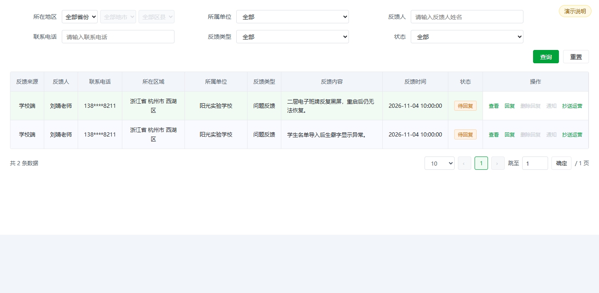
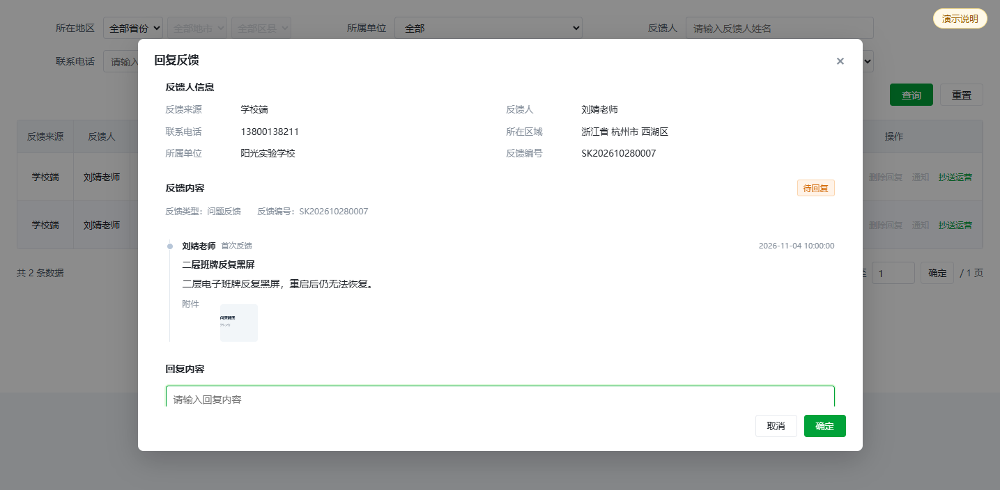
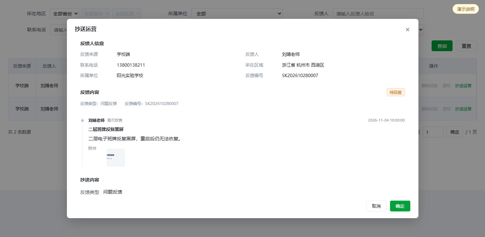
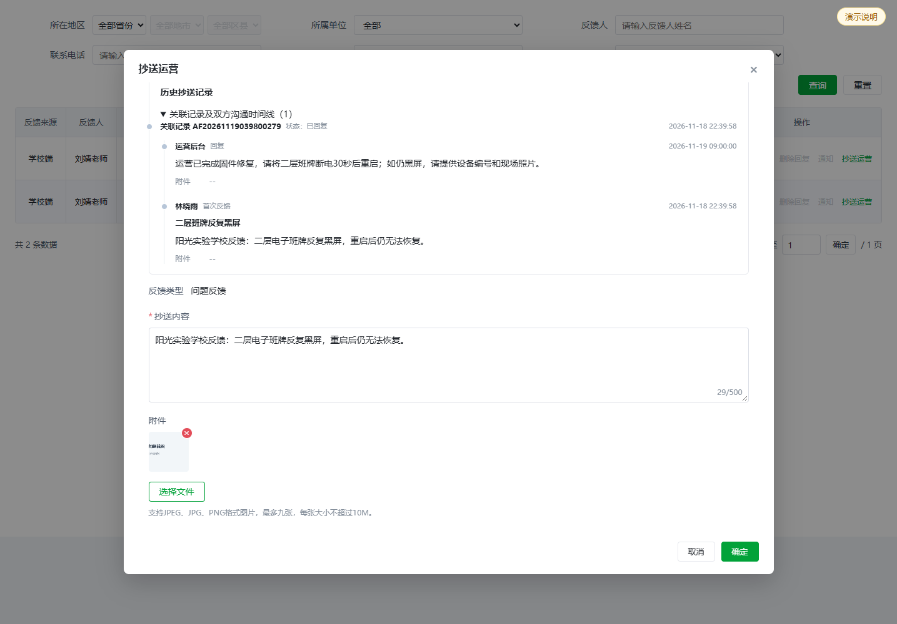
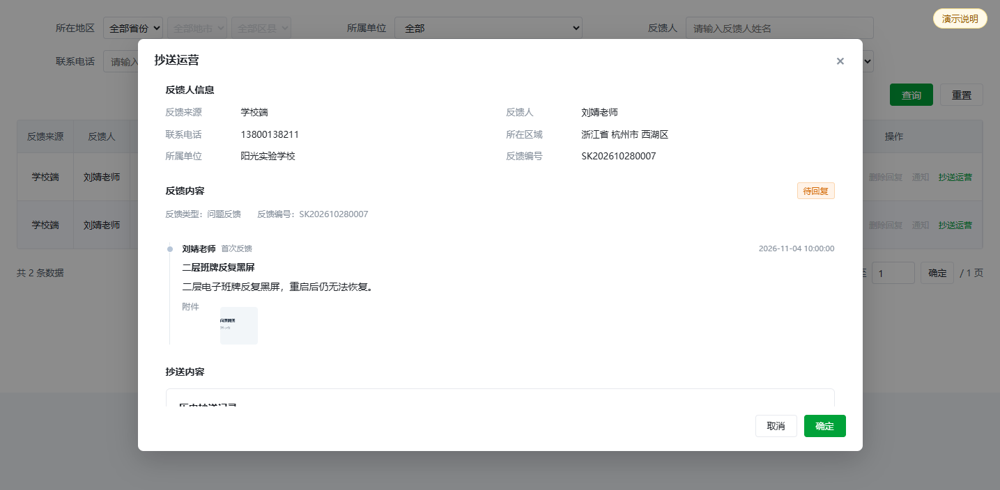
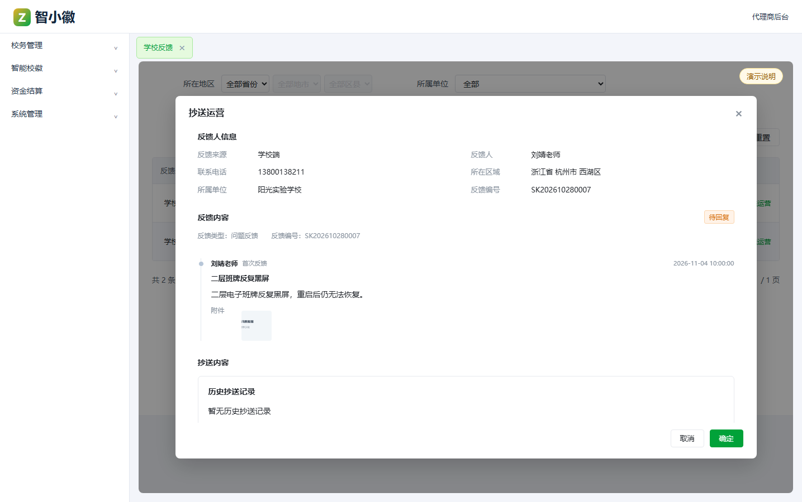
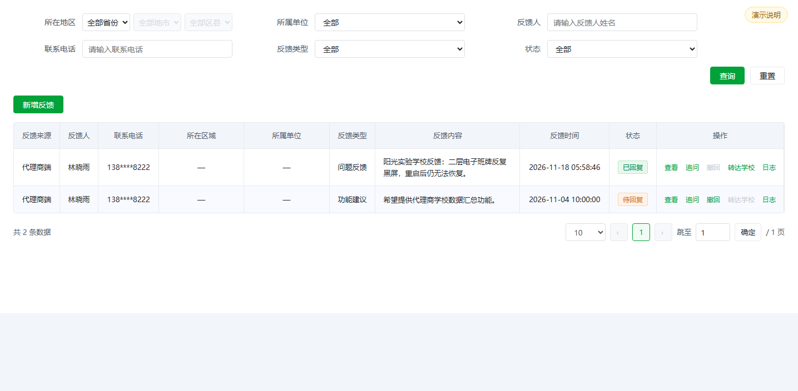
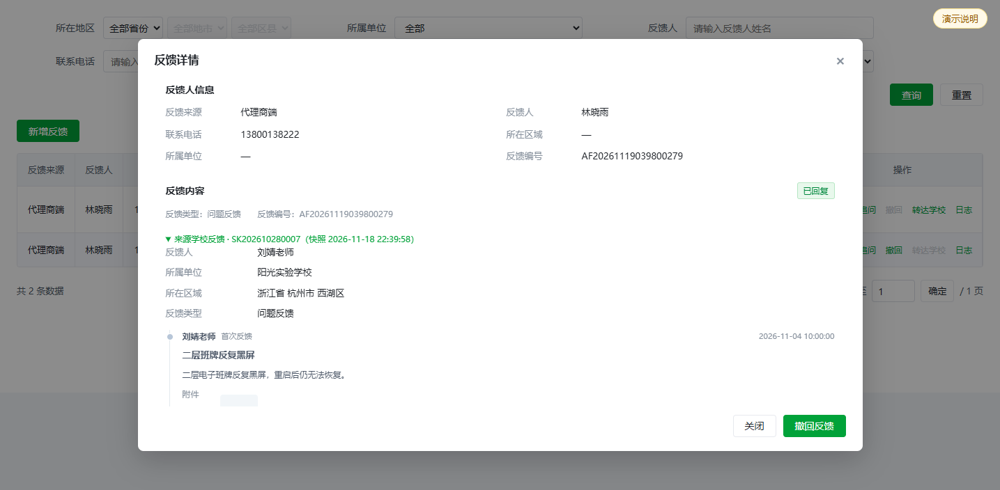
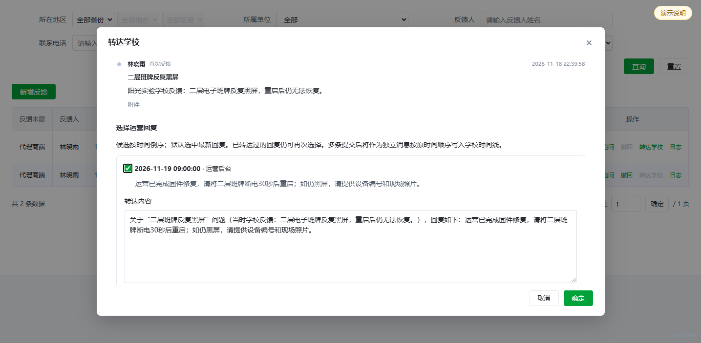
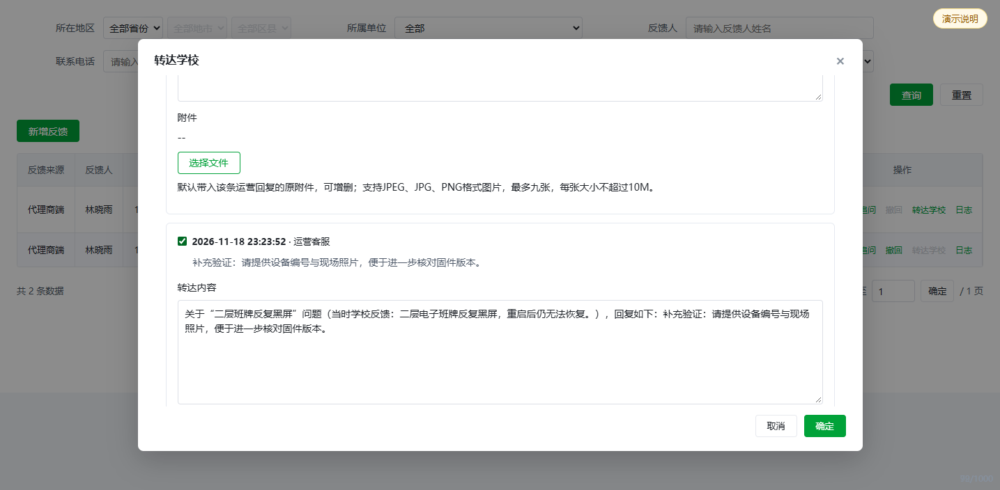

### 代理商 Web 客户反馈产品需求文档

产品版本：客户反馈 Web 第一期
文档编号：PRD-FB-AGENT-20261118
文档版本：v2.2（第一期，修改中，待评审）
文档状态：第一期修改中，未定版
适用端：代理商Web

本文只描述代理商 Web。R1 是学校、教师或家长向代理商提交的来源反馈。R2 是代理商每次抄送运营时新生成的独立记录。代理商自己的问题反馈记录也显示在代理商“问题反馈”菜单中，但它不是学校来源的R2。运营只回复R2；代理商可以直接回复R1，也可以把运营回复作为新消息转达给R1的原反馈人。

#### 1. 需求背景与目标

##### 1.1 背景

代理商负责学校问题处理。无法独立解决时，代理商将当前R1沟通抄送时保存的来源内容抄送运营，形成新的R2。运营答复先到R2，代理商选择一条或多条有效运营回复，编辑自己的对外消息并转达给原反馈人。R1、每条R2及代理商自有反馈记录必须分开计算状态，避免把运营内部回复误当作已发给学校。

##### 1.2 目标

- 在学校反馈列表完成查看、回复学校、抄送运营等操作；操作列和筛选/列表展示与运营合同管理页面风格统一。
- 每次抄送生成新R2并关联同一R1；抄送弹窗可查看该R1关联的既往R2及双方完整消息时间线。
- 在问题反馈菜单独立处理R2和代理商自己发出的反馈，展示清楚来源和转达资格。
- 支持多选运营回复转达，逐条编辑代理商新消息草稿、一次整批提交（全部成功或一条都不生成），按原反馈人的对应端展示。
- 所有提交后的消息不可修改；删除/撤回不写原因，保留抄送时保存的来源内容、附件、标记和日志。

##### 1.3 约束与边界

本文为代理商端第一期需求和原型评审说明。代理商端不直接编辑学校/教师/家长消息，不修改已提交的R1、R2或转达消息。可编辑的文本只属于尚未提交的新消息草稿。运营回复不是学校消息；转达是代理商创建的新消息。学校Web和运营后台各有独立文档；本文件不描述其它端的页面。

#### 2. 一期范围

##### 2.1 范围清单

| 页面 / 对象 | 本版本需求 | 必要联动 | 不在代理商端范围 |
|---|---|---|---|
| 学校反馈列表 / R1 | 查询、查看、直接回复、抄送运营、日志 | R1状态及责任范围 | 修改学校首条反馈 |
| 抄送表单 | 每次新建R2，显示R1会话及历史R2 | 来源反馈编号、抄送时保存的来源内容、R2编号 | 把旧R2覆盖或合并 |
| 问题反馈菜单 | 混合显示代理商自有反馈和R2；标来源/转达资格 | 每条记录独立状态 | 把自有记录伪装为来源R1 |
| R2回复 | 代理商追加内部协作消息；查看运营回复及附件 | R2状态 | 运营直接答复R1 |
| 转达学校 | 选择多个有效运营回复并逐条生成代理商消息 | 原R1、R2、运营来源消息编号 | 自动发送通知 |
| 删除/撤回/日志 | 二次确认软标记并留痕 | 消息/记录关联副本 | 物理删除、填写原因 |

##### 2.2 版本变化

| 变更ID | 变化内容 | 决策来源 | 状态 |
|---|---|---|---|
| CHG-AG-01 | 每次抄送都创建新的R2；新R2只复制R1来源会话与当时附件 | 用户 Q31、Q51、Q56 | 已确认 |
| CHG-AG-02 | 抄送表单展示同一R1的历史R2编号及双方完整消息 | 用户 Q57、Q69 | 已确认 |
| CHG-AG-03 | R1新增普通消息不自动同步到已有R2 | 用户 Q41—Q44 | 已确认 |
| CHG-AG-04 | R2来源角色为学校/教师/家长时可转达；代理商自有反馈置灰；无有效运营回复时置灰并说明原因 | 用户 Q53、Q68及补充 | 已确认 |
| CHG-AG-05 | 转达可多选、最新默认、逆序选择、重复选择有效回复 | 用户明确确认及 Q55、Q62—Q64 | 已确认 |
| CHG-AG-06 | 每条运营回复对应独立可编辑草稿，一次整批提交（全部成功或一条都不生成），学校收到独立消息 | 用户 Q58、Q59、Q63 | 已确认 |
| CHG-AG-07 | 转达回R1原反馈人及原角色端；源附件可移除或追加 | 用户 Q66、Q67 | 已确认 |
| CHG-AG-08 | 来源新消息提示、刷新、保留草稿并再次确认 | 用户 Q60、Q65 | 已确认 |
| CHG-AG-09 | 无提交后修改；删除/撤回均不询问原因，保留标记和抄送时保存的来源内容 | 用户多轮明确要求 | 已确认 |

##### 2.3 页面与流程清单

| 需求ID | 页面 / 弹窗 | 主要动作 | 入口 | 验收 |
|---|---|---|---|---|
| AG-FB-01 | 学校反馈列表（R1） | 查询、查看、回复、抄送运营、日志 | 校务管理 / 学校反馈 | AT-AG-01—05 |
| AG-FB-02 | 抄送运营并新建R2 | 查看来源、历史R2、编辑当次抄送内容、提交 | R1操作列 | AT-AG-06—13 |
| AG-FB-03 | 问题反馈列表及代理商自有反馈 | 新增代理商自有反馈；查看/追问/撤回/日志；区分自有记录与R2 | 校务管理 / 问题反馈 | AT-AG-14—18、48—53 |
| AG-FB-04 | R2详情与协作时间线 | 回复运营、删己方回复、查看抄送时保存的来源内容 | 问题反馈列表 | AT-AG-19—25 |
| AG-FB-05 | 转达原反馈人 | 选择运营回复、编辑每条草稿、上传附件、整批提交 | 可转达R2操作列 | AT-AG-26—38 |
| AG-FB-06 | 删除/撤回/通知/日志 | 二次确认、独立通知、操作追溯 | R1/R2操作及时间线 | AT-AG-39—47 |

#### 3. 业务名词、数据来源与基础规则

##### 3.1 业务对象与关系

| 对象 | 标识 | 代理商端职责 | 生命周期及关系 |
|---|---|---|---|
| R1来源反馈 | 学校/教师/家长原反馈编号 | 查看、直接回复、抄送运营、看学校侧时间线 | 创建者为来源端；多次抄送生成多条R2 |
| R2运营处理记录 | 每次抄送的新记录编号 | 在问题反馈菜单独立查看和处理 | 一个R2关联一个R1；R2互相不共享运营回复 |
| 代理商自有反馈 | 自有记录编号 | 向运营反馈代理商自己的问题 | 由代理商创建；与来源R1/R2区分 |
| 运营回复 | 运营消息编号 | 在R2中查看；可选一条或多条转达 | 仅属于一条R2，附件属于该回复 |
| 代理商R1回复/转达 | 学校侧新消息编号 | 对原反馈人发送新消息 | 转达消息关联一个或多个运营源消息，每个源回复生成一条新消息 |
| 日志/通知操作 | 操作编号 | 记录抄送、回复、删除、撤回、转达、通知 | 追加留存，不因消息标记而清除 |

##### 3.2 角色、权限与数据范围

| 记录/角色 | 可执行 | 不可执行 | 点击确定时再检查 |
|---|---|---|---|
| 代理商处理人员 | 负责区域/学校授权范围内查看R1、回复R1、抄送、查看/处理授权R2 | 编辑已提交内容；对其它组织记录保存 | 当前代理商、负责学校/区域、记录关联和状态 |
| R1来源角色为学校/教师/家长的R2 | 查看抄送时保存的来源内容；回复运营；若有有效运营回复则可转达 | 把运营回复直接显示成已到达R1 | R2来源角色、来源反馈编号、当前权限及来源状态 |
| 代理商自有反馈 | 查看、按该记录开放的操作与运营沟通 | 转达学校按钮可用 | 记录来源必须为代理商，转达动作拒绝 |
| 来源已撤回R1关联的R2 | 查看既有完整记录 | 新回复、抄送、转达、通知 | 若来源反馈已撤回，点击确定前必须再次确认并拒绝新增操作 |

同一授权代理商组织内不按创建者本人或已读状态限制删除/撤回。可删除消息仅限本端/本组织发出的有效消息；不可删除运营、学校、教师、家长发出的消息。

##### 3.3 状态与流转

| 对象 | 当前轮次状态 | 删除/撤回后的判定 |
|---|---|---|
| R1学校侧沟通 | 当前往来中最后一条有效消息由学校/原反馈人发出时为待回复；由代理商发出时为已回复 | 删除后按最后一条有效消息重新判断；较早的有效回复若之后仍有更新的学校消息，不会让状态变回已回复 |
| R2运营协作 | 当前往来中最后一条有效消息由代理商发出时为待回复；由运营发出时为已回复 | 删除后按最后一条有效消息重新判断；较早的运营回复若之后仍有更新的代理商消息，不会让状态变回已回复 |
| 代理商自有反馈 | 按此记录自己的当前有效消息方向判定 | 不受R1/R2状态影响 |
| 整条R1/R2 | R1或R2整条撤回后只读；R2自身撤回显示“已撤回”，R1来源撤回对R2的标记方式待确认（Q80） | 既有消息和附件仍显示；不新增消息 |
| 单条学校追问 | 处理方若曾回复该条追问则不能单独撤回，即使回复后来删除 | 只有处理方从未回复过的追问可消息级撤回；首条不单独撤回 |
| 已删除/已撤回消息 | 时间线持续展示 | 状态影响有效消息判断，但不物理删除抄送时保存的来源内容 |

R1的状态与每条R2的状态互不代算。R1后续普通追问、代理商回复不会同步进已有R2；再次抄送可基于最新R1创建新R2。整条R1撤回属于明确联动例外：所有关联R2追加“来源已撤回”事件并停止新增回复；保留此前运营回复及转达。

##### 3.4 跨端与通用规则

- 图片附件统一JPEG/JPG/PNG，最多9张，每张≤10MB。超出条件时在具体消息草稿上标明失败项。
- 代理商直接回复学校/原反馈人、抄送运营、运营回复、代理商转达、通知都是不同动作。转达不自动发送通知。
- 已提交反馈、回复、抄送和转达都不可修改。再次表达需新增消息；编辑器预填内容仅是新消息草稿。
- 软删除和撤回保留正文、附件、作者、时间、来源关系及操作日志，并显示“已删除/已撤回”；不询问原因。
- R1在抄送后有新消息，已有R2仍显示抄送时保存的来源内容；新R2显示本次抄送时最新来源内容。打开转达表单后R1有新消息时，按已确认规则保留草稿、更新来源摘要、提示来源已更新并要求代理商确认后再提交。若来源整条撤回，阻止转达。

#### 4. 原型、视觉与来源

##### 4.1 本期需求来源

| 来源 | 本文使用方式 | 状态 |
|---|---|---|
| 用户关于R1来源反馈、每次抄送新建R2、运营只回复R2及代理商逐条转达的确认 | 作为本端业务规则依据；R1和每条R2分别说明 | 已确认 |
| 用户对转达多选、默认最新、附件、草稿、来源变化提示、撤回/删除的确认 | 用于确定表单、列表、时间线、禁用原因与提交异常 | 已确认 |
| 代理商Web GitHub 候选 v0.66 | 核对学校反馈列表、问题反馈中的R2及转达表单 | 修改中、未定版 |

##### 4.2 页面展示原则

代理商“学校反馈”里的R1是学校、教师或家长发来的原始记录；代理商“问题反馈”里的R2是代理商每次抄送运营后新建的独立记录。代理商自己的问题反馈也在“问题反馈”列表，但不能当作来源R1，也不能使用“转达学校”。R1详情不增加协作记录块；同一R1的既往R2仅在本次抄送表单中核对。

##### 4.3 成熟服务台公开做法与本项目建议

公开资料核对日期：2026-11-19（UTC）。Zendesk公开帮助说明区分请求人可见的公开回复与仅处理人员可见的内部备注，并把沟通保留在工单中；其事件查看页展示工单更新及通知记录。[添加工单评论](https://support.zendesk.com/hc/en-us/articles/4408828489370-Adding-comments-to-tickets)、[查看工单更新事件](https://support.zendesk.com/hc/en-us/articles/4408829602970-Viewing-all-events-for-ticket-updates)。Jira官方帮助说明可为事项建立关联关系。[关联工作项](https://support.atlassian.com/jira-software-cloud/docs/link-issues/)。以上只归纳公开说明，不表示这些产品采用本项目的R1/R2、抄送、转达、删除或撤回规则；用户所说“GRM客服系统”尚未能唯一对应到具体产品。

本项目建议让R1与每条R2都能直接看到对方的编号，并在转达草稿中明确原问题、选中的运营回复及附件。代理商可以在发送前编辑自己将发出的新消息，但提交后不可修改。这样能保留谁对谁说了什么；取舍是代理商需要同时核对来源反馈和运营处理记录。

##### 4.4 当前候选核对情况

| 页面 | 已核对内容 | 尚待核对 |
|---|---|---|
| 学校反馈列表与抄送 | v0.66从正确页面地址打开成功；R1列表、直接回复表单、抄送表单和历史记录区域均有真实截图 | 新旧R2顺序、来源变化、权限变化及抄送失败仍需逐项核对 |
| 问题反馈、R2详情和回复 | 可从R1抄送生成R2，再查看R2来源快照和双方时间线；运营回复附件区已存在 | 多条运营回复、删除后状态及来源撤回只读需在同一流程中复核 |
| 转达学校 | 候选按时间倒序列运营回复，默认选中最新；每条选择项各有独立草稿和附件区 | 真实截图显示两条有效运营回复按时间倒序排列，最新一条默认勾选；勾选两条后出现两份独立草稿。失效项、整批失败和附件变化仍需逐项核对 |

R2与转达页面须先从R1抄送流程生成关联R2后查看；直接打开列表链接不会预先创建R2。截图为当前候选实际页面，不代表所有异常流程均已验收。

#### 5. 一期页面与功能清单

|需求编号|页面/弹窗|本端业务内容|
|---|---|---|
|AG-FB-01|学校反馈列表与R1操作|字段、按钮、校验、异常及结果见第6节。|
|AG-FB-02|抄送运营并创建R2|字段、按钮、校验、异常及结果见第6节。|
|AG-FB-03|问题反馈菜单与R2分类|字段、按钮、校验、异常及结果见第6节。|
|AG-FB-04|R2详情、运营回复与代理商跟进|字段、按钮、校验、异常及结果见第6节。|
|AG-FB-05|转达运营回复至原反馈人|字段、按钮、校验、异常及结果见第6节。|
|AG-FB-06|撤回、通知与日志|字段、按钮、校验、异常及结果见第6节。|

#### 6. 功能详细说明
##### 6.2 学校反馈列表与R1操作（AG-FB-01）

原型入口：[代理商Web学校反馈列表候选](https://rawcdn.githack.com/guozi0718/codex-projects/main/%E4%BB%A3%E7%90%86%E5%95%86%E7%AB%AF/versions/v0.66/index.html?page=school-feedback&content=1)

###### 6.2.1 页面信息和筛选

- 页面负责当前代理商授权学校的R1。筛选/列表/分页/斑马纹/按钮排列参考运营后台合同管理页面；学校端不显示的地区条件不能机械照搬。
- 所在地区选项只取代理商负责区域与代理商负责学校的所属地区并集；不负责的区域不出现在下拉选项。省市县级联，切换上级清空下级。
- 所属单位只显示代理商授权范围内学校；反馈人、联系电话、类型、状态按既有条件筛选。查询按钮提交条件后生效，重置恢复默认并重查。
- 表格字段包括来源、反馈人、联系电话、所在区域、所属单位、反馈类型、内容、反馈时间、状态、操作。区域/单位取来源当时记录的内容；空值显示“—”。
- 操作列需能完整显示查看、回复、抄送运营、日志；不提供“通知代理商”自通知动作。代理商不代学校/教师/家长撤回其来源反馈。代理商自有消息上的撤回、删除按钮使用带边框样式，并按资格置灰、说明原因。
- 成功无数据、无匹配、加载失败、无权限和失效记录分别呈现。

###### 6.2.2 ACT-AG-01 查询与查看

查询仅在当前代理商授权记录范围内执行。列表打开/关闭R1详情保留筛选值、页码和滚动位置。进入详情显示首条、学校/教师/家长后续消息、代理商回复及附件的完整逆序时间线；不显示“协作记录”汇总块。R2历史只在抄送表单核对，不能混入R1详情时间线。

###### 6.2.3 ACT-AG-02 直接回复R1

回复内容作为代理商发给原反馈人的新消息，正文必填，去除首尾空白后1—1000字；占位文字为“请输入回复内容”，右下角显示已输入字数/1000，达到1000字后不能继续输入。正文框宽度适中并与标签对齐。附件为非必填，支持JPEG/JPG/PNG、最多9张、每张≤10MB；显示缩略图、移除入口和上传状态，上传按钮与预览保持间隔且样式统一。提交后不可修改。前置条件为R1未整条撤回且代理商有此学校的处理权限。点击确定时再检查R1仍存在且未撤回、代理商仍负责该校、R1是否新增消息、正文与附件是否完整。成功后只追加R1消息及日志，R1按当前轮次重新计算；不改变任何关联R2当时记录的内容和状态。失败保留正文与有效附件。

##### 6.3 抄送运营并创建R2（AG-FB-02）

原型入口：[代理商Web抄送运营候选](https://rawcdn.githack.com/guozi0718/codex-projects/main/%E4%BB%A3%E7%90%86%E5%95%86%E7%AB%AF/versions/v0.66/index.html?page=school-feedback&content=1)

###### 6.3.1 表单结构与字段

| 顺序 | 内容 | 规则 | 交互和状态 |
|---|---|---|---|
| 1 | R1来源摘要 | 只读显示来源角色、人员、学校/单位、反馈类型、标题/原文、附件和消息时间线 | 当前来源可滚动查看；不修改R1 |
| 2 | 历史抄送记录 | 列出所有已关联R2编号；每条显示R2双方完整消息时间线，包含代理商消息和运营消息 | 新旧R2及每条时间线的排序方式待确认（Q72）；不将历史R2消息并入本次新记录 |
| 3 | 反馈类型 | 原样显示R1反馈类型，不允许修改 | 与来源记录一致；类型字段只读 |
| 4 | 抄送内容 | 默认带入来源学校名称及反馈原文，代理商可在提交前编辑本次新R2的抄送文字 | 字段与标题左侧对齐；正文、计数和附件不重叠 |
| 5 | 附件 | 非必填；支持JPEG/JPG/PNG，最多9张、每张≤10MB | 统一上传按钮样式，缩略图与按钮有清晰间隔；上传失败逐项显示 |

历史R2卡片仅用来核对同一R1此前已创建的运营记录，需显示R2编号及双方全部消息，不只显示一条摘要；不得在R1详情增加“协作记录”块。当前截图展示无历史抄送记录的空态；有历史时必须按“R2编号、时间、双方完整消息”显示。多条记录及其消息的排序方式尚待确认（Q72），不能把候选图中的空态视为已验证了有历史记录的展示。

###### 6.3.2 ACT-AG-03 创建新的R2

1. 执行资格：代理商对R1拥有处理权；R1未撤回、未删除；不受R1当前为待回复或已回复限制。
2. 打开表单：读取R1来源消息、附件、授权范围和已关联R2列表；实际新建时按本次抄送确认时的R1内容保存来源副本。
3. 用户编辑：可修改本次抄送草稿，不可改R1原文或历史R2内容。抄送内容为必填，去除首尾空白后1—500字；右下角显示已输入字数/500，达到500字后不可继续输入。
4. 填写时检查：抄送内容按页面既有必填规则校验；附件检查格式、数量、大小和读取状态。
5. 提交复验：重新检查R1仍存在、未撤回、代理商范围有效、记录是否仍有效、用户是否仍有权限以及附件是否可用。若表单打开期间R1有新消息或新增关联R2，刷新并提示、是否要求代理商确认待确认（Q77、Q78）。
6. 避免同一次操作重复建档与用户主动再次抄送：同一个本次提交重试不得意外生成重复R2；代理商完成一次抄送后再次主动确认新的抄送，必须生成另一个独立R2。
7. 一次完成保存；任一项失败则一条都不生成：新R2编号、来源反馈编号、创建时间、抄送内容、R1截至此时的来源当时记录的内容、附件当时记录的内容、独立状态和日志整体成功。
8. 当时记录的内容边界：只复制R1来源会话，不复制此前R2中的运营回复或其它R2历史。R1之后的新消息不回写该R2。
9. 成功后：关闭表单，回到R1或问题反馈记录列表的既定上下文；问题反馈菜单新增R2行；不发送转达或反馈人通知。
10. 失败或结果暂时无法确认：失败不留半个R2；保留草稿与附件。未知时查看当前列表或时间线核对，先确认之前是否已抄送成功，避免重复建档。
11. 验收：AT-AG-06—13。

###### 6.3.3 ERR-AG-01—08 抄送异常

| 编号 | 场景 | 提示与保存 | 输入保留和恢复 |
|---|---|---|---|
| ERR-AG-01 | 无R1处理权限或学校已移出代理商负责范围 | 拒绝打开/提交；不建R2 | 返回列表，筛选保留 |
| ERR-AG-02 | R1已整条撤回 | 不允许新抄送 | 保留查看能力；显示来源已撤回 |
| ERR-AG-03 | 来源编号无效或缺少来源会话 | 不生成R2 | 显示记录不可用，返回来源列表 |
| ERR-AG-04 | 附件格式/数量/大小错误 | 阻止整个R2提交 | 保留正文和其它有效附件 |
| ERR-AG-05 | R1在填写期间出现新消息 | 按本次确认时的R1内容生成新记录；是否刷新摘要并要求代理商再次确认待确认（Q77） | 保留抄送草稿；确认前不预设额外操作 |
| ERR-AG-06 | 表单打开期间有其他人新建关联R2 | 如何刷新并展示新增历史记录待确认（Q78） | 不覆盖本次内容，不把新旧R2合并 |
| ERR-AG-07 | R1在提交前整条撤回 | 复验失败，阻止创建R2 | 草稿保留供复制；不能继续提交 |
| ERR-AG-08 | 双击、重试或暂时没有拿到确认结果 | 同一次确认只创建一个R2；新的一次明确抄送仍可新建R2 | 查询原操作结果后决定，不盲目重复 |
| ERR-AG-09 | 保存过程中来源内容或附件保存失败 | 整体恢复原状，零R2保存 | 表单保留，允许修正后重试 |

##### 6.4 问题反馈菜单与R2分类（AG-FB-03）

原型入口：[代理商Web问题反馈列表候选](https://rawcdn.githack.com/guozi0718/codex-projects/main/%E4%BB%A3%E7%90%86%E5%95%86%E7%AB%AF/versions/v0.66/index.html?page=agent-feedback&content=1)

###### 6.4.1 列表与记录来源

- 问题反馈菜单展示代理商自有反馈和代理商抄送产生的R2。必须通过来源角色/来源记录编号清楚区分。
- 列表字段按当前页面需求展示来源、反馈人、电话、所属区域/单位、类型、内容、时间、状态、操作。列表和筛选样式按合同管理统一规范。
- R2按自己的往来显示待回复、已回复或已撤回；来源R1被撤回后的展示方式待确认（Q80）。自有记录单独计算。
- R2来源为学校、教师或家长时，允许用户从行操作进入转达流程，但仅在至少有一条有效运营回复时可用。
- R2来源为代理商自有反馈时，保留“转达学校”按钮但置灰，显示原因“仅学校、老师或家长来源的抄送记录可转达”。
- 没有任何有效运营回复时，转达按钮置灰并显示“运营尚未回复，暂时不能转达”。已删除或已撤回运营回复不算有效。已经转达过的有效运营回复仍可重选。

###### 6.4.2 新增代理商自有反馈

原型入口：[代理商Web问题反馈列表与新增入口](https://rawcdn.githack.com/guozi0718/codex-projects/main/%E4%BB%A3%E7%90%86%E5%95%86%E7%AB%AF/versions/v0.66/index.html?page=agent-feedback&content=1)

| 字段 | 必填 | 规则 | 保存结果 |
|---|---|---|---|
| 反馈类型 | 是 | 采用代理商当前已配置的类型，不在本稿新增枚举 | 类型保存在代理商自有记录 |
| 反馈标题 | 是 | 单行，1—50字；去除首尾空白后判空和计数 | 作为首条内容，不可提交后修改 |
| 反馈内容 | 是 | 多行，1—200字；保留内部换行 | 作为首条内容，不可提交后修改 |
| 附件 | 否 | JPEG/JPG/PNG，最多9张，单张≤10MB | 保存实际成功上传的附件当时记录的内容 |
| 代理商身份 | 登录上下文 | 自动记录当前代理商和提交人，不由表单改写 | 记录来源为“代理商端” |

新增入口在问题反馈列表上方。打开后创建未提交草稿；类型、标题、正文和附件均在提交前可编辑。点击确定时再检查登录身份、代理商组织、字段限制、附件状态和重复提交。成功后创建一条独立的代理商自有反馈，显示于问题反馈菜单，初始状态为“待回复”并保存首条日志；该记录不关联R1，不允许“转达学校”，对应按钮须置灰并解释来源限制。提交失败不创建半条记录，保留已填内容和有效附件；结果暂不明确时先查看是否已生成记录，不重复创建。关闭有内容草稿时二次确认，继续编辑则保留，确认放弃才清空草稿。

| 异常编号 | 场景 | 预期提示/保存 | 恢复 |
|---|---|---|---|
| ERR-AG-20 | 未选类型、标题/内容为空或全空白 | 定位必填项；不创建记录 | 保留其它字段 |
| ERR-AG-21 | 标题>50字或内容>200字 | 显示对应上限与计数；不截断提交 | 保留原输入并可编辑 |
| ERR-AG-22 | 非图片、第10张或单张>10MB | 标记具体文件；不创建记录 | 保留有效文件，可移除或重选 |
| ERR-AG-23 | 附件仍读取/上传中或上传失败 | 阻止提交并显示状态 | 正文保留，可重试附件 |
| ERR-AG-24 | 登录失效、代理商权限改变或系统校验拒绝 | 不创建记录；清楚说明权限/会话问题 | 保留草稿，重新认证后显式重试 |
| ERR-AG-25 | 提交超时、结果暂时无法确认或重复点击 | 不自动新建第二条记录 | 查看当前列表或时间线核对结果后恢复 |

上图展示问题反馈列表和新增入口；新增弹窗仍需对应真实截图，并核对表单字段、计数、附件和离开确认。

###### 6.4.3 ACT-AG-04 查看R2和返回

R2详情显示R2编号、来源R1编号、来源角色、来源内容保存时间、代理商抄送内容、R1只读当时记录的内容以及R2内部双方消息。R1后续新消息不自动进入R2。关闭详情回到来源列表原筛选、页码和滚动位置。直接链接参数缺失/无效时不打开其它记录。

##### 6.5 R2详情、运营回复与代理商跟进（AG-FB-04）

原型入口：[代理商Web R2问题反馈候选](https://rawcdn.githack.com/guozi0718/codex-projects/main/%E4%BB%A3%E7%90%86%E5%95%86%E7%AB%AF/versions/v0.66/index.html?page=agent-feedback&content=1)

###### 6.5.1 时间线与附件

- R2时间线显示代理商和运营双方每条消息，时间逆序，标明作者、消息方向、时间、正文、附件及状态；需要区分消息时使用清楚的消息编号。
- R1当时记录的内容区只读显示抄送时R1完整会话及附件。
- 运营回复附件显示缩略图/文件；已删除或已撤回的消息仍显示附件及标记。
- 多条R2不得共用状态；各R2分别追加代理商追问、运营回复与日志。

###### 6.5.2 ACT-AG-05 代理商回复运营

代理商可在R2向运营回复，正文为必填，去除首尾空白后1—1000字，输入框显示“请输入回复内容”和已输入字数/1000；达到1000字后不能继续输入。正文框宽度与表单其他字段协调并与标签对齐。附件为非必填，支持JPEG/JPG/PNG、最多9张、每张≤10MB；显示缩略图、移除入口、上传状态，上传按钮与附件预览保持间隔且样式统一。消息提交后不可修改。资格为R2未撤回、来源R1未撤回、代理商仍有R2处理权限。点击确定时再检查R2仍可处理、来源R1未撤回、当前登录角色、正文与附件是否完整。成功消息只进入当前R2，R1不变；失败不产生半条消息并保留正文和有效附件。取消关闭不提交。

###### 6.5.3 ACT-AG-06 删除代理商消息

代理商只能删除本端/本组织发出的任意有效R2回复，不能删除运营回复。删除按钮使用带边框样式，清楚可见。弹窗显示目标消息及附件，二次确认，不填写原因。确认点击确定时再检查权限、归属和状态。成功后保留原文/附件并标“已删除”；R2按有效消息重算。R1撤回后是否还允许删除既有R2消息待确认；既有日志保留。

##### 6.6 转达运营回复至原反馈人（AG-FB-05）

原型入口：[代理商Web转达学校候选](https://rawcdn.githack.com/guozi0718/codex-projects/main/%E4%BB%A3%E7%90%86%E5%95%86%E7%AB%AF/versions/v0.66/index.html?page=agent-feedback&content=1)

###### 6.6.1 来源回复选择和默认值

| 项目 | 规则 |
|---|---|
| 可选记录 | 当前R2中尚未删除、尚未撤回的有效运营回复 |
| 排序 | 运营回复按时间逆序展示，最新一条在最上方 |
| 默认选择 | 打开表单时默认选中最新一条有效运营回复 |
| 已转达消息 | 仍可选择与再次转达；每次生成独立代理商消息 |
| 不可选消息 | 已删除、已撤回或不属于当前R2的回复不可再次选择；所选回复附件在打开表单后失效时如何处理待确认（Q76），提交时按整批零保存处理 |
| 收件对象 | 回到R1的原反馈人及其原角色对应端，不因来源是家长/教师而改投学校管理员 |

###### 6.6.2 每条独立草稿

每一条选中的运营回复对应一份代理商新消息草稿。默认模板为：关于“原R1问题标题”问题（当时学校/老师/家长提出的问题原话），回复如下：运营回复原话。代理商可在提交前编辑该草稿正文。不同源回复正文分别编辑，互不覆盖。提交后消息不允许修改。

运营源回复附件默认随对应草稿带入。代理商可以移除源附件或增加自己的附件；提交后只保存本次实际发送的附件，R2内的运营原始附件仍保留为原回复当时记录的内容。每份草稿分别显示附件数、缩略图、上传状态、正文计数及错误。

###### 6.6.3 ACT-AG-07 选择与提交转达

1. 执行资格：R2来源为学校/教师/家长；R1、R2未整条撤回；当前代理商有处理权限；至少有一条有效运营回复。
2. 打开表单：读取R1内容与状态、R2状态、有效运营回复、回复附件、既有转达关系及对应原反馈人/端。
3. 选择：回复列表逆序；默认选择最新一条；允许多选，也允许再次勾选已转达过的有效回复。至少选一条才能提交。
4. 编辑：每条源回复一份独立新消息草稿；正文和附件可在提交前改动。移除附件只影响本次草稿，不删除R2原附件。
5. 填写时检查：每条正文去首尾空白后1—1000字；附件为JPEG/JPG/PNG、最多9张、每张≤10MB；读取/上传完成；源消息仍为有效状态。
6. 提交前刷新：若R1打开后新增消息，保留所有正文和附件草稿，更新来源摘要，展示“来源反馈已更新”；用户查看后明确确认，才能继续提交。若R1已整条撤回，阻止提交，不以确认绕过。
7. 提交复验：当前登录用户及代理商范围、R1/R2关联与状态、所选运营回复仍有效、转达对象为原反馈人及对应端、每条草稿和附件完整。
8. 全部成功或全部不生成：同批选中的所有源回复一次提交；任何一条失效、正文无效、附件失败或关联缺失，整批失败，零条保存。
9. 成功结果：每条运营回复生成一条独立代理商消息，带独立新消息编号、源运营回复编号、源原文当时记录的内容、实际编辑后正文、实际转达附件、操作者、时间与批次关联；消息发送到R1原反馈人对应端。
10. 排序：学校/反馈人时间线按时间逆序显示；同一次提交的多条新消息在消息组内部按运营原回复时间正序展示，确保用户阅读顺序与原答复先后相同。
11. 通知：转达只新增消息，不自动发送通知；通知按钮是独立动作。
12. 重复选择：后续可再次转达同一条仍有效运营回复；新提交产生全新的学校消息，不覆盖之前副本。
13. 取消/失败：取消不保存，回到R2上下文；校验失败保留选择和所有草稿；结果暂时无法确认先核对原请求，不盲目重复提交。
14. 验收：AT-AG-26—38。

###### 6.6.4 ERR-AG-09—19 转达异常

| 编号 | 场景 | 提示与保存 | 草稿/恢复 |
|---|---|---|---|
| ERR-AG-09 | R2为代理商自有反馈 | 按钮置灰，显示来源限制原因 | 不打开表单 |
| ERR-AG-10 | 无有效运营回复 | 按钮置灰，显示“运营尚未回复，暂时不能转达” | 可返回R2 |
| ERR-AG-11 | 未勾选任何消息 | 阻止提交并提示至少选择一条 | 保留全部草稿 |
| ERR-AG-12 | R1出现新消息 | 刷新摘要、提示来源更新；保留草稿并要求用户确认后提交 | 用户可先查看最新来源 |
| ERR-AG-13 | R1整条撤回 | 阻止打开或提交；来源撤回事件保留 | 草稿可复制但不能继续发送 |
| ERR-AG-14 | 源运营回复已删除/撤回 | 该源消息不可选；提交前变化时整批拒绝 | 保留其余草稿；刷新候选 |
| ERR-AG-15 | 任一正文空白或超1000 | 标出对应草稿错误；整批零保存 | 所有草稿保留 |
| ERR-AG-16 | 任一图片类型/数量/大小错误 | 标出对应附件；整批零保存 | 可移除/重选错误附件 |
| ERR-AG-17 | 原反馈人或对应端缺失 | 整批拒绝，提示收件对象资料不可用 | 不发送到代理商默认端；保留草稿 |
| ERR-AG-18 | 同时操作导致所选运营回复或附件变为不可用 | 整批零保存，明确失效内容；附件失效时的草稿处理待确认（Q76） | 保留全部草稿，刷新后按待确认规则重新选择 |
| ERR-AG-19 | 网络中断或暂时无法确认提交结果 | 先核对本次转达是否已完成，不自动新建另一批 | 结果未确认前不重复提交 |

##### 6.7 撤回、通知与日志（AG-FB-06）

原型入口：[代理商Web反馈列表候选](https://rawcdn.githack.com/guozi0718/codex-projects/main/%E4%BB%A3%E7%90%86%E5%95%86%E7%AB%AF/versions/v0.66/index.html?page=agent-feedback&content=1)

###### 6.7.1 撤回规则

- R1由学校/教师/家长创建，代理商不能替来源端撤回其整条R1或首条消息；代理商操作R1的回复、抄送与日志。
- R2可由授权代理商撤回。R2未撤回、来源R1未撤回且当前没有有效运营回复时可确认撤回；删除全部有效运营回复后重新判断。仍有一条有效运营回复则按钮置灰并显示原因。
- 代理商自有反馈整条撤回按该记录当前有效处理方回复判断。若有有效回复则置灰；所有有效回复删除后重新判断。
- 撤回按钮使用带边框样式并保持展示；无资格时置灰并显示简短原因或悬停说明。确认前再复验权限和状态。
- 撤回不填写原因，只二次确认。成功后保留正文、附件、时间、消息和日志并标“已撤回”；源R1整条撤回后关联R2增加来源已撤回事件并只读。R2列表/详情是否另显示独立标记待确认（Q80）。

###### 6.7.2 ACT-AG-08 通知

通知与转达分开。每次主动确认都独立尝试并记操作时间、操作人、接收人和渠道，不跟踪送达状态。没有手机号/小程序授权不阻止回复或转达；仍按原渠道尝试，不显示已送达。对删除/撤回消息、已撤回R1/R2不允许新通知；此前通知记录保留。通知未能发起时是否另记失败操作，待确认（Q81）。

###### 6.7.3 ACT-AG-09 日志

日志至少显示操作时间、操作人和操作内容；时间/人员列紧凑，操作内容列适当增宽。首条反馈、代理商回复、抄送、运营回复在R2、转达、删除、撤回、通知均留下事件。撤回/删除不删除日志。抄送日志应能看出新R2编号；转达日志应能关联运营来源消息编号和新消息编号。

#### 7. 数据、权限与跨端一致性要求

##### 7.1 每类记录的含义

| 记录 | 谁能看到 | 记录哪些内容 | 变化规则 |
|---|---|---|---|
| 原反馈记录（R1） | 学校、教师或家长提交方，以及有权处理的代理商 | 首条反馈、后续沟通、附件、作者、时间、状态 | 代理商每次抄送时读取当时已有的完整R1内容；后来的新消息不自动补进旧R2 |
| 运营抄送记录（R2） | 代理商和运营 | 抄送时的R1内容记录、代理商补充、运营与代理商往来 | 每次抄送产生一个新R2；每个R2独立处理和计算状态 |
| 代理商自有反馈 | 代理商和运营 | 代理商提交的首条问题及运营回复 | 不关联学校R1；“转达学校”保留但置灰 |
| 学校侧转达消息 | R1原反馈人及其原角色端 | 代理商从运营回复草稿生成的新消息及本次实际附件 | 每条运营回复生成一条新消息；再次转达也追加新消息，不覆盖旧消息 |

##### 7.2 记录如何变化

| 场景 | 原R1 | 当前R2 | 历史R2与学校端 |
|---|---|---|---|
| 代理商第一次抄送 | 不改变 | 新建独立待处理记录 | 历史为空；学校端看不到内部抄送 |
| 代理商再次抄送同一R1 | 不改变 | 新建另一个R2，只复制最新R1会话内容 | 旧R2保留原状，抄送表单能核对关联历史编号及双方消息 |
| R1在R2建立后新增追问或回复 | 按R1当前沟通重新计算 | 旧R2继续显示原抄送时内容，不自动同步 | 再次抄送可生成新R2并带入当时最新R1内容 |
| 运营回复R2 | 不改变 | 按R2当前轮次变化 | 学校端尚未收到回复，不能把R1记成已回复 |
| 代理商转达运营回复 | 新增一条代理商消息，并按R1当前轮次计算 | 不改变运营原回复 | 每条源回复各生成一条学校消息；同一批次按时间由早到晚显示 |
| 删除运营回复 | 不改变R1已有消息 | 被删回复标“已删除”；R2按剩余有效消息计算 | 已转达内容保留，标记来源回复已删除 |
| 整条R1撤回 | 原R1标记已撤回并只读 | 关联R2标记来源已撤回并只读 | 所有已产生的回复、转达和附件继续显示 |

##### 7.3 记录留存和操作记录

已提交的反馈、回复、抄送与转达都不能修改。任何修改只允许发生在提交前的草稿中；提交后要补充只能发一条新消息。删除/撤回不要求填写原因，二次确认后以状态标记显示，旧正文、附件、作者、时间和操作记录继续保留。

每次抄送、运营回复、代理商回复或转达、消息删除/撤回、整条R1撤回和通知操作都保留时间、操作人及内容。通知和转达是两项不同操作；转达不会自动发通知。通知只记录“已发起”，不宣称送达。

##### 7.4 代理商端与来源记录的关联变化

| 事件 | 代理商端呈现与处理 |
|---|---|
| 代理商首次抄送R1 | 创建一条独立R2，并出现在问题反馈列表；R1本身不因抄送新增学校消息 |
| 代理商再次抄送同一R1 | 新建另一条R2；旧R2不覆盖、不并入；抄送表单展示关联R2编号和消息历史 |
| R1在抄送后新增普通消息 | R1详情显示新消息；已有R2仍保留抄送时保存的来源内容；后续新抄送再读取最新R1内容 |
| 运营回复R2 | 运营回复和附件仅进入该R2；代理商须另外执行转达，学校才会收到新消息 |
| 代理商转达回复 | 每条选中的运营回复生成独立代理商消息；收件人是R1原反馈人及对应端 |
| R1整条撤回 | 已有关联R2追加来源撤回事件并只读；不能再回复、抄送、转达或通知 |
| 删除运营源回复 | R2保留原消息并标“已删除”；已经转达的消息仍显示，并标注来源回复已删除 |

关闭、刷新或浏览器前进/后退只恢复页面与筛选上下文，不会自动提交。重新进入记录时，代理商仍只看到自己有权处理的R1/R2。
##### 7.5 页面行为与一致性核对

- [ ] 每次抄送生成新R2；不复用和不覆盖旧R2。
- [ ] 新R2抄送时保存的来源内容只包含R1来源会话及当次抄送，不含其它R2运营回复。
- [ ] 历史R2列表只在抄送表单展示，并含编号与双方全部消息；R1详情不加协作汇总块。
- [ ] R2问题反馈菜单同时区分代理商自有反馈和来源抄送记录。
- [ ] 自有反馈的转达按钮置灰；无有效运营回复置灰；有效回复可重复选择。
- [ ] 转达给R1原反馈人及对应端；各源回复形成独立新消息。
- [ ] 源附件可移除或增加；只保存本次实际附件。
- [ ] 批量提交整批失败、全部不生成，不能部分送达。
- [ ] 删除、撤回无原因输入；二次确认；历史内容、附件和日志留存。
- [ ] 已核实原型缺陷明确记录；未执行的浏览器验收未写成通过。

##### 7.6 页面返回、取消与重复操作

- 取消或关闭新增、回复、追问、抄送、转达草稿时不创建新消息；已有未提交内容时，先让用户选择继续编辑或放弃。
- 删除或撤回必须由用户在二次确认中再次确认；关闭确认框或选择取消不改变原消息。
- 点击确定后暂时没有结果时，不自动重复创建消息；提示结果尚未确认，并保留可核对的页面上下文。
- 返回列表时保留本次进入前仍有效的筛选条件和页码；打开另一条反馈时不显示上一条反馈的消息或附件。

#### 8. 需求验收标准

| AT编号 | 操作场景 | 应看到的结果 | 状态 |
|---|---|---|---|
| AT-AG-01 | 代理商打开学校反馈列表 | 只显示授权学校范围 | 待执行 |
| AT-AG-02 | 查看地区筛选 | 仅出现负责区域与负责学校地区并集 | 待执行 |
| AT-AG-03 | 与合同管理页比较列表 | 筛选、分页、表格及操作列布局统一 | 待执行 |
| AT-AG-04 | 打开R1详情 | 显示来源对话；不出现“协作记录”块 | 当前候选可见，仍需按异常场景验收 |
| AT-AG-05 | R1有追问待处理 | 可直接回复和/或抄送运营，不出现通知代理商自通知操作 | 待执行 |
| AT-AG-06 | 首次抄送 | 新建R2且R2关联来源反馈编号 | 待执行 |
| AT-AG-07 | 对同一R1第二次主动抄送 | 新建第二条R2；第一条保持原状态/历史 | 待执行 |
| AT-AG-08 | 打开抄送表单 | 显示R1来源消息和附件 | 当前候选有来源摘要 |
| AT-AG-09 | R1已有多个R2 | 表单显示全部R2编号及双方完整消息时间线 | 当前候选未展示，待补充并核验 |
| AT-AG-10 | 对R1再次抄送 | 新R2不包含旧R2运营回复 | 当前原型逻辑存在风险 |
| AT-AG-11 | 抄送期间R1新增消息 | 保留草稿、刷新来源、提示并要求确认 | 待实现/再次检查 |
| AT-AG-12 | 抄送期间R1整条撤回 | 阻止提交，无新R2 | 待执行 |
| AT-AG-13 | 文件或抄送时保存的来源内容保存失败 | 整体零保存，草稿保留 | 待验证 |
| AT-AG-14 | 打开问题反馈菜单 | R2和代理商自有反馈来源易区分 | 待执行 |
| AT-AG-15 | 自有反馈点转达 | 按钮置灰并显示来源限制原因 | 当前候选可见，仍需按异常场景验收 |
| AT-AG-16 | R2无有效运营回复 | 转达按钮置灰并说明原因 | 当前候选可见，仍需按异常场景验收 |
| AT-AG-17 | R2存在有效运营回复 | 转达可用；回复已转达过仍可重选 | 当前候选可见，仍需按异常场景验收 |
| AT-AG-18 | R1后续消息未同步至旧R2 | R2保持抄送时抄送时保存的来源内容，显示来源副本时间 | 待执行 |
| AT-AG-19 | R2查看运营回复 | 正文、附件、时间和来源标记正确 | 待执行 |
| AT-AG-20 | 代理商回复运营 | 只追加当前R2，不改变R1 | 待执行 |
| AT-AG-21 | 删除代理商自己任意有效回复 | 二次确认；保留正文附件并标删除 | 待执行 |
| AT-AG-22 | 尝试删运营回复 | 被拒绝且不改变消息 | 待执行 |
| AT-AG-23 | R1已撤回 | R2显示来源撤回事件并只读 | 待执行 |
| AT-AG-24 | 打开多个运营回复 | 按时间逆序，最新默认选中 | 当前候选可见，仍需按异常场景验收 |
| AT-AG-25 | 选择多个回复 | 每条回复形成单独草稿，草稿互不覆盖 | 当前候选可见，仍需按异常场景验收 |
| AT-AG-26 | 任意单条源回复已删除或撤回 | 不能选入；已转达但有效仍可选 | 待执行 |
| AT-AG-27 | 编辑转达正文 | 只改变本次代理商草稿，不改运营原文 | 当前候选可见，仍需按异常场景验收 |
| AT-AG-28 | 移除运营附件/添加代理商附件 | 草稿显示实际附件集合 | 待执行 |
| AT-AG-29 | 选择家长/教师来源R2 | 收件人为R1原反馈人及对应端 | 待验证 |
| AT-AG-30 | 运营回复有多条且多选 | 学校侧每条生成独立消息 | 当前候选可见，仍需按异常场景验收 |
| AT-AG-31 | 同批任一消息或文件失效 | 整批失败，零消息保存 | 当前候选实现整批规则，待端到端再次检查 |
| AT-AG-32 | 同批提交成功 | 每条消息保留运营来源消息编号、原文抄送时保存的来源内容和附件对应 | 待执行 |
| AT-AG-33 | 同批消息在学校时间线展示 | 总体逆序；同一批次内部按源回复时间正序 | 待执行 |
| AT-AG-34 | 来源在转达表单打开后新增消息 | 刷新来源摘要、提示、保留草稿并待确认 | 当前候选缺提示 |
| AT-AG-35 | 对同一回复第二次转达 | 新增独立学校消息，不覆盖第一次 | 当前候选可见，仍需按异常场景验收 |
| AT-AG-36 | 转达后再删运营源回复 | 学校副本保留并标来源已删除 | 待执行 |
| AT-AG-37 | 转达确认但用户取消 | 不保存任何消息 | 待执行 |
| AT-AG-38 | 提交暂时无法确认结果 | 不自动重复保存；核对原批次 | 待验证 |
| AT-AG-39 | 点击撤回按钮 | 有权限且资格满足时显示二次确认 | 待执行 |
| AT-AG-40 | 撤回按钮不符合条件 | 保留置灰按钮并显示原因 | 待执行 |
| AT-AG-41 | 删除/撤回取消 | 只关闭确认，不改变记录 | 待执行 |
| AT-AG-42 | 确认软删除/撤回 | 原文附件和时间线保留并标状态 | 待执行 |
| AT-AG-43 | 查看日志 | 操作时间/人/内容可辨识；日志不删 | 待执行 |
| AT-AG-44 | 重复通知 | 每次独立记录发起，不显示送达 | 待执行 |
| AT-AG-45 | 当前消息已删除/来源已撤回时通知 | 禁止新通知 | 待执行 |
| AT-AG-46 | 刷新/后退/关闭危险弹窗 | 只恢复确认界面，不自动执行动作 | 待执行 |
| AT-AG-47 | 无权限/无效页面入口/文件失败 | 明确提示，保留可恢复上下文 | 待执行 |
| AT-AG-48 | 新增代理商自有反馈，标题50/51字、正文200/201字 | 上限内通过字段校验；超限阻止并保留输入 | 待执行 |
| AT-AG-49 | 上传9张有效图片后尝试第10张/错误格式/超10MB | 只接受9张符合规则图片；不产生部分记录 | 待执行 |
| AT-AG-50 | 新增自有反馈时会话过期/提交未知 | 不重复建记录；保留草稿并核对原请求 | 待执行 |
| AT-AG-51 | 新增自有反馈成功后打开问题反馈菜单 | 显示来源“代理商端”、待回复状态及查看/追问/撤回/日志入口 | 待执行 |
| AT-AG-52 | 对代理商自有记录打开转达操作 | 按钮置灰并说明只允许学校/老师/家长来源R2转达 | 待执行 |
| AT-AG-53 | 关闭含文字或附件的新增草稿 | 继续编辑保留内容；放弃离开需二次确认 | 待执行 |

#### 9. 客户反馈编号规则

|编号|代表什么|代理商端展示规则|
|---|---|---|
|R1编号|学校、老师或家长提交给代理商的原始反馈|来源详情、代理商回复、撤回判断、抄送表单中的历史记录均以R1编号识别。|
|R2编号|代理商每次抄送运营后新建的一条运营处理记录|一个R1可关联多条R2；每条R2分别保存抄送时间、来源内容、双方消息和当前状态。|
|消息编号|R1或R2时间线中的一条消息|转达的每条代理商新消息都能对应其运营回复来源；再次转达会生成一条新的消息。|

编号只用于识别和关联记录，不代表处理优先级；R1和R2分别计算状态。

#### 10. 文档边界与交付说明

##### 10.1 待确认项

| Q编号 | 问题 | 当前边界、成熟产品参考与建议 |
|---|---|---|
| Q70 | 抄送时已保存R1内容后，来源人后来撤回其中一条追问，旧R2是否追加“来源消息已撤回”系统事件？ | Zendesk公开说明支持按事件查看工单更新，但没有说明独立来源记录后续撤回如何同步。建议不改写抄送时快照，另追加来源消息撤回事件且不改变R2处理状态；好处是保留当时内容并提示来源变化，取舍是R2时间线增加系统事件。待确认。 |
| Q71 | 用户所指的“GRM客服系统”具体是哪一个产品？ | Zendesk公开说明区分公开回复与内部备注，并可查看工单事件；Jira支持关联不同事项。它们只能作为相近产品参考，不代表是指定GRM。提供具体产品名称或链接后再核对；好处是避免把别家规则当成本项目要求，取舍是目前无法做GRM逐项对照。待确认。 |
| Q72 | 抄送表单中的多个关联R2按什么顺序展示？ | Zendesk事件按更新分别查看，但公开资料没有规定本项目多个关联R2排序。建议R2按抄送时间从新到旧，每条R2中的消息也按时间从新到旧；好处是先看到最近处理，取舍是查早期记录需向下翻。待确认。 |
| Q76 | 转达表单打开后，所选运营回复或附件被删除、撤回或失效，草稿如何处理？ | Zendesk说明普通评论不能直接删除，但没有说明本项目标记删除后的转达选择。建议保留其他有效草稿、提示并取消失效回复，再让代理商重新选择；好处是少重写，取舍是提交前要复核选择。待确认。 |
| Q77 | 抄送表单打开时R1新增消息，是否刷新来源摘要并让代理商确认后新建R2？ | Zendesk可查看工单更新事件，但没有规定本项目已打开抄送表单遇到新消息的处理。建议保留草稿、刷新摘要并提示来源有新消息，确认后再按最新内容创建R2；好处是降低遗漏，取舍是代理商要重新核对。待确认。 |
| Q78 | 抄送表单打开时，其他人已为同一R1新增R2，是否更新历史列表并提示代理商？ | Jira支持关联不同事项，但没有规定这种历史列表是否自动刷新。建议刷新并提示新记录，同时仍允许按“一次抄送新建一条R2”继续创建；好处是减少重复误会，取舍是填写期间列表会变化。待确认。 |
| Q83 | R2已有有效运营回复时，代理商是否还能撤回整条R2？ | Zendesk公开资料支持查看工单事件，但没有给出本项目R2撤回的直接规则。建议只要仍有有效运营回复就暂不可撤回；所有有效回复均删除后再按无有效回复条件重新判断。好处是避免隐藏仍有效的运营处理结论，取舍是代理商不能立即撤回已进入处理中且已有答复的记录。本建议待确认。 |

来源R1整条撤回后R2列表标记、通知操作失败是否留日志、运营列表是否保留直达来源记录，见运营后台文档Q80—Q82。本页不重复定义这些跨端问题。

##### 10.2 文档状态与边界

本稿为代理商Web客户反馈产品需求文档 v2.2，面向第一期业务评审，目前仍在修改、未定版。已确认规则、待确认问题和成熟产品建议分开记录；建议不代表用户已确认。本文只描述代理商Web页面与业务规则，学校Web、运营后台及小程序各有独立文档，不混写其它端页面。尚未提供的人员字段、权限名称或收件渠道资料不在本文中预设。
