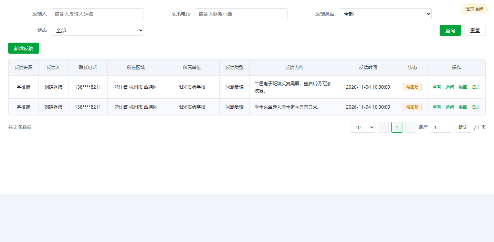
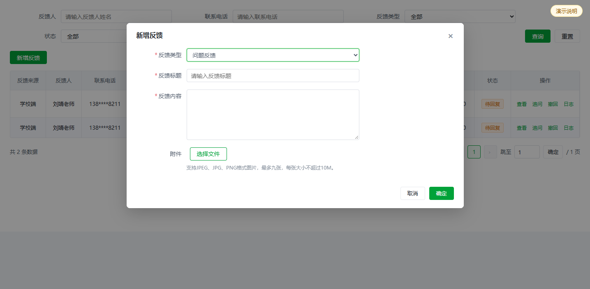
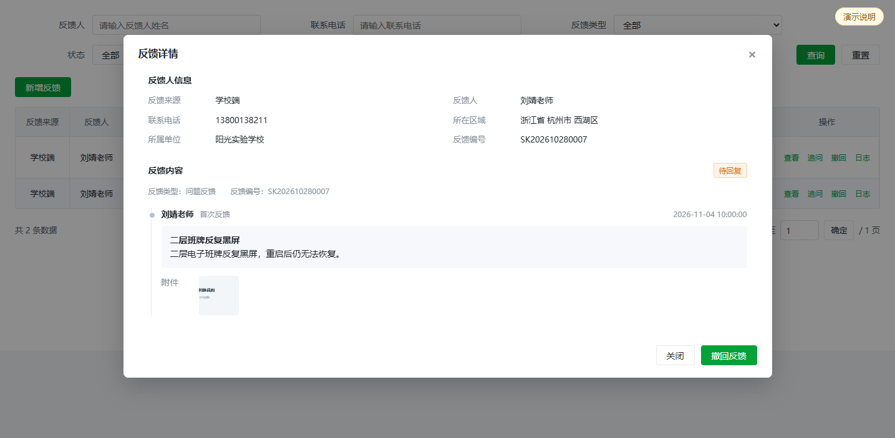
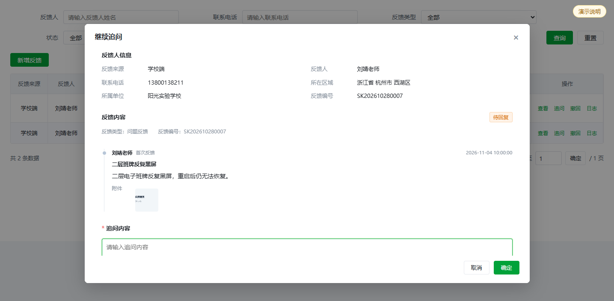
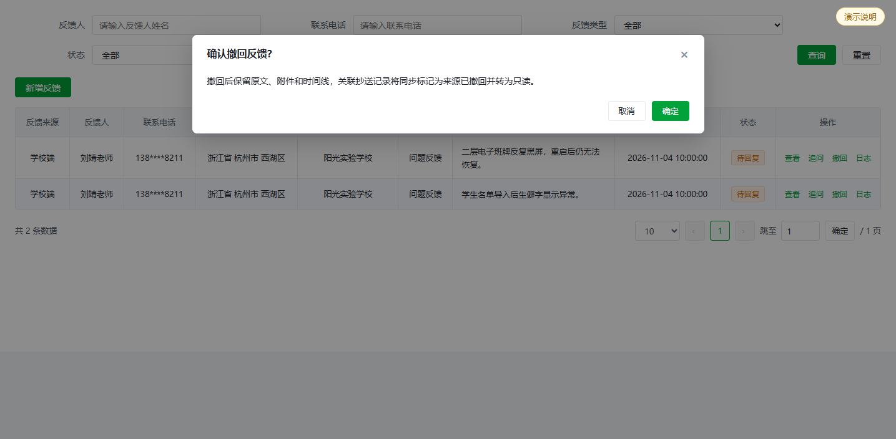
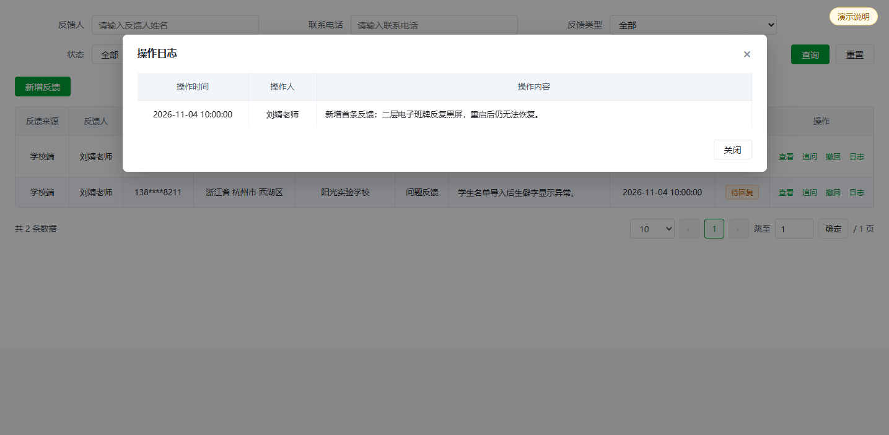

### 学校 Web 客户反馈产品需求文档

产品版本：客户反馈 Web 第一期
文档编号：PRD-FB-SCHOOL-20261118
文档版本：v1.11（第一期，修改中，待评审）
文档状态：第一期修改中，未定版
适用端：学校Web

本文仅描述学校Web。学校记录1（R1）由学校提交，代理商负责处理；代理商需要运营支持时可为R1创建一条新的记录2（R2）。运营只回复R2，不直接回复学校。代理商对运营回复执行转达后，学校才在R1时间线上看到代理商发送的新消息。学校端只展示本端反馈时间线和本端可执行操作，不展示运营的内部工作台。

#### 1. 需求背景与目标

##### 1.1 背景

学校需要向代理商提交问题、查看完整沟通、继续追问并在符合条件时撤回。代理商可能直接回复，也可能向运营抄送；运营回复在R2内只对代理商可见，只有代理商转达后才形成学校收到的答复。学校端需防止“内部已回复”被误显示为“学校已回复”。

##### 1.2 目标

- 列表筛选、展示、分页和操作列按运营后台合同管理页面统一；学校端删除地区筛选。
- 学校反馈首条、追问、代理商回复、转达消息、附件、删除/撤回标记按时间逆序展示。
- 整条反馈撤回与单条追问消息撤回分开判断，按钮资格与状态明确。
- 提交失败和状态变化不丢失文本/附件，不产生部分消息；撤回和删除保留日志及历史内容。
- 学校端只呈现学校/代理商沟通结果，不将运营内部消息直接当作学校收到的内容。

##### 1.3 约束与边界

本文件只包含学校Web，不与代理商Web、运营后台或家长/教师小程序合并。学校端不显示地区筛选、不提供已提交消息修改入口、不让学校直接回复运营。新增反馈标题1—50字、内容1—200字，附件规则按已确认的Web要求执行。

#### 2. 一期范围

##### 2.1 范围清单

| 页面 / 对象 | 本版本需求 | 必要联动 | 不在本端范围 |
|---|---|---|---|
| 问题反馈列表 | 查询、重置、分页、查看、追问、整条撤回、日志 | 学校R1 | 地区筛选 |
| 新增反馈 | 类型、标题、正文、可选图片附件、二次离开确认 | 创建首条消息和日志 | 提交后修改 |
| 反馈详情 | 反馈人信息、状态、逆序时间线、附件、消息撤回资格 | R1和转达副本 | 运营内部处理时间线 |
| 继续追问 | 必填正文、计数、选填附件 | 当前轮次、日志 | 硬性往返上限 |
| 撤回 | 单条学校追问撤回与整条R1撤回 | 关联R2只读联动 | 首条消息级撤回 |

##### 2.2 版本变化

| 变更ID | 变化内容 | 决策来源 | 状态 |
|---|---|---|---|
| CHG-SC-01 | 学校问题反馈筛选删除所在地区 | 用户浏览器批注 | 已确认 |
| CHG-SC-02 | 学校操作列对可撤回记录显示可用按钮；不可撤回记录按钮保留但置灰并解释 | 用户撤回批注 | 已确认 |
| CHG-SC-03 | 首条反馈不得消息级撤回；整条反馈撤回单独按当前有效回复判断 | 用户 Q21及撤回确认 | 已确认 |
| CHG-SC-04 | 追问消息撤回按是否曾收到处理方回复判断；曾回复后即使回复删除也禁撤 | 用户明确确认及一致性复核 | 已确认 |
| CHG-SC-05 | 所有提交后的反馈/回复/转达不可修改；撤回、删除二次确认，无原因输入 | 用户多轮明确要求 | 已确认 |
| CHG-SC-06 | R1整条撤回后，关联R2只读并追加来源撤回事件；保留此前内容 | 用户 Q6、Q19 | 已确认 |
| CHG-SC-07 | 运营回复被删除后，学校已收到的转达副本保留并标记来源删除 | 用户 Q9、Q10 | 已确认 |
| CHG-SC-08 | 学校端界面时间线按最新多消息转达排序规则展示 | 用户 Q58、Q59及此前确认 | 已确认 |

##### 2.3 页面与流程清单

| 需求ID | 页面 / 弹窗 | 主要动作 | 入口 | 验收 |
|---|---|---|---|---|
| SC-FB-01 | 学校问题反馈列表 | 查询、重置、分页、查看、追问、撤回、日志 | 问题反馈 | AT-SC-01—07 |
| SC-FB-02 | 新增反馈表单 | 填写首条、上传附件、提交或确认离开 | 列表新增反馈 | AT-SC-08—14 |
| SC-FB-03 | R1反馈详情 | 查看来源信息和逆序时间线 | 列表查看 | AT-SC-15—20 |
| SC-FB-04 | 继续追问表单 | 新增一条学校消息、附件 | 列表追问/详情 | AT-SC-21—28 |
| SC-FB-05 | 消息/整条撤回 | 单条追问撤回、整条R1撤回二次确认 | 操作列/详情 | AT-SC-29—38 |
| SC-FB-06 | 日志 | 按时间/操作人/内容查看记录 | 列表日志/详情 | AT-SC-39—42 |

#### 3. 业务名词、数据来源与基础规则

##### 3.1 业务对象与关系

| 对象 | 标识 | 学校端内容 | 生命周期及关联 |
|---|---|---|---|
| R1学校反馈 | 学校反馈编号 | 首条、学校追问、代理商回复/转达、附件、状态和日志 | 学校创建；代理商负责处理 |
| R2运营记录 | 代理商每次抄送产生的新编号 | 学校端不展示内部详情 | 关联一个R1，但编号/状态独立 |
| 学校端代理商消息 | 消息编号 | 代理商直接回复或转达的运营答复；转达消息按代理商本次提交的内容展示 | 每个运营源回复生成一条独立代理商消息 |
| 消息附件 | 消息附件编号 | 按所属消息展示 | 删除/撤回后保留可查看抄送时保存的来源内容 |
| 系统事件/日志 | 事件编号 | 学校日志与时间线状态标记 | 不随消息删除/撤回移除 |

##### 3.2 角色、权限与数据范围

| 角色 | 可见范围 | 可执行 | 禁止事项 | 点击确定时再检查 |
|---|---|---|---|---|
| 学校授权用户 | 当前学校授权范围内R1 | 新增、查看、追问、按资格撤回、日志 | 直接回复运营；编辑已提交内容；操作其它学校 | 登录状态、学校范围、反馈状态、消息归属、正文和附件 |
| 代理商 | 负责学校范围内R1 | 在代理商端查看/回复/抄送/转达 | 在学校端覆盖学校原文 | 由代理商端再次检查组织和负责学校 |
| 运营 | 仅运营R2 | 在R2回复代理商 | 直接回复R1或学校 | 由运营端再次检查R2/来源反馈编号 |

同一学校授权范围内的操作不限制为创建人本人；不因已读与否改变撤回或删除按钮状态。学校端只提供用户角色允许的操作；系统必须重新验证权限和组织范围。

##### 3.3 状态与流转

| R1/消息状态 | 判定 | 学校端展示 |
|---|---|---|
| 待回复 | 当前最后一条未撤回、未删除的消息由学校发出，等待代理商处理 | 显示“待回复”；学校可继续追问，追问后仍为待回复 |
| 已回复 | 当前最后一条未撤回、未删除的消息由代理商发出，且之后没有新的学校消息 | 显示“已回复”；学校如继续追问，状态重新变为待回复 |
| 回复已删除 | 处理方回复被删除，导致当前没有有效答复 | 主状态按当前最后一条有效消息方向判定；时间线显示“回复已删除”。若仍有更早的有效答复且之后没有新的学校消息，仍显示已回复 |
| 已撤回消息 | 单条追问或整条R1经确认撤回 | 保留原文、附件、作者、时间及撤回标记 |
| 来源已撤回 | R1整条撤回时通知关联记录 | 学校R1自身显示已撤回；关联R2只读。R2已确认追加来源撤回事件并转只读；列表/标题是否另显示“来源已撤回”标记待确认（运营后台Q80） |
| 代理商已转达 | 代理商把一条或多条运营回复作为独立新消息发送给学校 | 每条独立显示在R1时间线；运营内部R2状态不直接改变学校端 |

##### 3.4 撤回规则边界

整条R1撤回与单条学校追问消息撤回判定对象不同，二者并不冲突：

- 整条R1撤回：R1未撤回、当前权限有效且没有有效代理商回复时可撤回；所有有效代理商回复均被删除后重新判断。追问本身不阻止整条撤回。
- 首条学校反馈：不能单独撤回。需要撤回时走整条R1撤回。
- 单条学校追问撤回：只有处理方从未回复该条追问时可撤回。处理方曾回复过该追问，即使该回复后来被删除，仍不可单独撤回。
- “有效回复”指当前未删除、未撤回的处理方消息。有效回复用于整条R1资格和当前状态；消息级追问资格使用历史事实“是否曾回复过”，不按有效与否重算。
- 撤回按钮使用带边框的按钮样式并始终展示；不符合条件时置灰并显示原因。已读状态和同组织内具体提交人不是资格条件。
- 删除/撤回均二次确认，不填写原因。取消不改变数据；确认前再次检查权限、消息/记录状态和来源状态。

##### 3.5 学校端时间线规则

- 学校端显示学校用户与代理商之间的消息，不展示运营未转达的内部回复。
- 代理商转达后，学校端显示代理商新消息。每一条运营源回复各生成一条独立代理商消息，保留源回复编号、源正文抄送时保存的来源内容及随转达的附件抄送时保存的来源内容。
- 学校时间线整体按时间逆序。一次批量转达中，多个新消息按其运营原回复时间正序排列，以保持该批答复先后顺序；批次组与其它消息仍按时间逆序排序。
- 运营删除/撤回回复，不移除学校已收到的转达副本；副本保留正文和附件并显示来源已删除/已撤回。
- 所有学校端已提交消息不可修改。关闭草稿确认只处理未提交输入，不改变既有R1。

#### 4. 原型、视觉与来源

##### 4.1 本期需求来源

| 来源 | 本文使用方式 | 状态 |
|---|---|---|
| 用户对学校反馈、追问、消息撤回、整条反馈撤回、删除标记及日志的明确要求 | 作为学校Web业务规则依据；只描述学校端可见与可操作内容 | 已确认 |
| 本任务运营后台和代理商Web分册及本项目历史确认 | 只引用影响学校端的关联规则；不把运营内部回复当作学校已收到的回复 | 已核对 |
| 学校Web GitHub 候选 v0.58 | 核对学校反馈页面、详情、表单和撤回确认界面 | 修改中、未定版 |

##### 4.2 页面展示原则

学校反馈页面不显示所在地区筛选项；地区及所属单位仍可作为记录内容展示。反馈详情按时间倒序显示消息，消息正文、附件、作者和时间对应同一条记录。运营的内部回复只在代理商与运营处理记录中显示；代理商实际转达后，学校端才新增代理商消息。

##### 4.3 成熟服务台公开做法与本项目建议

公开资料核对日期：2026-11-19（UTC）。Zendesk公开帮助说明区分请求人可见的公开回复与仅处理人员可见的内部备注，并把沟通保留在工单中；其事件查看页展示工单更新及通知记录。[添加工单评论](https://support.zendesk.com/hc/en-us/articles/4408828489370-Adding-comments-to-tickets)、[查看工单更新事件](https://support.zendesk.com/hc/en-us/articles/4408829602970-Viewing-all-events-for-ticket-updates)。Jira官方帮助说明可为事项建立关联关系。[关联工作项](https://support.atlassian.com/jira-software-cloud/docs/link-issues/)。以上仅作公开做法参考，不表示这些产品采用本项目的消息撤回或删除规则；用户所说“GRM客服系统”尚未能唯一对应到具体产品。

本项目建议将来源消息、代理商回复、撤回标记和日志放在同一条清晰的沟通时间线上；内部回复仍不进入学校时间线，代理商转达后才作为新消息出现。这样能让反馈人明确自己实际收到的内容；取舍是学校端看到的内容与代理商/运营内部处理记录不同。

##### 4.4 当前候选核对情况

| 页面 | 已核对内容 | 尚待核对 |
|---|---|---|
| 学校反馈列表 | v0.58从干净浏览器打开成功，显示地区筛选已移除、反馈列表和操作列 | 无结果、授权变化、窄屏操作列与各状态按钮仍需逐项核对 |
| 新增反馈与继续追问 | 候选表单可显示必填字段、字数计数和附件入口 | 字数边界、9张图片上限、读取失败、取消与提交异常仍需逐项核对 |
| 反馈详情、撤回和日志 | 真实截图显示时间线、撤回二次确认及日志表格 | 首条/追问撤回资格、来源撤回、已删除回复与同时操作仍需逐项核对 |

截图来自当前候选的实际浏览器页面。本表不表示所有异常路径均已验收。

#### 5. 一期页面与功能清单

|需求编号|页面/弹窗|本端业务内容|
|---|---|---|
|SC-FB-01|学校反馈列表|字段、按钮、校验、异常及结果见第6节。|
|SC-FB-02|新增学校反馈|字段、按钮、校验、异常及结果见第6节。|
|SC-FB-03|R1反馈详情与学校时间线|字段、按钮、校验、异常及结果见第6节。|
|SC-FB-04|继续追问|字段、按钮、校验、异常及结果见第6节。|
|SC-FB-05 / SC-FB-06|消息撤回、整条撤回与日志|字段、按钮、校验、异常及结果见第6节。|

#### 6. 功能详细说明
##### 6.2 学校问题反馈列表（SC-FB-01）

原型入口：[学校Web问题反馈列表候选](https://rawcdn.githack.com/guozi0718/codex-projects/main/%E5%AD%A6%E6%A0%A1%E7%AB%AF/releases/v0.58/index.html?page=school-feedback&content=1)

###### 6.2.1 查询条件

| 条件 | 控件 / 默认 | 匹配与联动 | 生效 / 错误 |
|---|---|---|---|
| 所在地区 | 不显示 | 学校列表按当前学校范围查看 | 不提供地区筛选 |
| 所属单位 | 学校范围内条件（如当前项目仍提供） | 只匹配当前学校 | 无单位配置不显示无效下拉 |
| 反馈人 | 文本输入 | 按已登记名称条件匹配 | 分享页面地址不显示反馈人等敏感内容 |
| 联系电话 | 文本输入 | 按当前账号可见范围查询号码 | UI脱敏；查询失败保留 |
| 反馈类型 | 全部及当前登记枚举 | 与其他所有条件同时满足 | 未知值不可误当为全部 |
| 状态 | 全部、待回复、已回复、已撤回 | 依学校R1状态 | 回复已删除的辅助标记与主状态分开 |

页面筛选、表格、分页、按钮与操作列样式参考学校后台现有页面。学校端无“所在地区”行；操作列包含查看、追问、撤回、日志。撤回按钮为带边框样式并始终显示，资格不足置灰并说明原因；弹窗底部“撤回反馈”与列表按钮使用同一条件。

查询多个不同条件需同时满足；查询成功回第1页；重置恢复默认并重查。数据读取失败、无结果、无权限、失效记录分别显示，不用旧列表假装成功。关闭详情回原筛选、页码、滚动位置和选中记录。

###### 6.2.2 ACT-SC-01 查询与打开详情

打开列表及提交操作前，都要确认当前学校范围和菜单权限仍有效。打开列表仅读取，不写日志以外的业务消息。查看详情时按R1编号读取完整可见时间线；来源关系缺失或无效时显示提示，不跳到其它记录。列表中撤回按钮状态依据资格计算，但提交必须再次验证，不以界面置灰代替系统复验。

###### 6.2.3 ERR-SC-01—04 列表异常

| 编号 | 场景 | 页面表现 | 保存/恢复 |
|---|---|---|---|
| ERR-SC-01 | 成功但无记录 | 显示无反馈空态和新增入口 | 无保存；可新增 |
| ERR-SC-02 | 筛选无匹配 | 显示无匹配，保留条件 | 无保存；重置或改条件 |
| ERR-SC-03 | 查询加载失败 | 明确显示加载失败，不显示旧结果为当前结果 | 筛选保留，允许重试 |
| ERR-SC-04 | 记录无效/超出学校权限 | 显示无权访问或记录失效 | 不泄露其它学校数据；返回列表 |

##### 6.3 新增学校反馈（SC-FB-02）

原型入口：[学校Web新增反馈入口](https://rawcdn.githack.com/guozi0718/codex-projects/main/%E5%AD%A6%E6%A0%A1%E7%AB%AF/releases/v0.58/index.html?page=school-feedback&content=1)

该图为当前候选新增反馈弹窗的真实页面截图，展示反馈类型、标题、正文和附件入口。表单字段和行为要求见下方。

###### 6.3.1 表单字段与附件

| 字段 | 必填 | 规则 | 当前文档依据与待核实 |
|---|---|---|---|
| 反馈类型 | 是 | 选择当前系统已登记类型 | 具体枚举按原型字典；不得补造新枚举 |
| 反馈标题 | 是 | 单行，去首尾空白后1—50字；首条标题随R1保存并在时间线展示 | 含边界；超限阻止提交并保留原输入 |
| 反馈内容 | 是 | 多行，去首尾空白后1—200字；内部换行保留；首条原文不可再编辑 | 含边界；超限阻止提交并保留原输入 |
| 附件 | 否 | JPEG/JPG/PNG最多9张，每张≤10MB | 显示缩略图、移除本次未提交文件和上传状态 |
| 反馈人/单位 | 登录信息自动带入 | 显示当前登录人和任职学校，不允许在表单中修改 | 提交时保留当时显示的人员与学校信息 |

###### 6.3.2 ACT-SC-02 提交首条反馈

1. 执行资格：登录用户具备学校反馈提交权限，且当前学校允许提交反馈。
2. 开始操作：打开表单时绑定当前学校和登录人上下文，表单为未提交草稿。
3. 填写时检查：反馈类型已选；标题为1—50字、内容为1—200字；附件符合JPEG/JPG/PNG、最多9张、单张不超过10MB，且读取/上传完成。
4. 点击确定时再检查：登录状态、当前学校范围、反馈类型、字数限制、附件状态，以及该表单是否已经提交；输入计数与提交校验保持一致。
5. 同时操作与重复：提交中按钮防重；提交结果尚未确认时先核对列表，避免重复创建；确认第一次提交成功后再次主动新增时才创建新的R1。
6. 提交成功后，创建R1编号、首条消息、附件当时记录的内容、作者、时间、状态“待回复”和首条日志。
7. 明确失败：不建R1；错误定位到字段或文件；保留文本、类型和有效附件。
8. 未知结果：先查看列表确认是否已提交；不盲目再建。
9. 取消与关闭：表单有内容/附件时二次确认。选“继续编辑”回表单保留内容；选“放弃离开”清空未提交草稿并回列表。已提交消息不受影响。
10. 验收：AT-SC-08—14。

###### 6.3.3 ERR-SC-05—10 新增异常

| 编号 | 场景 | 提示 | 保存与恢复 |
|---|---|---|---|
| ERR-SC-05 | 类型未选、标题/内容为空 | 对应字段显示必填错误 | 不提交；保留其它输入 |
| ERR-SC-06 | 标题超过50字或内容超过200字 | 标题提示“请输入1-50字反馈标题”；内容提示“内容不能超过200字”并显示计数 | 不截断、不提交；保留输入并定位；系统重复校验 |
| ERR-SC-07 | 图片格式/数量/大小不符 | 指出具体失败附件 | 不提交；保留有效文件，允许移除/重选 |
| ERR-SC-08 | 图片读取中/上传失败 | 显示读取/上传失败 | 禁止成功提交；文字保留 |
| ERR-SC-09 | 学校权限或组织在表单打开后失效 | 明确提示权限变化 | 不保存；草稿保留供复制 |
| ERR-SC-10 | 关闭/返回有未提交内容 | 二次确认“继续编辑/放弃离开” | 取消离开留在表单；确认放弃才清空本次草稿 |

##### 6.4 R1反馈详情与学校时间线（SC-FB-03）

原型入口：[学校Web反馈详情候选](https://rawcdn.githack.com/guozi0718/codex-projects/main/%E5%AD%A6%E6%A0%A1%E7%AB%AF/releases/v0.58/index.html?page=school-feedback&content=1)

###### 6.4.1 页面信息

详情顶部显示联系人、联系电话、学校/区域、R1编号、类型与当前状态。具体个人信息按学校权限展示。时间线按消息时间逆序，消息包含作者、角色、类型、时间、标题、正文、附件、来源以及“已删除/已撤回/来源回复已删除”标记。

未由代理商转达的运营回复在学校端不可见。多条转达消息独立显示；批次内消息按运营原回复时间正序呈现，但批次整体仍参与时间逆序排序。一个运营源消息重复转达后，每条新代理商消息仍独立保留。

###### 6.4.2 ACT-SC-03 查看时间线和附件

打开详情时显示R1最新内容、消息和附件；附件按所属消息展示，删除/撤回不隐藏原附件。点击图片可查看原图；关闭预览返回同一时间线位置。加载失败仅标记对应消息/附件，不将空消息解释成无内容。详情关闭回列表上下文。

###### 6.4.3 ERR-SC-11—14 详情异常

| 编号 | 场景 | 页面表现 | 恢复 |
|---|---|---|---|
| ERR-SC-11 | R1加载失败 | 详情显示读取失败并提供返回/重试 | 不显示旧R1内容 |
| ERR-SC-12 | 时间线部分加载失败 | 已加载消息保留，提示有消息未加载 | 重试时间线，不重复业务事件 |
| ERR-SC-13 | 附件不可读 | 消息正文和其余附件保留；失败附件单独标识 | 单项重试 |
| ERR-SC-14 | 非学校来源R2编号进入学校页面入口 | 拒绝并提示记录类型或权限错误 | 回学校反馈列表，不跳到其他业务记录 |

##### 6.5 继续追问（SC-FB-04）

原型入口：[学校Web继续追问候选](https://rawcdn.githack.com/guozi0718/codex-projects/main/%E5%AD%A6%E6%A0%A1%E7%AB%AF/releases/v0.58/index.html?page=school-feedback&content=1)

###### 6.5.1 表单字段

| 字段 | 规则 | 校验与展示 |
|---|---|---|
| 当前反馈上下文 | 只读，包含R1类型/编号/原反馈及消息时间线 | 逆序展示，附件可查看 |
| 追问内容 | 必填；去首尾空白后1—1000字；占位“请输入追问内容” | 标题左对齐，textarea宽度适当缩减，底部显示实时计数；达到1000禁止输入新增字符 |
| 附件 | 非必填；JPEG/JPG/PNG最多9张，每张≤10MB | 统一上传按钮样式，附件缩略图与按钮间隔清晰；可移除本次未提交附件 |
| 必填符号 | 追问内容标签左侧显示红色必填星号 | 不重复显示额外“继续追问”字段标签 |

###### 6.5.2 ACT-SC-04 提交追问

1. 执行资格：R1未整条撤回，账号在学校范围内有权限；单条撤回过的首条或来源状态不允许继续操作。
2. 开始操作：重新读取R1当前状态与完整逆序时间线，形成一个独立消息草稿。
3. 填写时检查：正文必填且1—1000字；附件格式、数量、大小、读取状态有效。
4. 提交复验：重新检查账号、学校范围、R1仍存在且未撤回、当前反馈状态、操作权限和附件状态。
5. 重复/同时操作：同一次追问提交只新增一条消息；如表单打开期间反馈状态改变，点击确定时再次检查并拒绝不符合条件的提交，保留草稿。
6. 提交成功后，追加一条独立学校消息及附件当时记录的内容、作者、时间和日志，R1状态转为待回复；不覆盖首条。
7. 明确失败：错误定位到字段/附件或状态；保留正文、已选有效附件和当前上下文。
8. 未知结果：先核对原提交状态，不自动再次追问。
9. 取消与关闭：含文本或附件时二次确认；取消放弃动作留在表单，确认放弃后清空未提交内容并返回前一页。
10. 验收：AT-SC-21—28。

###### 6.5.3 ERR-SC-15—19 追问异常

| 编号 | 场景 | 页面提示 | 保存与恢复 |
|---|---|---|---|
| ERR-SC-15 | 正文为空/全空格 | 提示“请输入追问内容” | 不保存；保留其它字段 |
| ERR-SC-16 | 字数超过1000 | 计数与输入限制可见 | 禁止新增字符；已有文本保留 |
| ERR-SC-17 | 附件格式、数量或大小不符 | 标记失败文件及限制 | 整条追问不提交；正文/有效附件保留 |
| ERR-SC-18 | R1在填写时被撤回或状态变化 | 提示记录状态已变化 | 不保存；草稿可复制 |
| ERR-SC-19 | 图片上传或提交结果暂时无法确认 | 明确说明是否正在核对 | 不盲目新建第二条；核对后由用户决定 |

##### 6.6 消息撤回、整条撤回与日志（SC-FB-05 / SC-FB-06）

原型入口：[学校Web撤回与日志候选](https://rawcdn.githack.com/guozi0718/codex-projects/main/%E5%AD%A6%E6%A0%A1%E7%AB%AF/releases/v0.58/index.html?page=school-feedback&content=1)

###### 6.6.1 ACT-SC-05 撤回单条追问消息

学校可以针对具体追问消息执行消息级撤回，不能对首条反馈执行消息级撤回。撤回按钮使用带边框样式。若处理方从未回复该追问，按钮展示为可用；只要处理方曾回复过该追问，按钮置灰并显示“该消息已被回复，无法撤回”，即使该回复后来已删除也不恢复资格。点击可用按钮后进入二次确认，不填写原因。确认时再次检查学校权限、R1、目标消息、消息类型及处理方是否曾回复。成功后仅目标追问标“已撤回”，保留原文、附件、时间及日志；不自动撤回整条R1，也不清除R2。

###### 6.6.2 ACT-SC-06 撤回整条R1

列表和详情“撤回反馈”按钮为带边框样式并始终展示。资格为R1当前未撤回、权限有效且没有有效代理商答复。若仍有有效代理商回复，按钮置灰并提示“该反馈已被回复，无法撤回”；所有有效代理商回复被删除后重新判断。追问本身不阻止整条撤回。点击后出现与详情查看弹窗一致的确认框架，只说明将撤回整条反馈并保留日志，不询问原因。确认前再次检查权限、R1状态和有效代理商回复。

成功后R1标记已撤回，保留所有消息和附件；每条关联R2同步追加来源及撤回时间系统事件并进入只读。撤回前已存在的代理商/运营/转达消息仍在学校时间线显示，不撤回已送达的副本。撤回后所有新增消息在提交前仍须检查来源状态；若来源已撤回则拒绝提交。

###### 6.6.3 ACT-SC-07 删除、来源标记与日志

学校端不提供删除已提交学校反馈或追问的操作，也不能编辑任何已提交消息。代理商或运营删除来源回复时，学校已收到的转达内容仍保留并显示来源已删除。日志列为操作时间、操作人、操作内容；时间/人员列缩短，内容列增宽，追加追问应显示追问内容。新增首条、追问、代理商回复/转达、消息撤回、整条撤回、来源撤回等记录均保留。

###### 6.6.4 ERR-SC-20—27 撤回/删除/日志异常

| 编号 | 场景 | 页面提示与状态 | 数据副作用 / 恢复 |
|---|---|---|---|
| ERR-SC-20 | 用户取消消息撤回 | 关闭确认或留在目标弹窗 | 不改变记录/消息；时间线不加标记 |
| ERR-SC-21 | 追问曾被回复但回复后来删除 | 撤回按钮仍置灰并说明曾被回复 | 不提交；日志保持 |
| ERR-SC-22 | 整条R1仍有有效代理商回复 | 撤回按钮置灰并说明原因 | 不提交；列表/详情状态保留 |
| ERR-SC-23 | 整条R1所有有效代理商回复被删除 | 重新开放资格判断 | 若其它条件满足，可显示可撤回 |
| ERR-SC-24 | 确认时另一用户刚回复 | 点击确定时再检查失败并刷新状态 | 不撤回；弹窗可关闭，保留状态说明 |
| ERR-SC-25 | 来源R1已撤回后尝试新增追问 | 明确拒绝 | 无保存；只读查看原时间线 |
| ERR-SC-26 | 已转达消息来源运营回复被删除 | 学校端继续显示收到的正文/附件和来源已删除标记 | 不删副本、不改写正文 |
| ERR-SC-27 | 日志读取失败 | 详情仍可关闭，日志区明确失败 | 不影响其它数据；单独重试 |

#### 7. 数据、权限与跨端一致性要求

所有状态样例应由原型“演示说明”按端集中列出，并可切换到对应记录；不能只在文档文字里出现而原型默认数据完全没有。学校默认列表目前只显示待回复记录，不能据此宣称已覆盖已回复/已撤回状态。

##### 7.1 R1状态样例

| 编号 | 示例状态 | 预期主状态 | 预期详情/按钮 |
|---|---|---|---|
| R1-001 | 学校首条反馈后无代理商有效答复 | 待回复 | 可追问；整条撤回按资格可用；首条无消息级撤回 |
| R1-002 | 当前最后一条有效消息为代理商回复 | 已回复 | 详情保留消息；整条撤回置灰 |
| R1-003 | 所有代理商有效回复已删除 | 待回复并显示回复已删除 | 代理商回复保留已删除标记；整条撤回重新评估 |
| R1-004 | 多条代理商回复，部分删除，且代理商仍是最后发言方 | 已回复 | 仍有有效答复；删除回复保留原文及附件 |
| R1-005 | 有效代理商回复后学校又追问 | 待回复 | 最新有效学校消息等待代理商处理；整条撤回按当前有效回复重新判断 |
| R1-006 | 整条反馈已撤回 | 已撤回 | 只读；所有消息附件保留 |
| R1-007 | R1已抄送一个或多个R2，学校整条撤回 | 已撤回 | 所有关联R2追加来源撤回事件并只读；R2标记样式待确认（Q80） |
| R1-007 | 同一代理商运营回复被重复转达 | 按当前轮次判定 | 每次转达是独立代理商消息，保留每个源ID |

##### 7.2 消息级撤回样例

| 编号 | 示例 | 预期 |
|---|---|---|
| MSG-001 | 首条学校反馈 | 不显示消息级撤回；只能整条撤回 |
| MSG-002 | 追问尚未收到处理方回复 | 追问消息撤回可用；二次确认后只标该条 |
| MSG-003 | 追问曾收到代理商回复，后来代理商回复被删除 | 追问消息撤回仍置灰；提示该消息曾被回复 |
| MSG-004 | 追问被撤回但R1未撤回 | 其它时间线仍显示；R1剩余消息继续按当前有效消息判断 |

##### 7.3 R2与转达样例（学校端可见部分）

| 编号 | 示例 | 学校端预期 |
|---|---|---|
| R2-001 | 代理商抄送运营，运营尚未回复 | 学校R1状态仍由当前学校/代理商沟通计算，不因内部抄送变化 |
| R2-002 | 运营回复但代理商未转达 | 学校不显示运营回复，不视为已回复 |
| R2-003 | 代理商转达一条运营回复 | 学校追加一条代理商消息，保存原文/源附件抄送时保存的来源内容 |
| R2-004 | 代理商一次转达多条运营回复 | 每条源回复对应独立消息；总体逆序、批次内部正序 |
| R2-005 | 同一回复被再次转达 | 学校新增第二条独立代理商消息，不覆盖首次消息 |
| R2-006 | 运营删除已转达的回复 | 已收到的学校副本保留并标“来源回复已删除” |
| R2-007 | R1整条撤回后既有运营回复/转达存在 | 全部历史可见；关联R2只读；不得新增通知或回复 |

##### 7.4 异常验收用例

| 编号 | 异常前提 | 应见结果 | 恢复要求 |
|---|---|---|---|
| ERR-SC-28 | 无效记录ID、错误端页面入口 | 明确显示记录无效或无权 | 不跳其它记录 |
| ERR-SC-29 | 同一学校帐号会话失效 | 阻止保存且不泄露其它学校内容 | 重新认证后用户主动重试 |
| ERR-SC-30 | 追问表单打开后被代理商回复 | 提交前再次检查当前反馈状态 | 保留草稿，用户刷新后决定是否另发一条追问 |
| ERR-SC-31 | 附件附件读取或上传失败但正文正常 | 整条消息不提交 | 保留正文，允许重试附件 |
| ERR-SC-32 | 已撤回记录在浏览器历史中恢复 | 只恢复只读详情，不提交保存 | 返回安全页面 |
| ERR-SC-33 | 一批转达中的任一消息无效 | 不出现部分消息 | 代理商修正后重新整批提交 |

##### 7.5 记录留存与操作记录

###### 7.5.1 学校端要保留的记录

学校反馈、每次追问、每条代理商回复/转达、附件、作者、时间以及删除/撤回状态都在同一条反馈详情时间线上持续显示。时间线按时间由近到远排列。被标记删除或撤回的消息不从学校页面移除，附件仍可点开查看。

###### 7.5.2 操作记录

新增首条反馈、追加追问、单条追问撤回、整条反馈撤回、收到代理商转达、消息删除/来源删除标记和通知发起均记录操作时间、操作人及操作内容。操作记录不因消息撤回或删除而消失。运营未转达的回复不会出现在学校页面，也不会作为学校已回复状态的依据。

###### 7.5.3 两种撤回的区别

“撤回整条反馈”与“撤回一条追问”针对不同内容，资格不能混为一谈：

- 整条R1只有在没有仍有效的处理方回复时才能撤回。处理方的有效回复全部被删除后，重新判断整条撤回资格；仅有学校追问不会阻止撤回。
- 首条反馈不能单独撤回。某条追问只要曾经收到处理方回复，就不能再单独撤回；即使那条回复后来被删除也一样。
- 所以“回复都删掉后可撤回整条”与“曾被回复过的单条追问仍不可撤回”并不冲突：前者看整条记录现在是否还留有有效回复，后者看指定追问是否曾被回复。
- 撤回整条R1后，关联的R2追加来源撤回事件并停止新增回复；R2已确认追加来源撤回事件并转只读；列表/标题是否另显示“来源已撤回”标记待确认（运营后台Q80）。此前已产生的代理商、运营回复和转达仍保留。

##### 7.6 学校端关联变化与重新进入后的表现

| 事件 | 学校端显示与处理 |
|---|---|
| 学校新增R1 | 学校列表出现自己的新反馈；详情显示首条消息、附件和当前状态 |
| 代理商将R1抄送运营 | 学校端的R1和状态不变；运营抄送记录不在学校页面显示 |
| 代理商直接回复学校 | 学校时间线新增代理商消息，R1按当前轮次更新状态 |
| 运营在R2回复 | 学校端不显示内部回复，状态不因运营回复改变 |
| 代理商转达运营回复 | 学校时间线增加代理商新消息；每条源回复对应一条消息，附件只显示本次实际转达的附件 |
| 反馈人继续追问 | 学校时间线追加追问；已有R2仍保留抄送时的来源内容，不自动展示为学校端消息 |
| 学校撤回整条R1 | 学校详情只读并显示已撤回；所有已有关联消息和附件继续显示 |
| 运营删除已转达回复 | 已收到的学校消息与附件继续显示，另标记“来源回复已删除” |

重新打开详情应恢复当前R1和原列表筛选、页码及位置。浏览器刷新、关闭和返回不会自动新增消息或确认撤回。
##### 7.7 页面行为与一致性核对

- [ ] 学校端列表不显示地区筛选。
- [ ] 筛选/列表/分页样式与运营合同管理页面一致。
- [ ] R1和每条R2编号、状态、消息及抄送时保存的来源内容独立。
- [ ] 运营内部回复未转达前不显示在学校端。
- [ ] 批次转达每条运营回复生成独立消息；批次内部正序、整体时间线逆序。
- [ ] 所有提交消息不可修改；撤回/删除使用二次确认且无原因字段。
- [ ] 整条撤回根据当前有效回复判断；追问消息撤回根据是否曾被回复判断。
- [ ] 新增标题1—50字、内容1—200字；追问正文1—1000字、实时计数、超限阻止；附件最多9张、单张≤10MB。
- [ ] 所有失败情形写明是否保存、输入保留和安全恢复。
- [ ] 需求、演示样例、验收标准和截图缺口互相一致。

##### 7.8 页面返回、取消与重复操作

- 取消或关闭新增、回复、追问、抄送、转达草稿时不创建新消息；已有未提交内容时，先让用户选择继续编辑或放弃。
- 删除或撤回必须由用户在二次确认中再次确认；关闭确认框或选择取消不改变原消息。
- 点击确定后暂时没有结果时，不自动重复创建消息；提示结果尚未确认，并保留可核对的页面上下文。
- 返回列表时保留本次进入前仍有效的筛选条件和页码；打开另一条反馈时不显示上一条反馈的消息或附件。

#### 8. 需求验收标准

| AT编号 | 操作场景 | 应看到的结果 | 状态 |
|---|---|---|---|
| AT-SC-01 | 打开学校反馈列表 | 不显示所在地区筛选 | 当前候选截图符合 |
| AT-SC-02 | 查询/重置/分页 | 条件生效时机和列表总数一致 | 待执行 |
| AT-SC-03 | 比较合同管理页面 | 筛选、列表和分页展示统一 | 待执行 |
| AT-SC-04 | 小视口查看操作列 | 查看/追问/撤回/日志完整显示 | 待执行 |
| AT-SC-05 | 不可撤回R1查看操作列 | 撤回按钮存在、置灰且解释原因 | 当前候选待再次检查 |
| AT-SC-06 | 可撤回R1查看操作列 | 撤回按钮可用并打开二次确认 | 当前候选待再次检查 |
| AT-SC-07 | 已读状态或同校其他人打开记录 | 不改变撤回资格 | 待执行 |
| AT-SC-08 | 打开新增反馈入口 | 表单字段、必填和附件显示 | 当前真实截图显示弹窗基本内容；交互待逐项核对 |
| AT-SC-09 | 类型未选或正文空白 | 阻止提交并定位字段 | 待执行 |
| AT-SC-10 | 标题输入1、50、51字；正文输入1、200、201字 | 边界内可提交；超限阻止且保留原文 | 待执行；字段上限已由既有Web要求确认 |
| AT-SC-11 | 选择有效图片 | 缩略图、移除和文件上限正确 | 待执行 |
| AT-SC-12 | 附件超限/上传失败 | 不产生半条反馈，保留输入 | 待执行 |
| AT-SC-13 | 首条成功提交 | 创建R1、首条消息、状态及日志 | 待执行 |
| AT-SC-14 | 有未提交表单按关闭 | 二次确认继续编辑或放弃离开 | 待执行 |
| AT-SC-15 | 打开R1详情 | 反馈人信息及逆序时间线完整 | 当前候选截图符合基本时间线 |
| AT-SC-16 | 运营回复未转达 | 学校不显示该回复，状态不假定已回复 | 待执行 |
| AT-SC-17 | 代理商多条转达 | 每条消息独立，批次内正序 | 待执行 |
| AT-SC-18 | 删除转达源回复 | 学校副本保留并标来源已删除 | 待执行 |
| AT-SC-19 | 整条R1撤回后查看 | 所有既有消息/附件保留 | 待执行 |
| AT-SC-20 | 来源R1无效或加载失败 | 不跳转到其他记录 | 待执行 |
| AT-SC-21 | 追问输入为空 | 阻止提交并保留上下文 | 当前截图显示必填表单 |
| AT-SC-22 | 输入达到1000字 | 右下角计数正确且阻止超限输入 | 当前截图有0/1000 |
| AT-SC-23 | 上传9张有效附件 | 可预览、移除并提交 | 待执行 |
| AT-SC-24 | 上传第10张/非图片/超10MB | 说明具体文件错误，不提交 | 待执行 |
| AT-SC-25 | 追问成功提交 | 新消息追加，状态变待回复并记日志 | 待执行 |
| AT-SC-26 | 追问提交期间R1撤回 | 系统阻止，输入保留 | 待执行 |
| AT-SC-27 | 取消/关闭有内容追问 | 二次确认；确认放弃才清草稿 | 待执行 |
| AT-SC-28 | 追问中图片读取失败 | 禁止提交且可重新选择 | 待执行 |
| AT-SC-29 | 首条反馈消息操作 | 没有单条撤回；整条撤回单独判断 | 待执行 |
| AT-SC-30 | 追问从未被处理方回复 | 单条撤回可用，二次确认 | 待执行 |
| AT-SC-31 | 追问曾被回复 | 单条撤回置灰并给原因 | 待执行 |
| AT-SC-32 | 追问曾被回复后处理方回复已删除 | 仍置灰，历史事实不清除 | 待执行 |
| AT-SC-33 | R1存在有效代理商回复 | 整条撤回置灰，说明原因 | 待执行 |
| AT-SC-34 | R1有效回复全部删除 | 整条撤回重新评估资格 | 待执行 |
| AT-SC-35 | 用户取消撤回 | 无数据变化，无撤回日志 | 待执行 |
| AT-SC-36 | 用户确认整条撤回 | R1状态已撤回，关联R2只读 | 待执行 |
| AT-SC-37 | 整条撤回前有转达 | 学校仍显示收到的转达和附件 | 待执行 |
| AT-SC-38 | 确认期间同时操作产生处理回复 | 提交再次检查拒绝，状态刷新 | 待执行 |
| AT-SC-39 | 查看日志列 | 操作时间/人/内容布局清晰 | 当前原型未拍日志图，待补 |
| AT-SC-40 | 追问操作日志 | 操作内容包括追问摘要 | 待执行 |
| AT-SC-41 | 删除/撤回消息后看日志 | 既有日志保留 | 待执行 |
| AT-SC-42 | 日志读取失败 | 提示日志失败，可关闭详情 | 待执行 |

#### 9. 客户反馈编号规则

|编号|代表什么|学校端展示规则|
|---|---|---|
|R1编号|学校提交的一条原始反馈及其后续沟通|学校列表、详情、追问、撤回和操作记录始终围绕同一个R1展示。|
|R2编号|代理商将R1抄送运营后形成的运营处理记录|学校不直接查看或处理R2；代理商转达后，学校只在自己的R1时间线中看到代理商新发出的消息。|
|消息编号|R1时间线中的反馈、追问、代理商回复或转达|每条消息分别显示作者、时间、附件和撤回/删除标记。|

编号只用于识别记录，不表示处理优先级。多个R2关联同一个R1时，学校仍只看到自己的R1时间线。

#### 10. 文档边界与交付说明

##### 10.1 待确认项

学校Web没有新增独立待确认项。跨端问题集中记录在各自文档：来源追问后来撤回对旧R2的影响见代理商Web文档Q70；来源R1整条撤回后R2列表是否另加标记见运营后台文档Q80。学校端已确认的整条撤回和单条追问撤回规则不受这两项影响。

##### 10.2 文档状态与边界

本稿为学校Web客户反馈产品需求文档 v1.11，面向第一期业务评审，目前仍在修改、未定版。已确认规则、待确认问题和成熟产品建议分开记录；建议不代表用户已确认。本文只描述学校Web页面与业务规则，代理商Web、运营后台及小程序各有独立文档，不混写其它端页面。尚未提供的人员字段、权限名称或收件渠道资料不在本文中预设。
