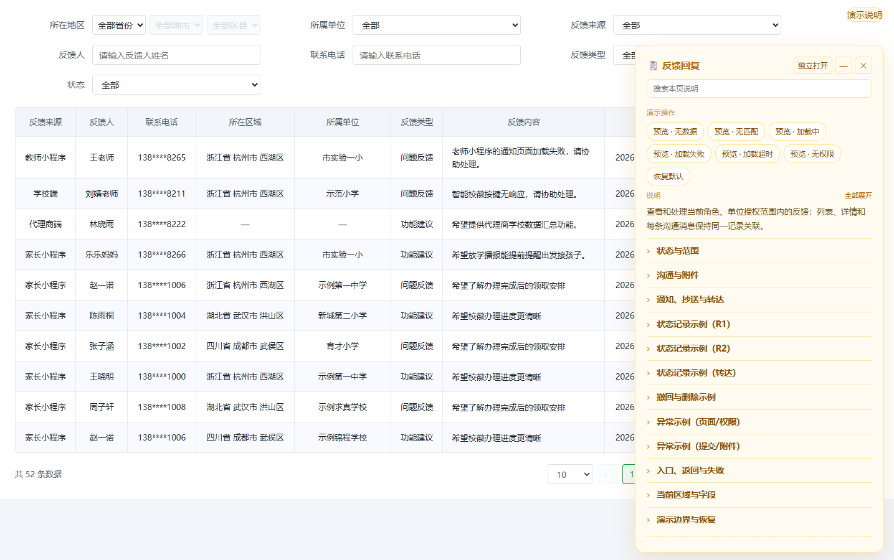
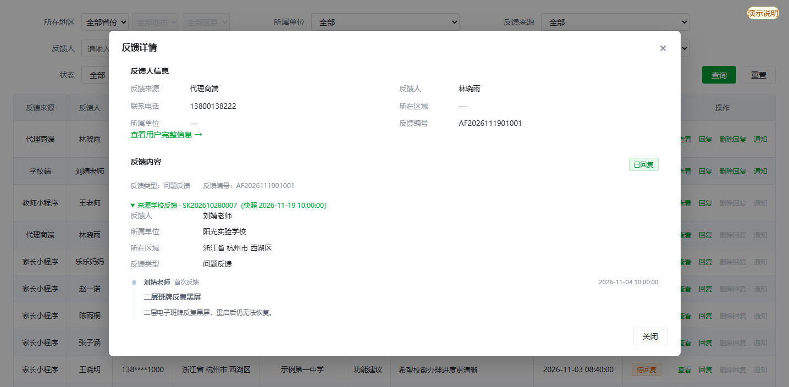
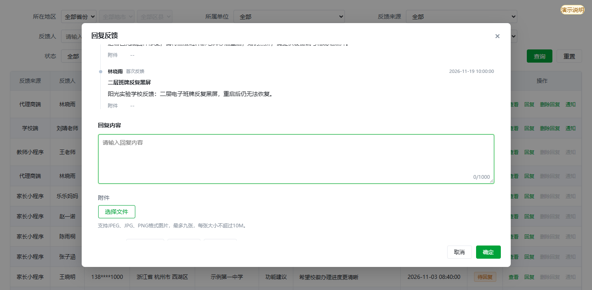
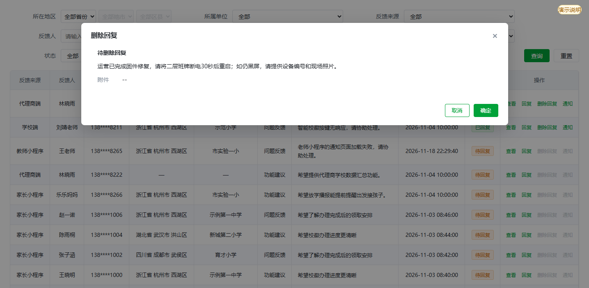
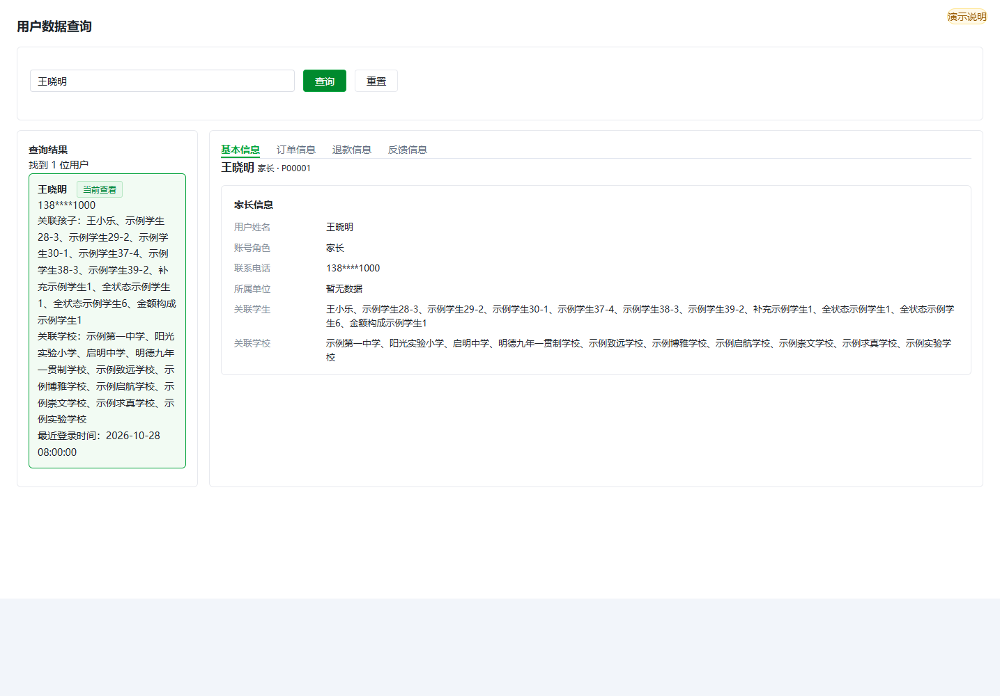
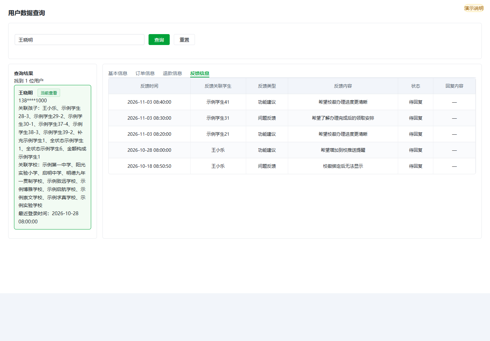

### 运营后台客户反馈产品需求文档

产品版本：客户反馈 Web 第一期
文档编号：PRD-FB-OPS-20261118
文档版本：v1.12（第一期，修改中，待评审）
文档状态：第一期修改中，未定版
适用端：运营后台

本文件仅说明运营端。R1 指学校、教师或家长提交给代理商的原始记录；R2 指代理商每次抄送运营后创建的新记录。运营只在 R2 中处理并回复代理商，不直接回复学校、教师或家长。R1 与每条 R2 有来源关联，但各自编号、消息、状态、日志及附件抄送时保存的来源内容独立。

#### 1. 需求背景与目标

##### 1.1 背景

代理商可把一个 R1 多次抄送给运营；每次抄送都形成新的 R2。运营需要从 R2 看见抄送时冻结的 R1 来源会话与代理商补充内容，并只向代理商回复。运营回复后，代理商再决定是否转达给 R1 的原反馈人。运营回复本身不得被误认作对外答复。

##### 1.2 目标

- 清晰区分运营正在处理的 R2 与其来源 R1；每个 R2 独立计算状态。
- 保留抄送时来源会话、来源消息、附件、人员及时间的抄送时保存的来源内容，后续 R1 普通消息不回写旧 R2。
- 回复支持图片附件；删除/撤回用二次确认，不填写原因，保留消息、附件、状态标记和日志。
- 反馈列表筛选、表格、分页和操作列遵循运营后台合同管理页的既有展示规范。
- 从反馈进入用户资料与直接查询进入用户资料，使用同一页面框架及相同角色资料结构。

##### 1.3 约束与边界

本文是第一期需求稿和原型评审说明，不代表真实业务数据已接入。运营端不持有 R1 的对外回复权。所有已提交反馈、回复、抄送和转达均不可修改；编辑器只用于创建一条新消息。未确认的接收人和通知渠道细节列为待补充内容，本稿不预设。

#### 2. 一期范围

##### 2.1 范围清单

| 端 / 角色 | 页面 / 对象 | 本版本需求 | 必要联动 | 不在范围 |
|---|---|---|---|---|
| 运营处理人员 | 反馈回复列表 | 查询、重置、分页、查看 R2、打开回复/删除/通知/日志 | R2状态与授权范围 | 直接回复 R1 |
| 运营处理人员 | R2详情与时间线 | 查看抄送时保存的来源内容、双方消息、附件及删除/撤回标记 | R2及其关联的R1编号 | 将R1后续消息并入旧抄送时保存的来源内容 |
| 运营处理人员 | 回复R2 | 新增不可变运营回复；正文可选附件 | 仅改变R2沟通状态 | 修改既有回复 |
| 运营处理人员 | 删除/通知/日志 | 对本组织有效回复删除；独立发起通知；追溯操作 | 软删除、通知尝试记录 | 送达状态、回执追踪 |
| 运营查询人员 | 用户数据查询 | 直接检索与条件跳转；资料、订单、退款、反馈四页签 | 反馈关联学生 | 修改用户资料 |

##### 2.2 版本变化

| 变更ID | 变化内容 | 决策来源 | 状态 |
|---|---|---|---|
| CHG-OPS-01 | 每次抄送都新建R2；R2只复制R1来源会话抄送时保存的来源内容，不带入其他R2内容 | 用户 Q31、Q56 | 已确认 |
| CHG-OPS-02 | 运营仅回复R2；R1与R2的状态分开计算 | 用户多轮确认 | 已确认 |
| CHG-OPS-03 | 运营回复增加可选附件，随消息保存并可预览 | 用户指出回复页面缺附件 | 已确认 |
| CHG-OPS-04 | 全局取消已提交消息修改入口；删除/撤回不收集原因，使用二次确认与状态标记 | 用户明确要求 | 已确认 |
| CHG-OPS-05 | 删除回复后，状态按当前仍有效的处理方回复重算；已有学校副本不撤回 | 用户 Q8、Q9、Q10 | 已确认 |
| CHG-OPS-06 | 用户资料反馈页签使用“反馈关联学生”；所有角色资料页签结构一致 | 用户浏览器批注 | 已确认 |
| CHG-OPS-07 | PRD增加逐动作再次检查、失败恢复及状态样例 | 用户要求详细核查 | 已确认 |

##### 2.3 页面与流程清单

| 需求ID | 页面 / 弹窗 | 主要动作 | 入口 | 验收 |
|---|---|---|---|---|
| OPS-FB-01 | 客户反馈列表 | 查询、重置、分页、打开R2 | 用户反馈 / 反馈回复 | AT-OPS-01—04 |
| OPS-FB-02 | R2详情 | 查看抄送时保存的来源内容和完整R2时间线 | 列表查看 | AT-OPS-05—07 |
| OPS-FB-03 | 回复R2 | 输入正文、附件，创建运营回复 | R2操作列/时间线 | AT-OPS-08—13 |
| OPS-FB-04 | 删除运营回复 | 选择本组织消息并二次确认 | R2时间线 | AT-OPS-14—17 |
| OPS-FB-05 | 通知及操作日志 | 发起通知；查看操作记录 | 回复操作/日志入口 | AT-OPS-18—21 |
| OPS-UD-01 | 用户数据查询 | 直接搜索或条件跳转后查看四页签 | 用户反馈 / 用户数据查询 | AT-OPS-22—26 |

#### 3. 业务名词、数据来源与基础规则

##### 3.1 业务对象与关系

| 对象 | 标识 | 运营端读取或保存内容 | 生命周期及关联 |
|---|---|---|---|
| R1来源记录 | 学校/教师/家长反馈编号 | 只读抄送时保存的来源内容；可能有多条相关R2 | 来源端创建；普通新消息不回写既有R2抄送时保存的来源内容 |
| R2运营处理记录 | 每次抄送生成的独立记录编号 | 运营查询、回复、删除回复、通知、日志 | 通过来源反馈编号关联一个R1；各R2互相独立 |
| 运营回复消息 | 消息编号 | 正文、图片附件、作者、时间、来源记录编号、状态标记 | 仅归属一条R2；提交后不可编辑 |
| 转达副本 | 学校/反馈人侧的新消息 | 关联的运营回复编号及当次实际转达的附件 | 代理商选择并转达后形成；运营删除源消息不删除已发副本 |
| 操作日志 | 操作记录编号 | 操作时间、操作人、操作内容及相关反馈/消息编号 | 追加保留；不随消息删除或撤回而删除 |

R2抄送时保存的来源内容含创建时R1的首条反馈、截至抄送时已存在的R1沟通消息及对应附件，以及代理商当次抄送内容和附件。它不复制先前R2中的运营回复，也不把不同R2的处理过程合并。每条R2必须保留自己的来源R1编号、来源副本生成时间和独立状态。

##### 3.2 角色、权限与数据范围

| 角色 / 对象 | 可见与可执行范围 | 不可执行事项 | 点击确定时再检查 |
|---|---|---|---|
| 运营处理人员 | 权限范围内查看R2、抄送时保存的来源内容；回复R2；删除本组织发出的有效回复；通知；看日志 | 直接回复R1；编辑已提交内容；对代理商或学校消息执行运营删除 | 当前账号登录状态、功能权限、R2类型、记录与消息归属、来源状态及消息是否仍有效 |
| 运营查询人员 | 权限范围内查看用户数据与反馈关联资料 | 改用户、反馈、订单、退款数据 | 查询权限和每条资料的授权范围 |
| 来源R1 | 只读展示 | 不在运营端编辑或直接答复 | R2与来源反馈编号关系有效 |
| 已撤回来源 | 只读查看既有时间线 | 新增运营回复、发起新通知 | 来源撤回状态必须由提交端再次检查 |

不按原始提交人身份限制同一授权组织内的操作，也不以已读状态改变删除或撤回按钮资格。运营不得仅凭界面隐藏绕过系统对象与权限再次检查。

##### 3.3 状态与流转

| 对象状态 | 判定 | 运营端行为 |
|---|---|---|
| R2待回复 | 当前往来中最后一条有效消息来自代理商 | 显示待回复；有权限时可回复 |
| R2已回复 | 当前往来中最后一条有效消息来自运营 | 显示已回复；有新代理商消息后重新变为待回复 |
| R2已撤回 | 该R2本身被代理商撤回 | 只读；保留来源和既有消息 |
| R2来源已撤回 | R1整条反馈已撤回 | 只读；不允许新回复或新通知。R2是否在列表/标题另显示“来源已撤回”标记待确认（Q80） |
| 回复已删除 | 该回复为软删除 | 时间线仍显示原文、附件、作者和时间并标“已删除”；不作为有效回复计算 |
| 转达后来源回复已删除 | R2的运营回复曾被代理商转达，之后运营删除该回复 | 学校/原反馈人已收到的副本保留，并标明来源回复已删除 |

记录状态只看当前记录里最后一条有效消息的方向。R2回复不会使R1显示已回复；只有代理商在R1追加回复/转达，才影响学校/反馈人侧记录。删除任意一条回复后，按剩余有效消息重新判断：最后一条有效消息来自运营则R2显示已回复，来自代理商则显示待回复。若删除后仍有较早的运营回复，但之后存在代理商消息，仍显示待回复。撤回R1会使所有关联R2追加来源撤回系统事件并转只读，但不抹去任何既有内容。

##### 3.4 跨端与通用规则

- R2详情中的来源区只读；来源R1普通新消息不会自动出现在已有R2。新R2会按当时R1最新状态重新取抄送时保存的来源内容。
- 运营只回复代理商。运营回复不得直接通知或呈现为已交付给原反馈人；代理商的转达是另一条新消息。
- 运营回复支持可选图片，格式JPEG/JPG/PNG，最多9张，每张不超过10MB。加载、校验和上传中的状态必须可区分；文件上传失败不得造成只有正文成功的半条消息。
- 回复、通知、删除、撤回、日志是分开的操作。发起通知不等于确认送达，不改变回复状态。
- 所有提交后的正文和附件不可修改。更正只能新建消息；软删除仅增加状态与日志，不覆盖原文。
- 对话框取消、关闭、刷新或浏览器前进/后退均不得自动提交。页面恢复可恢复查看上下文，不恢复或重放破坏性提交。

#### 4. 原型、视觉与来源

##### 4.1 本期需求来源

| 来源 | 本文使用方式 | 状态 |
|---|---|---|
| 用户对运营后台反馈回复、回复附件、删除、通知、日志及用户数据查询的明确要求 | 作为本端业务规则依据；与代理商Web、学校Web分别成册 | 已确认 |
| 本任务代理商端、学校端和运营后台既有PRD及修正记录 | 只继承未被新确认推翻的字段、范围与页面细节；历史冲突按本版规则处理 | 已核对 |
| 运营后台 GitHub 候选 v0.67 | 核对反馈回复页面及用户数据查询页的当前展示 | 修改中、未定版 |

##### 4.2 页面展示原则

反馈列表和弹窗沿用运营后台已有页面结构。字段、操作和消息按本端角色显示；运营回复只属于代理商抄送生成的运营处理记录（R2），不直接回复学校、教师或家长的来源记录（R1）。不同角色的资料和无数据状态按第6节说明，不能因为来源不同而改变其他菜单结构。

##### 4.3 成熟服务台公开做法与本项目建议

公开资料核对日期：2026-11-19（UTC）。Zendesk的帮助说明区分请求人可见的公开回复与仅处理人员可见的内部备注，并展示工单更新及通知记录。[添加工单评论](https://support.zendesk.com/hc/en-us/articles/4408828489370-Adding-comments-to-tickets)、[查看工单更新事件](https://support.zendesk.com/hc/en-us/articles/4408829602970-Viewing-all-events-for-ticket-updates)。Jira官方帮助说明可为事项建立关联关系。[关联工作项](https://support.atlassian.com/jira-software-cloud/docs/link-issues/)。以上是公开产品说明的归纳，不表示这些产品采用本项目的R1/R2、删除或撤回规则。用户所说“GRM客服系统”尚未能唯一对应到具体产品，不能把上述任一产品说成指定的GRM。

本项目建议继续明确消息面向谁、哪个角色能看、来源记录如何关联，并保留删除/撤回标记与操作记录。这样可减少把内部回复误当作已经回复学校的情况；取舍是同一条反馈可能需要查看来源记录及运营处理记录两个页面。

##### 4.4 当前候选核对情况

| 页面 | 已核对内容 | 尚待核对 |
|---|---|---|
| 反馈回复列表 | v0.67从干净浏览器打开成功，列表、筛选、分页和“演示说明”可见 | 候选包含直达来源反馈及运营回复按钮，与“代理商抄送后只回复R2”的范围关系待确认（Q82） |
| R2详情、回复与删除 | 通过代理商抄送流程生成R2后，可查看来源快照、运营时间线、回复附件和删除二次确认；删除不收集原因 | 多轮删除、来源撤回只读、并发变化等组合仍按第8节逐项验收 |
| 用户数据查询 | 当前候选截图显示基础信息、订单信息、退款信息、反馈信息四个页签；反馈信息含“反馈关联学生” | 直接搜索与条件跳转、无数据、单页签失败和返回原列表仍需逐项核对 |

截图来自当前候选的实际浏览器页面。页面截图不代表全部异常操作或真实资料均已验收。

#### 5. 一期页面与功能清单

|需求编号|页面/弹窗|本端业务内容|
|---|---|---|
|OPS-FB-01|运营后台反馈回复列表|字段、按钮、校验、异常及结果见第6节。|
|OPS-FB-02|R2详情与来源时间线|字段、按钮、校验、异常及结果见第6节。|
|OPS-FB-03|回复R2及图片附件|字段、按钮、校验、异常及结果见第6节。|
|OPS-FB-04 / OPS-FB-05|删除回复、通知与日志|字段、按钮、校验、异常及结果见第6节。|
|OPS-UD-01|用户数据查询|字段、按钮、校验、异常及结果见第6节。|

#### 6. 功能详细说明
##### 6.2 运营后台反馈回复列表（OPS-FB-01）

原型入口：[运营后台反馈回复列表候选](https://raw.githack.com/guozi0718/codex-projects/main/%E8%BF%90%E8%90%A5%E5%90%8E%E5%8F%B0/versions/v0.67/index.html?page=feedback.replies&content=1)

###### 6.2.1 页面信息

- 使用菜单用户反馈 / 反馈回复，列表由菜单中的“用户反馈 / 反馈回复”入口打开。
- 列表只放运营可处理的R2及其可见来源摘要。运营不能通过列表直接回复普通R1。
- 查询、重置、表格、分页、斑马纹、按钮间距和操作列宽遵循运营后台合同管理页面。操作列必须容纳查看、回复、删除回复、通知、日志；按钮不得被挤压、截断或被滚动条覆盖。
- 加载时显示独立加载态；成功无数据、筛选无匹配、读取失败和无权限分别呈现，禁止用旧上一次显示的数据伪装新查询结果。

###### 6.2.2 查询条件

| 顺序 | 条件 | 控件与匹配 | 默认与重置 | 生效与异常 |
|---|---|---|---|---|
| 1 | 所在地区 | 省、市、区县级联；运营范围内全部地区 | 默认全部；重置恢复全部 | 查询按钮提交后生效；上级变化清空下级 |
| 2 | 所属单位 | 单位下拉；限定当前可见组织 | 默认全部 | 无单位数据时保留空态，不虚构单位 |
| 3 | 反馈来源 | 学校、教师、家长、代理商来源 | 默认全部 | 与其他条件所有条件同时满足 |
| 4 | 反馈人 | 文本输入；按当前支持的反馈人检索条件匹配 | 空 | 保留输入值至查询/重置 |
| 5 | 联系电话 | 文本输入；查询使用权限范围内数据 | 空 | 页面不在地址栏链接中放完整电话 |
| 6 | 反馈类型 | 全部、功能建议、问题反馈及已登记选项 | 默认全部 | 未知枚举显示安全值并保留记录 |
| 7 | 状态 | 全部、待回复、已回复、已撤回 | 默认全部 | “来源已撤回”是否作为独立标记展示待确认（Q80）；不预设为R2自身状态 |

查询逻辑：多个筛选条件所有条件同时满足；单个多选范围内选中范围中任一项匹配。查询成功跳转到第1页；切换分页只改变页码；重置清空文本并恢复默认值后重新查询。失败时保留筛选值和原页上下文，但明确标记旧结果不是本次查询。

###### 6.2.3 列表字段

| 字段 | 取值 | 展示规则 |
|---|---|---|
| 反馈来源 | R2来源角色 | 学校、教师、家长或代理商 |
| 反馈人 / 联系电话 | R2业务关联的操作者或提交者资料 | 联系电话按既有权限脱敏显示 |
| 所在区域 / 所属单位 | 来源当时记录的内容或R2记录的可见属性 | 无资料显示“—”，不从当前用户资料反推覆盖历史当时记录的内容 |
| 反馈关联学生 | 反馈时的学生关联当时记录的内容 | 家长来源显示反馈发生时登录家长对应孩子；教师、代理商、学校来源显示“—” |
| 反馈类型 / 内容 / 时间 | R2消息和来源摘要 | 摘要截断可查看全文；时间按登记业务时间显示 |
| 状态 | R2独立状态 | 不从R1状态代算；显示待回复、已回复或已撤回。列表/标题是否另加“来源已撤回”标记待确认（Q80） |
| 操作 | 权限与状态决定 | 按页面权限显示按钮；无资格按钮置灰并可查看原因 |

分页总数表示当前授权范围及筛选条件下的记录数。排序默认按最近更新时间由近到远；更新时间相同时按记录编号由新到旧，方便用户稳定查找。

###### 6.2.4 ACT-OPS-01 查询、重置与分页

1. 执行资格：用户拥有反馈查询权限。
2. 开始操作：页面读取授权范围与当前查询值；加载失败时保留页面并显示重试入口。
3. 填写时检查：级联条件合法；不将手机号或正文拼入地址栏链接。
4. 提交复验：系统重新检查身份、菜单权限及数据范围。
5. 同时操作与重复：查询可安全重复；翻页时以最新筛选条件为准。
6. 成功：替换列表结果并更新总数与页码。
7. 失败：保留条件；显示查询失败和重试，不冒充成功空态。
8. 取消与返回：恢复调用前列表上下文；不产生保存。
9. 验收：AT-OPS-01—04。

###### 6.2.5 ERR-OPS-01—04 列表异常

| 编号 | 场景 | 展示和操作 | 数据副作用 | 恢复 |
|---|---|---|---|---|
| ERR-OPS-01 | 成功但零条 | 显示“暂无数据”或“未找到匹配记录”并区分是否有筛选 | 无 | 修改条件或重置 |
| ERR-OPS-02 | 查询失败 | 显示“查询失败，请重试”；条件保留 | 无；旧结果显式标旧 | 重试 |
| ERR-OPS-03 | 登录权限失效 | 停止展示受限列表，提示重新登录/无权限 | 无 | 重新鉴权，不清理用户其它导航 |
| ERR-OPS-04 | 页码超出总页数 | 以系统当前总数校正到有效页并说明列表已更新 | 无 | 刷新当前条件 |

##### 6.3 R2详情与来源时间线（OPS-FB-02）

原型入口：[运营后台R2反馈详情候选](https://raw.githack.com/guozi0718/codex-projects/main/%E8%BF%90%E8%90%A5%E5%90%8E%E5%8F%B0/versions/v0.67/index.html?page=feedback.replies&content=1)

###### 6.3.1 展示与返回

- 页首展示反馈人信息、R2编号、来源角色、状态与R2更新时间。
- 来源块标明“来源R1”及R1编号、来源内容保存时间、原反馈人/学校/地区/类型，并按抄送当时记录的内容展示截至该时点的R1消息和附件。
- R2时间线按时间逆序展示，消息包含作者、角色、类型、时间、正文、附件及状态标记。运营消息只属于此R2；不得混入另一个R2的消息。
- 撤回或删除后的消息仍显示原文、原附件、作者和时间，并在消息上标“已删除”或“已撤回”。R1整条撤回时追加“来源已撤回”系统事件。
- 关闭/返回回到原列表筛选条件、页码、滚动位置和排序；无效R2编号提示无效记录，不跳到其他R2。

###### 6.3.2 ACT-OPS-02 查看R2

打开时重新读取R2、来源反馈编号、来源内容保存时间、消息、附件及当前权限。若来源当时记录的内容不完整，明确显示缺失数据并保留其余已读内容；不得用当前R1资料静默补写历史。详情查询失败时不显示空时间线。刷新只重读详情，不重放回复、删除或通知操作。

###### 6.3.3 ERR-OPS-05—07 详情异常

| 编号 | 场景 | 提示/状态 | 是否保存 | 恢复 |
|---|---|---|---|---|
| ERR-OPS-05 | R2不存在或编号与对象不匹配 | “该反馈记录不存在或已不可访问” | 否 | 返回列表并保留筛选 |
| ERR-OPS-06 | R2关联的来源编号缺失或来源内容无法读取 | 展示R2中可确认的内容，来源区标“来源资料暂不可用” | 否 | 保留现有信息，不使用当前R1资料补写历史；请运营人员核对来源 |
| ERR-OPS-07 | 附件不可加载 | 保留附件名称和错误标记；提示“附件加载失败” | 否 | 单附件重试；不影响正文 |

##### 6.4 回复R2及图片附件（OPS-FB-03）

原型入口：[运营后台回复R2候选](https://raw.githack.com/guozi0718/codex-projects/main/%E8%BF%90%E8%90%A5%E5%90%8E%E5%8F%B0/versions/v0.67/index.html?page=feedback.replies&content=1)

###### 6.4.1 表单字段

| 顺序 | 字段 | 必填与规则 | 校验、计数和失败恢复 |
|---|---|---|---|
| 1 | 回复内容 | 必填；去首尾空白后1–1000字；占位“请输入回复内容” | 实时显示已输/1000；达到上限禁止继续输入，不截断已输入字符 |
| 2 | 附件 | 非必填；JPEG/JPG/PNG；最多9张，每张≤10MB | 选择后显示缩略图、移除入口和上传状态；失败项明确标识 |
| 3 | 快捷回复 | 非字段、仅供快速填文案 | 点击只填入当前草稿，不自动发送，不重置附件 |

###### 6.4.2 ACT-OPS-03 提交回复

1. 执行资格：当前用户具备R2回复权限；R2未撤回、来源R1未整条撤回，且此R2当前等待运营回复。
2. 开始操作：读取当前R2编号、来源关联、R2当前状态、时间线、权限和附件引用。
3. 填写时检查：正文非空且不超过1000字；附件格式、数量、大小和读取状态有效。字段错误就地显示并保留内容。
4. 点击确定时再检查：重新验证当前账号和权限、R2仍存在且仍可写、来源R1未撤回、R2仍可回复且状态未改变、附件未失效。
5. 重复/同时操作：确认按钮提交中禁用；同一提交重试不得重复生成回复。如他人已先回复，提示记录已更新，不覆盖对方消息。
6. 一次完成保存；任一项失败则一条都不生成：正文、附件引用/当时记录的内容、作者、时间、R2消息和日志整体成功；任何一项失败不得只写部分消息。
7. 成功结果：新增一条运营回复；R2按当前轮次重算；不改变R1状态、不直接通知原反馈人。
8. 明确失败：说明具体字段、权限或附件问题，保留正文和附件清单；用户可复制或修正后重试。
9. 结果暂时无法确认：先查看时间线确认是否已生成消息；确认之前是否已成功，避免重复添加内容。关闭弹窗不撤销已成功的消息。
10. 取消：未提交时取消/关闭返回R2详情；若弹窗有内容，按当前原型确认离开并说明选择结果。
11. 验收：AT-OPS-08—13。

###### 6.4.3 ERR-OPS-08—13 回复异常

| 编号 | 触发 | 提示 | 保存结果与保留 | 安全恢复 |
|---|---|---|---|---|
| ERR-OPS-08 | 空白/超过1000字 | 对应输入框下显示原因 | 不保存；正文保留 | 修正后重试 |
| ERR-OPS-09 | 文件类型、数量或大小超限 | 标出失败文件和上限 | 整条消息不提交；其它附件及正文保留 | 移除失败文件再选 |
| ERR-OPS-10 | 文件读取/上传失败 | “附件上传失败，请重新选择” | 不产生正文孤儿消息；草稿文字保留 | 重新选择失败文件 |
| ERR-OPS-11 | 来源R1刚被整条撤回 | 禁止提交，显示来源已撤回 | 不保存 | 只读查看；复制草稿后退出 |
| ERR-OPS-12 | R2在打开表单后被其他人回复、删除或改变状态 | 说明记录已更新 | 不覆盖同时操作数据；草稿保留 | 刷新时间线后由用户决定重新发 |
| ERR-OPS-13 | 网络超时、提交结果不明 | 提示正在核实或结果待确认 | 不自动第二次保存 | 先查看时间线确认结果后再决定 |

##### 6.5 删除运营回复、通知与日志（OPS-FB-04 / OPS-FB-05）

原型入口：[运营后台反馈回复候选](https://raw.githack.com/guozi0718/codex-projects/main/%E8%BF%90%E8%90%A5%E5%90%8E%E5%8F%B0/versions/v0.67/index.html?page=feedback.replies&content=1)

###### 6.5.1 ACT-OPS-04 删除回复

运营可删除本端/本组织发出的任意一条当前有效回复，不限制为“最近一条”；不能删除代理商、学校、教师或家长发出的消息。删除按钮使用带边框样式，清楚可见。点击删除后先展示目标回复及附件，再进行二次确认。确认弹窗不要求填写原因。取消或关闭不改变数据。

确认提交前重新检查当前操作人权限、R2与目标消息、消息归属、消息仍未删除/撤回以及R2和来源状态。R1撤回后是否还允许删除R2里已有的运营回复待确认。成功时保留原文、附件、作者、时间并标“已删除”和追加日志；所有当前有效运营回复都被删除后，R2重新显示待回复。运营回复已转达的学校副本继续显示，标注“来源回复已删除”。通知历史不会被抹除。

###### 6.5.2 ACT-OPS-05 发起通知

- 通知是独立操作，只对有效、未删除、未撤回的运营回复执行。R2已撤回或来源R1已撤回时不能新发通知。
- 通知对象为该R2对应的代理商人员或组织；具体接收对象名称和通知渠道按项目资料补充。
- 每次用户确认都记录一条独立通知操作，包括操作时间、操作人、接收对象和渠道；不记录送达状态，也不以送达与否改变回复或记录状态。
- 没有手机号或小程序授权信息不阻止回复或转达。发起通知时仍尝试使用原渠道；页面只展示通知操作，不显示送达结果，也不得把发起失败显示成“已送达”。通知未能发起时是否另记失败操作，待确认（Q81）。
- 删除/撤回某回复后该回复不能新发通知；此前通知记录保留。

###### 6.5.3 ACT-OPS-06 查看日志

日志列为操作时间、操作人、操作内容。时间与人员列保持紧凑，操作内容列宽以显示消息摘要为先。新增首条抄送、运营回复、删除、撤回、通知尝试等操作均有记录；操作内容应能区分回复、追问、撤回和删除，并在合适权限下展示必要消息摘要。日志不因消息删除/撤回而删改。日志读取失败单独提示，不阻止用户关闭详情。

###### 6.5.4 ERR-OPS-14—19 删除/通知异常

| 编号 | 场景 | 结果 | 输入与历史 | 恢复 |
|---|---|---|---|---|
| ERR-OPS-14 | 取消删除确认 | 不执行删除；关闭二次确认 | 原消息、附件和状态不变 | 留在详情 |
| ERR-OPS-15 | 删除确认期间回复已被删除/状态已变 | 提示目标消息已更新 | 不重复标记，不移除当时记录的内容 | 刷新时间线 |
| ERR-OPS-16 | 删除权限或归属不符 | 明确提示无权删除此消息 | 无保存 | 只读查看 |
| ERR-OPS-17 | 通知未能发起 | 提示“通知未能发起，请稍后重试”，不显示为已送达 | 不改变回复；是否另记失败操作待确认（Q81） | 如有失败记录，重试前查看操作记录 |
| ERR-OPS-18 | 已有通知后再次确认 | 每次是独立尝试 | 逐次记录；无送达字段 | 允许重复发起 |
| ERR-OPS-19 | 来源撤回后尝试通知 | 拒绝新通知 | 旧通知记录保留 | 仅查看既有时间线 |

##### 6.6 用户数据查询（OPS-UD-01）

原型入口：[运营后台用户数据查询候选](https://raw.githack.com/guozi0718/codex-projects/main/%E8%BF%90%E8%90%A5%E5%90%8E%E5%8F%B0/versions/v0.67/index.html?page=feedback.user-data&content=1)

本图来自运营后台当前候选用户数据查询页面的真实截图，展示查询区、四个信息页签及家长基础信息。截图只证明页面可展示；两种进入方式、其他角色资料、空数据与单页签失败状态仍按验收项逐项核对。

###### 6.6.1 页面与资料结构

- 入口A：用户相关记录中的“查看用户完整信息”按钮，带必要查询条件进入用户数据查询。
- 入口B：运营人员直接打开用户数据查询菜单并按页面既有样式搜索。
- 两个入口进入同一页面框架：基础信息、订单信息、退款信息、反馈信息四个页签；入口方式不能造成页签、布局、资料范围或空态不同。
- 基础信息为角色化资料框架。家长、教师、代理商、学校分别显示该角色适用信息块；缺资料显示“暂无数据”，不得因角色不同删掉其它页签。
- 订单、退款、反馈页签无记录时显示“暂无数据”；查询中、无匹配、查询失败分别展示不同状态。
- 反馈页签列表在联系电话后增加“反馈关联学生”。家长反馈按提交当时登录家长对应孩子保存并显示；教师、代理商、学校反馈显示“—”。展示历史时不按孩子当前在读状态或绑定关系改写当时关联对象。
- 从反馈列表条件跳转时保留必要上下文以便返回原筛选、页码；地址栏链接不得包含手机号或反馈正文。

###### 6.6.2 ACT-OPS-07 直接搜索与条件跳转

1. 执行资格：有用户数据查询权限。
2. 开始操作：直接搜索进入空查询态；从反馈按钮进入时复用同一页面并载入已知条件。
3. 填写时检查：按页面已有的姓名、手机号条件查询；不额外增加未确认的搜索项。输入不符合页面规则时就地提示并保留内容。
4. 提交复验：系统确认用户身份、查询条件、数据范围和反馈关联权限。
5. 重复/同时操作：重复搜索安全；从另一用户切换时先清空前一个用户各页签上一次显示的数据，防止串数据。
6. 成功：基础信息和页签分别加载；单个页签失败不得用其他用户的旧数据替代。
7. 失败：显示准确失败态，保留查询值；需要登录或无权限时停止暴露资料。
8. 返回：从反馈详情入口返回原列表上下文；直接搜索返回用户数据查询页。
9. 验收：AT-OPS-22—26。

###### 6.6.3 ERR-OPS-20—24 用户数据异常

| 编号 | 场景 | 呈现 | 数据安全与恢复 |
|---|---|---|---|
| ERR-OPS-20 | 搜索字段为空或不合法 | 表单提示，不发起查询 | 保留查询值，修正后重试 |
| ERR-OPS-21 | 用户不存在 | 结果区显示“未找到用户” | 不显示上一个用户资料 |
| ERR-OPS-22 | 用户存在但某页签无记录 | 对应页签显示“暂无数据” | 其它页签仍可用 |
| ERR-OPS-23 | 一个页签读取失败 | 只在该页签显示读取失败与重试 | 其它已成功页签保留；不复制旧用户数据 |
| ERR-OPS-24 | 从家长按钮进入时缺关联学生值 | 反馈关联学生显示“—”，保留其它记录 | 不以当前孩子替代历史数据；记录为待数据核查 |

#### 7. 数据、权限与跨端一致性要求

##### 7.1 用户看到的记录内容

| 记录 | 页面展示内容 | 规则 |
|---|---|---|
| 原反馈记录（R1） | 学校、教师或家长的原文、附件、作者、反馈时间及后续沟通 | 运营只读取抄送时的来源内容，不直接回复这条原记录 |
| 运营抄送记录（R2） | 独立编号、抄送时间、抄送时来源内容、代理商补充内容、运营与代理商往来 | 每次抄送都形成一条新记录；不把其他R2的回复并进来 |
| 运营回复 | 回复正文、附件、回复人、回复时间及已删除/已撤回标记 | 回复只属于当前R2；提交后不能修改 |
| 通知操作 | 操作人、操作时间、接收对象和通知方式 | 记录已发起的操作，不记录或展示送达结果 |

##### 7.2 状态变化样例

| 场景 | R2状态 | 原R1及反馈人看到的内容 |
|---|---|---|
| 代理商首次抄送运营 | 待回复 | R1不变；学校/教师/家长看不到运营抄送内容 |
| 运营回复代理商 | 按当前轮次等待方判断 | R1不变；学校/教师/家长尚未收到运营答复 |
| 代理商把运营回复转达 | R2按自己的往来状态计算 | 原R1新增一条代理商消息；学校/教师/家长看到的是代理商发送的消息 |
| R2唯一一条有效运营回复被删除 | 待回复，并在时间线上标“已删除” | 任何已转达的学校副本保留，标出“来源回复已删除” |
| R2多条运营回复中删除一条 | 按最后一条有效消息方向重新判定；时间线上保留被删消息 | 已收到的副本不被删除 |
| 原R1整条撤回 | R2只读；是否另显示“来源已撤回”标记待确认（Q80） | 原R1及R2所有既有内容继续展示；不得新增回复或通知 |
| 删除或撤回后查看操作记录 | 不改变R2状态判定规则 | 既有日志仍在，显示操作人、时间和内容 |

##### 7.3 删除、撤回和通知的留存

删除回复或撤回记录只改变该条内容的状态。原文、附件、作者、时间与来源关系仍留在时间线上，并出现“已删除”“已撤回”或“来源已撤回”。操作不要求填写原因，只需用户再次确认。每次确认通知对应一条独立发送操作记录；不显示“已送达”。

##### 7.4 运营端与来源记录的关联变化

| 事件 | 运营端呈现与处理 |
|---|---|
| 代理商首次或再次抄送R1 | 每次新增一条独立R2；显示本次抄送时保存的来源内容、附件、代理商说明和R1编号 |
| R1在抄送后新增普通消息 | 已有R2继续显示抄送时保存的内容，不自动增加新消息；新抄送生成另一条R2时再显示最新来源内容 |
| 运营回复R2 | 回复只进入当前R2，代理商可查看；运营回复不会直接出现在R1学校时间线 |
| 代理商转达运营回复 | R2原记录不改变；转达是另一个来源消息，学校收到后才会在R1看到代理商的新消息 |
| 学校整条撤回R1 | 每条关联R2增加来源撤回事件并只读；既有内容保留，不能再回复或通知 |
| 运营删除自己的回复 | 原回复保留并标“已删除”；已经转达给学校的内容仍显示，并标注来源回复已删除 |
| 用户切换到另一名用户查询 | 清除前一名用户已显示的资料后再展示新结果，避免资料串在一起 |

关闭页面或浏览器前进/后退不会提交任何操作。重新打开R2时仍显示该R2独有的状态和消息，不把另一条R2内容带入。
##### 7.5 页面行为与一致性核对

- [ ] 运营只写R2，不直接回复R1。
- [ ] 每次抄送一个新R2；R2抄送时保存的来源内容不复制其它R2的运营内容。
- [ ] R1和R2独立编号、状态与时间线。
- [ ] 已提交消息不可编辑；软删除保留原文、附件、时间线和日志。
- [ ] 回复附件规则为JPEG/JPG/PNG、最多9张、每张≤10MB。
- [ ] 用户数据四页签和“反馈关联学生”规则与运营用户查询要求一致。
- [ ] 每个操作都描述点击确定时再检查、同时操作/重复、成功影响、明确失败和未知结果。
- [ ] 预览入口缺陷及未执行的交互验收没有写成通过。
- [ ] 成熟产品公开能力和本项目建议分开表述。

##### 7.6 页面返回、取消与重复操作

- 取消或关闭新增、回复、追问、抄送、转达草稿时不创建新消息；已有未提交内容时，先让用户选择继续编辑或放弃。
- 删除或撤回必须由用户在二次确认中再次确认；关闭确认框或选择取消不改变原消息。
- 点击确定后暂时没有结果时，不自动重复创建消息；提示结果尚未确认，并保留可核对的页面上下文。
- 返回列表时保留本次进入前仍有效的筛选条件和页码；打开另一条反馈时不显示上一条反馈的消息或附件。

#### 8. 需求验收标准

| AT编号 | 前提与动作 | 可观察结果 | 状态 |
|---|---|---|---|
| AT-OPS-01 | 打开反馈回复菜单 | 首屏进入反馈列表；筛选与合同管理页一致 | 设计待浏览器修复后再次检查 |
| AT-OPS-02 | 使用多条件查询/重置/分页 | 所有条件同时满足、重置恢复默认，列表数与页码一致 | 待执行 |
| AT-OPS-03 | 比较两条关联同R1的R2 | 编号、抄送时保存的来源内容与处理状态独立 | 待执行 |
| AT-OPS-04 | 调整小视口检查操作列 | 查看/回复/删除/通知/日志均完整可见或明确可访问 | 待执行 |
| AT-OPS-05 | 打开R2详情 | 显示来源反馈编号、来源内容保存时间、来源消息和附件 | 待执行 |
| AT-OPS-06 | 打开R2但R1已有后续消息 | 旧抄送时保存的来源内容不变；新R1消息不被混入 | 待执行 |
| AT-OPS-07 | R1整条撤回后打开R2 | 显示来源撤回系统事件；只读且保留既有回复 | 待执行 |
| AT-OPS-08 | 回复正文为空 | 阻止提交并保留文本 | 待执行 |
| AT-OPS-09 | 正文达到1000字 | 计数正确，阻止继续输入 | 待执行 |
| AT-OPS-10 | 上传9张有效图片 | 完整显示缩略图并可提交 | 待执行 |
| AT-OPS-11 | 上传第10张或超限文件 | 显示具体错误，不保存回复 | 待执行 |
| AT-OPS-12 | 来源在提交前撤回 | 系统再次检查拒绝，保留草稿 | 待执行 |
| AT-OPS-13 | 连接中断且暂时无法确认结果 | 不重复保存；核对原请求结果 | 待执行 |
| AT-OPS-14 | 选择任一运营回复删除并取消 | 只关闭确认；无删除标记 | 待执行 |
| AT-OPS-15 | 确认删除已转达回复 | 原消息标“已删除”；学校副本保留并标来源已删 | 待执行 |
| AT-OPS-16 | 删除最后一条有效回复 | R2按有效消息重算为待回复 | 待执行 |
| AT-OPS-17 | 删除非运营发出的消息 | 操作不出现或禁用；提交层拒绝 | 待执行 |
| AT-OPS-18 | 对回复重复点击通知 | 每次产生独立尝试记录，不显示送达结果 | 待执行 |
| AT-OPS-19 | R1撤回后尝试通知 | 阻止新增通知 | 待执行 |
| AT-OPS-20 | 查询操作日志 | 时间、人员、内容列呈现清晰；日志不可被消息删除影响 | 待执行 |
| AT-OPS-21 | 发起通知后查看记录 | 显示本次发送操作时间、操作人、接收对象与渠道；不显示送达结果 | 规则已确认，待页面验证 |
| AT-OPS-22 | 反馈页点击查看完整用户 | 进入统一四页签框架并可返回原列表 | 当前原型待核验项 |
| AT-OPS-23 | 直接进入用户查询搜索 | 与条件跳转使用同一页面和资料框架 | 当前原型待核验项 |
| AT-OPS-24 | 家长反馈存在当时孩子关联 | 反馈列表显示提交当时孩子 | 待验证 |
| AT-OPS-25 | 教师/代理商/学校反馈 | 反馈关联学生显示“—” | 待执行 |
| AT-OPS-26 | 某页签无数据或读取失败 | 显示独立空态/失败态，不串入上位用户上一次显示的数据 | 待执行 |

验收状态仅表示方案设计或当前核查结果，不代表已对生产服务执行。页面交互核对结果以第4节原型核对情况和第8节验收状态为准。

#### 9. 客户反馈编号规则

|编号|代表什么|运营端展示规则|
|---|---|---|
|R1编号|学校、老师或家长提交给代理商的原始反馈|运营只在相关R2中查看该编号及抄送时保存的来源内容，不直接回复R1。|
|R2编号|代理商每次抄送后新建的一条运营处理记录|每次抄送生成一个新R2编号；不同R2的消息、状态和操作记录分别展示。|
|消息编号|某条反馈、回复、抄送或转达|时间线中每条消息单独显示作者、时间和状态；消息编号不能代替R1或R2编号。|

编号用于识别和关联记录，不代表处理优先级或处理结果。

#### 10. 文档边界与交付说明

##### 10.1 待确认项

| Q编号 | 问题 | 影响 | 暂行边界 |
|---|---|---|---|
| Q80 | R1整条撤回后，R2已确认追加来源撤回事件并转只读；是否还要在R2列表/详情标题增加独立“来源已撤回”标记？ | R2自身处理状态与来源状态的区分 | Zendesk公开说明可查看工单更新和通知事件，但没有规定此类跨记录徽标。建议保留R2自身状态并另加来源标记；好处是两种状态一眼可辨，取舍是列表增加一枚标记。本建议待确认。 |
| Q81 | 用户确认通知后，若通知操作未能开始，是否也留一条“未能发起”记录？ | 通知记录能否帮助区分“已尝试”与“未开始” | Zendesk事件可查看工单更新及相关通知，但没有规定本项目的发起失败记录。建议记录“未能发起”及时间，不记录送达结果；好处是便于判断是否重试，取舍是日志多出失败尝试。本建议待确认。 |
| Q82 | 当前运营列表是否仍需展示直达学校/老师/家长的反馈并允许直接回复，还是本期仅处理代理商抄送生成的R2？ | 列表入口与“运营只在R2回复代理商”的已确认规则是否一致 | 当前候选同时展示直达来源记录及“回复”按钮。建议代理商模式仅显示R2；若还需直达模式，应明确区分入口和回复对象。取舍是多一个路由区分，但可避免运营回复被误认为已发给反馈人。本建议待确认。 |

来源R1中的单条追问后来撤回是否向旧R2追加事件，及“GRM客服系统”的产品识别，统一见代理商Web文档Q70、Q71，本页不重复定义。

##### 10.2 文档状态与边界

本稿为运营后台客户反馈产品需求文档 v1.12，面向第一期业务评审，目前仍在修改、未定版。已确认规则、待确认问题和成熟产品建议分开记录；建议不代表用户已确认。本文只描述运营后台页面与业务规则，学校Web、代理商Web及小程序各有独立文档，不混写其它端页面。尚未提供的人员字段、权限名称或收件渠道资料不在本文中预设。
