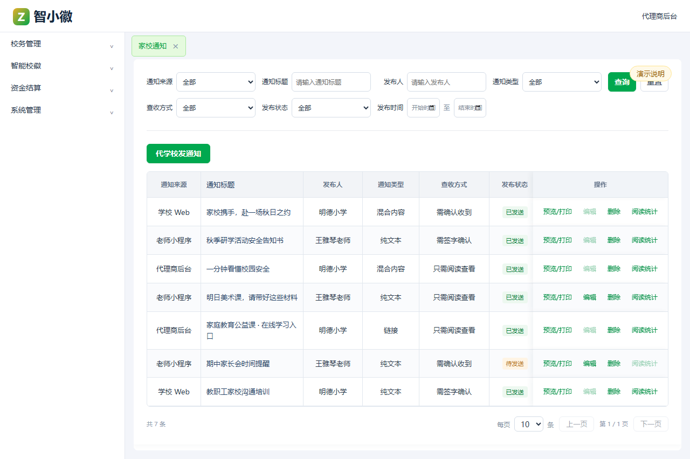

### 家校通知一期产品需求文档｜代理商 Web

需求范围：第一期新增（产品版本待定）  
文档编号：PRD-FN-20261118-AGT  
文档版本：V0.1（修改中）  
文档状态：第一期新增，修改中，未定版  
适用端：代理商 Web｜获授权代学校发布通知的代理商账号  
共通规则：见[全端共通规则](家校通知一期产品需求文档-全端共通规则.md)；版本对应及后续同步规则见[原型映射与同步规则](原型映射与同步规则.md)。

#### 1. 原型入口与来源

| 项目 | 当前值 |
|---|---|
| 当前页面 | [代理商 Web 家校通知](https://guozi0718.github.io/codex-projects/%E4%BB%A3%E7%90%86%E5%95%86%E7%AB%AF/index.html?page=family-notice) |
| 固定发布版本 | [代理商 Web v0.58](https://guozi0718.github.io/codex-projects/%E4%BB%A3%E7%90%86%E5%95%86%E7%AB%AF/versions/v0.58/index.html?page=family-notice) |
| GitHub 提交 | adeb315f7cec7fa34b383b675d734ee06cd7adc3 |
| 通知功能依赖 | 家校通知 V20；通知入口使用发布包内 notice/index.html |
| 代理商基线 | v0.57 主框架基础上发布 v0.58；家校通知路由 family-notice 由代理商基线菜单登记。 |
| 菜单 | 校务管理 → 家校通知；代理商主菜单、页签、框架由代理商 Web 项目控制。 |

本发布是静态评审原型，不代表代理商生产权限和学校目录服务已连接。已授权学校名单必须由现有代理商权限范围提供，不能由本页自行扩权。

#### 2. 页面与流程清单

| 需求编号 | 页面 | 主要信息与动作 | 验收 |
|---|---|---|---|
| AGT-01 | 家校通知列表 | 学校范围内的通知筛选、列表、查询、重置和行操作 | AT-AGT-01 |
| AGT-02 | 发布通知—选择学校 | 地区级联及学校名称筛选；确认目标学校 | AT-AGT-02 |
| AGT-03 | 发布通知—填写内容 | 标题、封面、正文、附件；预览、上一步/下一步 | AT-AGT-03 |
| AGT-04 | 发布通知—准备发布 | 对象、查收、学校名义、定时发送、可选截止；发布 | AT-AGT-04 |
| AGT-05 | 选择发布对象 | 学生与教师选择 | AT-AGT-05 |
| AGT-06 | 预览/打印、阅读统计 | 预览、PDF导出、统计子页 | AT-AGT-06 |
| AGT-07 | 编辑、删除 | 编辑资格复验；合同管理式删除确认 | AT-AGT-07 |

#### 3. 学校选择（AGT-02）

代理商代学校发布，必须先明确目标学校，再填写通知。学校选择是三步流程的第一步。

| 字段/控件 | 交互与校验 |
|---|---|
| 所在地区 | 省/市/区级联筛选；下级选项依上级地区筛选 |
| 学校名称 | 可单独输入学校名称模糊搜索；不要求先选择地区 |
| 学校结果 | 显示代理商有权限的匹配学校名称和所在地区 |
| 选择学校 | 只能选一所学校；确认后显示学校名称并启用下一步 |
| 下一步 | 未选学校时禁用；选定后进入通知内容 |

筛选为空时显示无匹配结果，不应显示授权范围外的学校。地区和名称筛选条件同时存在时取交集；名称可独立搜索。若所选学校授权在提交时失效，停止发布并保留已填写内容。

#### 4. 通知内容与发布设置

##### 4.1 第二步：填写通知内容（AGT-03）

| 字段 | 必填 | 规则 |
|---|---|---|
| 通知标题 | 是 | 单行输入，最多 50 字；不显示字数计数 |
| 封面 | 否 | 可选；不在标签显示“选填”；与标题输入内容左对齐且不换行 |
| 通知内容 | 是 | Web 普通通知，富文本编辑；支持文本、图文、视频、链接内容 |
| 附件 | 否 | PDF、Word、Excel、JPEG/JPG/PNG；最多 9 份，每份 ≤20MB |

可预览；上一步返回学校选择，下一步进入准备发布；同一向导内上一步保留已填写内容。标题等单行输入框和附件字段样式遵循共通 PRD 及用户提供的反馈表单截图；正文富文本框保持 V20 原有尺寸和工具栏。标题/正文/附件规则与共通 PRD 一致。

##### 4.2 第三步：准备发布（AGT-04）

| 字段 | 必填 | 默认/说明 |
|---|---|---|
| 发布对象 | 是 | 学生、教师两类；按钮回显已选中学生和教师人数，不重复显示控件下方人数 |
| 查收方式 | 是 | 下拉框，默认只需阅读查看；可选需确认收到、需签字确认 |
| 以学校名义通知 | 是 | 保存用户所选开关值；当前原型初始值为开启，此处仅记录原型现状 |
| 定时发送 | 是 | 关闭表示立即发送；开启后时间默认次日 09:00:00 |
| 截止时间 | 否 | 默认空；占位“请选择”；日期时间选择器 |
| 操作 | — | 上一步、发布；代理商 Web 不显示保存草稿 |

日期格式统一 YYYY-MM-DD HH:mm:ss。截止时间为空时的有效纳入/回执窗口与显式截止时间规则见共通 PRD。选择学校名义、发布对象、查收方式和发送方式均须有明确值；截止时间可不填。

#### 5. 发布对象选择（AGT-05）

| 页签 | 列表规则 | 操作 |
|---|---|---|
| 学生 | 年级/班级默认收起；展开后显示班级学生，姓名 A-Z | 选择整个年级、整个班或单个/部分学生 |
| 教师 | 按姓名 A-Z 展示 | 单选、全选；全选后所有姓名均呈选中状态 |
| 底部操作 | 取消、确定 | 确定将已选学生/教师数量回显到发布设置；取消不回填 |

通过校验的目标对象再进入提交。全班完整选择以班级对象保存，部分选择固定到已选学生；两种对象的名单变化规则见共通 PRD。

#### 6. 列表与操作（AGT-01）

列表筛选字段为通知来源、通知标题、发布人、通知类型、查收方式、发布状态、发布时间。枚举默认“全部”，文本框使用“请输入通知标题/请输入发布人”，时间筛选沿用 V20 当前占位。查询/重置按钮对齐筛选第一行和容器边界；发布通知按钮位于筛选下方靠左，不带加号。

列表至少区分目标学校及下列现有通知字段：通知标题、发布人、通知类型、查收方式、发布状态、发布时间、未读/已读/已确认/已签字人数、创建时间和操作。字段各占一列；标题左对齐，其余列居中；不增加完成率。数据列横向滚动，右侧操作列固定；预览/打印、编辑、删除、阅读统计同一行显示。

#### 7. 预览/统计/编辑/删除（AGT-06、AGT-07）

1. 预览/打印是独立页面，只展示通知内容与当前查收方式对应的阅读或回执统计，不展示发布设置。
2. PDF 仅包含预览页面；隐藏顶部栏和演示说明；按钮靠右；A4 页边距上37mm、右26mm、下35mm、左28mm。
3. 阅读统计使用子页面，学生/教师分开，每页10人；学生行不展示年级/班级；详情展示该学生各家长状态。
4. 有任一接收人已读、确认或签字，编辑按钮置灰且提交端再次拒绝；超出有效时限也不可编辑。
5. 可编辑时只允许修改通知内容、封面和学校名义；目标学校、发布对象、查收方式、发布时间、定时发送时间保持不变。保存前重核发布设置。
6. 删除操作弹窗参考运营后台合同管理；确认后记录立即消失，且不展示已删除状态。后台快照和操作信息由技术后端保存。

#### 8. 权限、异常与恢复

| 场景 | 处理要求 |
|---|---|
| 用户无可管理学校 | 禁止进入内容步骤；显示必要的无权限/无学校结果 |
| 学校模糊查询无结果 | 显示空结果，筛选条件可修改 |
| 学校权限在发布前变更 | 提交时重查权限并中止；保留可恢复内容 |
| 对象全选或确定未生效 | 视觉选中状态必须与选择集合一致；确定后人数与选择列表回显一致 |
| 已选学校发生切换 | 未经确认不丢弃内容；具体切换确认交互待定 |
| 发布失败或结果未知 | 不盲目重复创建；先核对该学校下是否已有同一通知 |
| 用户删除后刷新页面 | 被删记录不再出现在任一端列表；不出现删除状态入口 |

#### 9. 验收场景

| AT | Given | When | Then |
|---|---|---|---|
| AT-AGT-01 | 用户从代理商基线菜单进入 | 打开家校通知 | 显示代理商可见范围内的列表 |
| AT-AGT-02 | 用户拥有多校权限 | 不选地区，直接输入学校名称 | 模糊结果回显授权内学校；选择后才可继续 |
| AT-AGT-03 | 学校已选定 | 继续填写 | 页面步骤显示选择学校、填写内容、准备发布三步 |
| AT-AGT-04 | 通知必填字段有效 | 点击发布 | 通知归属所选学校且状态/日期符合设置 |
| AT-AGT-05 | 选择全体教师 | 点击全选并确定 | 每名教师显示勾选，发布设置回显正确人数 |
| AT-AGT-06 | 通知查收方式为确认收到 | 打开预览/统计 | 显示确认统计；Web统计为10人/页 |
| AT-AGT-07 | 通知已有任一回执 | 打开操作列 | 编辑置灰；删除仍可用并要求二次确认 |

#### 10. 当前原型与待实现边界

代理商 Web 当前发布为 v0.58，通知依赖 V20；代理商主菜单和页签由代理商 Web 基线维护。学校目录、代理商授权、名单变化、微信提醒和服务端快照未由本静态原型接通。PRD 待确认项见共通 PRD Q66–Q70；不把当前静态演示数据当作真实权限证明。

#### 10. 页面级逻辑校验、异常与恢复细则

所有提交操作都需明确区分本地校验、权限/对象复验、明确失败、结果未知和成功；不得在请求开始时先乐观改变通知状态。细节与共通规则一致，以下明确代理商端校验顺序。

##### 10.1 学校选择（AGT-02）

1. **进入页面**：加载代理商当前可代发学校。未取得代理商身份或授权范围时，不加载全部学校、不允许继续。
2. **级联地区**：省变化清除市/区；市变化清除区；地区候选失败显示对应失败并可重试，不以旧地区结果作为新条件结果。
3. **学校名称模糊检索**：可单独查询；地区与名称同时设置时按交集筛选。输入改变时清除之前已选学校，避免旧选择与新搜索词不一致。
4. **匹配结果**：仅显示当前代理商授权且有效的学校；无结果与加载失败分别显示。用户选择前不默认首条。
5. **选择与下一步**：只能选择一所学校；下一步前复验选中对象处于授权范围。空值或失效对象阻止进入内容步骤。
6. **返回学校步骤**：从后续步骤返回时保留已选学校和本地已填内容；改选学校后的字段清空/保留策略不在本 PRD增加新口径，需产品确认后实施。
7. **权限失效**：若学校在填写期间被移出代理商授权，下一步和最终发布均拒绝；清除该失效学校标识并重新加载候选，已输入内容留在页面供核对，不自动绑定到另一所学校。

##### 10.2 内容步骤与附件（AGT-03）

1. 标题去两端空白后不能为空，最多50字；正文不能为空；两者在下一步、发布时分别复验。
2. 封面可空；选择后与标题输入内容左边对齐，不折行；图片读取失败不覆盖标题/正文。
3. 支持PDF、Word、Excel、JPEG/JPG/PNG，最多9份，每份最大20MB。第10份、超限文件和不支持格式被拒绝，不移除已添加文件。
4. 添加附件中途取消不改变列表。删除附件只删除本次未提交表单引用，不删除其他文件；上传结果未知时显示为待核实，不把文件标成已成功。
5. 预览只读；预览页关闭返回当前编辑步骤，保留表单。选择上一步返回学校选择，保留已选学校。
6. 进入发布设置前复验学校当前仍有效且可代发；失效时停止前进并允许重新选择/重试。

##### 10.3 发布对象（AGT-05）

1. 先确认学校及名单来源；学生、教师两个页签分别加载，加载失败不得以空列表视为“零人全选”。
2. 教师全选必须同步更新所有个体勾选状态及人数；再次点击全选反选所有可选教师。部分取消后全选状态显示为部分选择。
3. 学生年级和班级默认关闭；展开后支持全班、部分学生和整年级操作。学生顺序按班级内姓名 A-Z。整班保存为班级对象；部分名单保存为学生对象。整年级未来新增班级范围列 Q70。
4. 选中计数应排除无效/重复对象。一个学生涉及多个班级时，按班级副本区分，不在视觉上误合并为一个通知对象。
5. 确定后发布设置字段显示已选学生/教师数量，弹层关闭；取消则不改变已确认集合。空选择时不能确认。
6. 确定时复验名单和学校权限；名单服务失败/版本变化时留在弹层，已有选中项保留并提示重新读取。
7. 新对象在发布完成后的动态纳入、班级转出和新增家长规则见共通 PRD；最终截止/编辑重算口径以 Q66–Q68 为准。

##### 10.4 三步向导状态与发布提交（AGT-02—AGT-04）

1. 步骤顺序固定：选择学校 → 填写内容 → 准备发布。尚未选学校不能填写，内容校验未通过不能进入准备发布，未完成发布设置不得提交。
2. 每步返回仅在同一向导上下文内导航；不重新生成通知，不覆盖已输入数据。
3. 代理商 Web 仅创建普通通知；美文通知在教师小程序端，不在 Web 端新增类型。
4. 发布前复验学校、代理商授权、对象清单、标题/正文、查收方式、学校名义值、发送/截止时间。截止时间可空，其他必填须有有效值。
5. 定时发送时间必须晚于当前时间；截止时间不得早于实际/计划发送点。控件取消不改之前值。
6. 发布中禁用按钮及重复提交；显示处理中但不乐观新增列表行。
7. 明确失败时停留最后一步，保留已填内容，展示服务端允许给出的必要原因；成功才进入列表并刷新。
8. 结果未知或网络超时不提示“发布成功”，也不自动再建一条；先核验目标学校下是否已创建同一操作记录，确认没有后再由用户发起重试。
9. 对象、学校或权限在提交瞬间发生变化，整体拒绝，不局部创建学生或教师对象；重新选择后再提交。

##### 10.5 编辑/删除/统计/导出

1. **列表操作**：编辑状态在打开前读取最新记录；通知有已读、确认、签字或过期时禁用。无权对象直接路由访问也拒绝。
2. **编辑字段**：只允许正文、封面、学校名义；发布对象、查收、发送时间和定时任务时间不能改变。保存时字段白名单和记录版本都要复验。
3. **编辑结果未知**：重新读取通知版本；如果服务端已写入则显示最新版本，不写第二次重复历史；未写入则保留编辑态供用户重试。
4. **删除**：确认前显示目标通知标题；取消无任何变更。确认后提交时复验代理商对该学校当前删除权。成功后记录从所有接收端消失；无已删除状态，后端保留快照与操作记录。
5. **删除结果未知**：读取列表核对目标是否仍存在；存在可再次确认，不存在则刷新并显示最终状态。不能因网络超时把仍存在记录从本地永久隐藏。
6. **统计**：学生/教师分别查看；每页10人，学生行不显示具体年级班级；打开学生明细才能查看每位家长状态。切换筛选/类型回第1页；读取失败显示重试。
7. **提醒**：截止前才允许触发；目标以共通 PRD Q69 最终答复为准。只触发小程序提醒、不显示发送任务状态、不重试，成功触发不改变统计字段。
8. **打印导出**：导出前核验当前通知仍可查看；仅导出预览页面内容，隐藏顶部栏/演示说明；PDF用A4公文边距。导出失败停留预览页，不改变通知。

