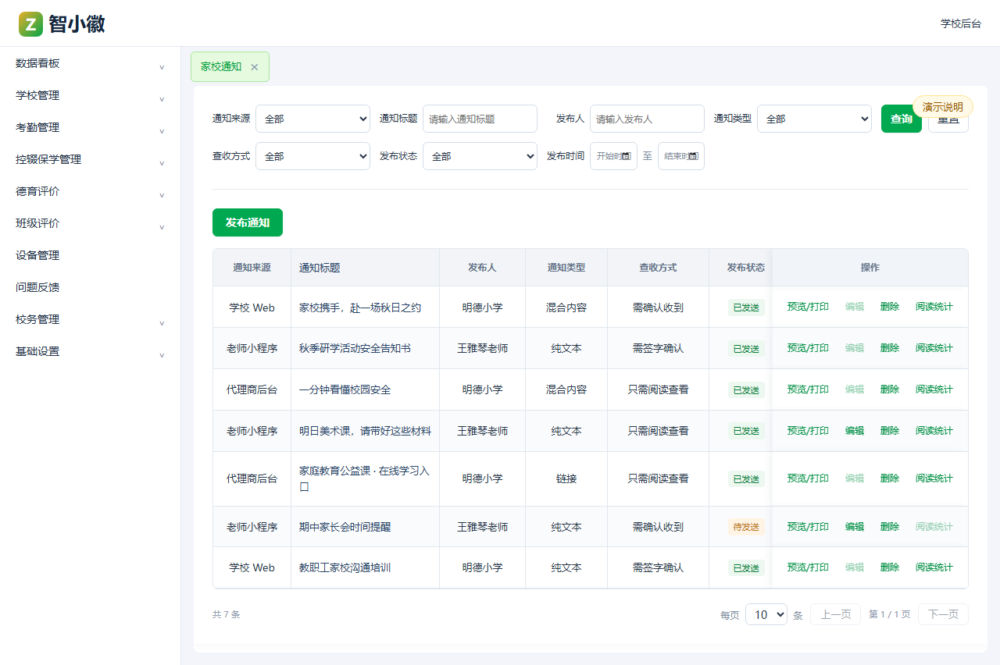

### 家校通知一期产品需求文档｜学校 Web

需求范围：第一期新增（产品版本待定）  
文档编号：PRD-FN-20261118-SCH  
文档版本：V0.1（修改中）  
文档状态：第一期新增，修改中，未定版  
适用端：学校 Web｜学校管理员及具备通知权限的校内人员  
共通规则：见[全端共通规则](家校通知一期产品需求文档-全端共通规则.md)；版本对应及后续同步规则见[原型映射与同步规则](原型映射与同步规则.md)。

#### 1. 原型入口与来源

| 项目 | 当前值 |
|---|---|
| 当前页面 | [学校 Web 家校通知](https://guozi0718.github.io/codex-projects/%E5%AD%A6%E6%A0%A1%E7%AB%AF/index.html?page=family-notice) |
| 固定发布版本 | [学校 Web v0.54](https://guozi0718.github.io/codex-projects/%E5%AD%A6%E6%A0%A1%E7%AB%AF/releases/v0.54/index.html?page=family-notice) |
| GitHub 提交 | 04f17002547c3dd0783822412cc26a4041b9dc96 |
| 通知功能依赖 | 家校通知 V20；功能源哈希见[原型发布登记](原型发布登记.json) |
| 学校基线 | GitHub 学校 Web v0.53 主框架基础；v0.54 将通知模块接入 V20。主菜单与页签由学校 Web 基线项目拥有。 |
| 菜单与路由 | 校务管理 → 家校通知；稳定路由 family-notice。入口由学校 Web 基线菜单打开。 |
| 小程序 | 教师与家长小程序不挂学校 Web 菜单；本轮原型不改。 |

本页的校级账号、菜单及页签沿用学校基线；进入家校通知后使用通知模块内部页面。外层返回和页签关闭由基线控制。

#### 2. 页面与流程清单

| 需求编号 | 页面 | 主要信息与动作 | 验收 |
|---|---|---|---|
| SCH-01 | 家校通知列表 | 筛选、查询、重置、发布通知、列表操作、分页 | AT-SCH-01 |
| SCH-02 | 发布通知—填写内容 | 标题、封面、正文、附件；预览、下一步 | AT-SCH-02 |
| SCH-03 | 发布通知—准备发布 | 发布对象、查收方式、学校名义、定时发送、可选截止；上一步、发布 | AT-SCH-03 |
| SCH-04 | 选择发布对象 | 学生/教师两个页签，年级/班级/学生选择与教师选择 | AT-SCH-04 |
| SCH-05 | 通知预览/打印 | 通知正文及与查收方式匹配的统计；导出 PDF、关闭 | AT-SCH-05 |
| SCH-06 | 阅读与回执统计子页 | 学生/教师统计、个人明细、分页 | AT-SCH-06 |
| SCH-07 | 编辑通知 | 允许编辑时回显内容、封面和学校名义；重新核对发布设置 | AT-SCH-07 |
| SCH-08 | 删除确认 | 参考运营后台合同管理删除确认样式 | AT-SCH-08 |

#### 3. 列表页（SCH-01）

##### 3.1 字段与控件

| 区域 | 字段/控件 | 规则 |
|---|---|---|
| 筛选区 | 通知来源 | 下拉，默认全部 |
| 筛选区 | 通知标题 | 文本输入，占位“请输入通知标题” |
| 筛选区 | 发布人 | 文本输入，占位“请输入发布人” |
| 筛选区 | 通知类型 | 下拉，默认全部；一期 Web 选项为普通通知 |
| 筛选区 | 查收方式 | 下拉，默认全部；选项为只需阅读查看、需确认收到、需签字确认 |
| 筛选区 | 发布状态 | 下拉，默认全部；选项依当前状态口径 |
| 筛选区 | 发布时间 | 开始/结束日期时间筛选，保留 V20 当前占位样式 |
| 筛选区 | 查询/重置 | 按钮与筛选第一行对齐，查询和重置边界对齐筛选容器 |
| 列表 | 通知来源、通知标题、发布人、通知类型、查收方式、发布状态、发布时间、未读人数、已读人数、已确认人数、已签字人数、创建时间、操作 | 一列一个字段；通知标题左对齐，其余数据列居中；无完成率 |
| 操作 | 预览/打印、编辑、删除、阅读统计 | 同一行显示；编辑不可用时置灰；无撤回操作 |
| 新增 | 发布通知 | 位于筛选区下方靠左；不带加号 |

列表数据区可横向滚动，操作列固定且与数据列容器高度对齐。页面使用基线内容区，不叠加第二层页面边框。列表底部分页显示总条数及页码。

##### 3.2 初始状态与筛选

1. 首次进入展示当前学校有权查看的通知；学校由登录上下文确定，不显示选学校步骤。
2. 下拉筛选默认“全部”；查询采用当前选择条件；重置清空文本、恢复枚举默认并清除时间范围。
3. 查询结果不满足条件时显示空列表，不提供“已删除”或 Web 草稿筛选。
4. 发布状态只显示已发送、待发送、已截止；被删除通知从列表消失。

#### 4. 发布/编辑页

##### 4.1 两步发布

学校 Web 只显示两步流程：

1. 第一步：填写通知内容。
2. 第二步：准备发布。

不显示“选择学校”步骤。标题、内容、附件不满足要求时阻止进入下一步并定位相应字段；返回上一步时保留当前填写内容。Web 不提供保存草稿入口。

##### 4.2 通知内容字段（SCH-02）

| 字段 | 必填 | 控件与校验 |
|---|---|---|
| 通知标题 | 是 | 单行输入，最多 50 字；不显示字数计数 |
| 封面 | 否 | 图片选择；标签不附“选填”；输入内容左边与标题对齐，不换行 |
| 通知内容 | 是 | 富文本编辑框，支持文本格式工具及纯文本、图文、视频、链接正文 |
| 附件 | 否 | 支持 PDF、Word、Excel、JPEG/JPG/PNG；最多 9 份，每份 ≤20MB |

操作顺序：填写标题与内容 → 可选封面/附件 → 预览 → 下一步。文件类型或大小不合格时阻止添加并保留其他有效附件。标题等单行输入框和附件字段样式遵循共通 PRD 及用户提供的反馈表单截图；通知正文编辑区域维持 V20 样式，不按表单截图缩小。

##### 4.3 发布设置字段（SCH-03）

| 字段 | 必填 | 当前默认/交互 |
|---|---|---|
| 发布对象 | 是 | 点击打开对象选择页；入口回显“已选中学生 N 人，教师 N 人”，不在控件下方重复显示人数 |
| 查收方式 | 是 | 下拉选择；默认“只需阅读查看”；其余为“需确认收到”“需签字确认” |
| 以学校名义通知 | 是 | 开关；保存用户所选状态。当前原型初始值为开启，此处仅记录原型现状 |
| 定时发送 | 是 | 开关；开启后选日期时间，默认次日 09:00:00；格式 YYYY-MM-DD HH:mm:ss |
| 截止时间 | 否 | 默认空，提示“请选择”；日期时间选择器，格式 YYYY-MM-DD HH:mm:ss |

“必填”表示发布时这些设置均须有明确值；截止时间可以留空。发布成功后返回通知列表并出现该条记录；不得生成重复通知。具体提示文案只保留阻断操作所必需的内容。

##### 4.4 发布对象选择（SCH-04）

| 页签/区域 | 显示内容 | 选择行为 |
|---|---|---|
| 学生 | 年级、班级、班级学生及人数 | 年级和班级默认收起；展开后可选择整年级、整班或个别学生；班内姓名 A-Z |
| 教师 | 教师姓名 A-Z 列表 | 支持单选、全选；全选后列表中每名教师均显示已选状态 |
| 底部 | 取消、确定 | 取消不回填；确定将所选对象回显到发布对象字段 |

整班完整选择保存为班级对象；班级只选部分学生时保存个人名单。全年级未来新增班级的纳入规则及存储粒度见 Q70，未确认前不把年级选择自动扩展为未来班级。一个对象只可计入一次；学生确实属于多个已选班级时按班级副本区分。

#### 5. 统计、预览和行操作

##### 5.1 阅读统计子页（SCH-06）

Web 阅读统计使用子页面，不使用大弹窗。统计按学生与教师分开，每页 10 人。学生行不展示具体年级和班级；支持查看每名学生的每位家长状态。统计只展示已存在字段，包括应收人数、已读人数、已确认人数、已签字人数及个人状态，不新增完成率字段。没有家长的学生标记“未关联家长”。

##### 5.2 预览/打印（SCH-05）

1. 进入独立预览/打印页面，回显标题、封面、正文和附件，以及与查收方式对应的阅读/确认/签字统计明细。
2. 不显示发布设置。
3. 页面底部导出 PDF 和关闭按钮靠右排列。
4. 导出内容只包含预览页面；PDF 隐藏顶部栏与演示说明，纸张边距为上 37mm、右 26mm、下 35mm、左 28mm。
5. 只读通知显示阅读统计；需确认通知显示确认状态；需签字通知显示签字图片和确认时间等原型已有字段。

##### 5.3 删除与编辑

- 删除前显示与运营后台合同管理相同层级的二次确认；取消不改变数据，确认后通知立即从本端及其他前端列表消失。
- 删除后不显示已删除状态，也不发送家长消息；后端快照和日志由技术实现。
- 有人已读、确认或签字后，编辑按钮置灰且不能通过直接路由或重复提交绕过。
- 未产生任何接收人动作且未超时的通知，编辑仅允许修改内容、封面和学校名义；受众、查收方式、发送时间及定时任务时间保持不变。
- 编辑不通知所有接收人；修改历史不在前端展示。

#### 6. 权限、校验与失败恢复

| 操作 | 前置条件 | 提交复验/失败行为 |
|---|---|---|
| 查看列表/详情 | 当前学校上下文且有家校通知访问权 | 无权时拒绝读取，基线菜单仍可用 |
| 新增通知 | 有新增权限；标题/内容/必填设置完成 | 提交复核权限与对象有效性；失败保留表单 |
| 编辑 | 创建人或学校授权角色；未超时；无任何已读/确认/签字 | 提交时再次核验通知版本与回执；冲突时拒绝并提示重新打开 |
| 删除 | 有删除权限 | 先确认；提交重复或网络结果未知时按通知ID核验，避免误报成功 |
| 导出 PDF | 有当前通知查看权限 | 导出失败留在预览页，不修改通知数据 |

#### 7. 验收场景

| AT | Given | When | Then |
|---|---|---|---|
| AT-SCH-01 | 学校人员进入本校基线 | 点击校务管理→家校通知 | 直接进入本校列表，无选校步骤 |
| AT-SCH-02 | 新增权限有效 | 点击发布通知 | 页面显示内容步骤和发布设置步骤，共两步 |
| AT-SCH-03 | 有通知内容、对象及查收设置 | 点击发布 | 新通知进入列表，状态和发送时间符合设置 |
| AT-SCH-04 | 教师对象列表已打开 | 点击全选教师 | 每名教师均显示已选；确认后人数和所选人回显 |
| AT-SCH-05 | 通知需签字确认 | 打开预览/打印并导出 | 出现签字统计；PDF隐藏顶部栏/演示说明且保留公文边距 |
| AT-SCH-06 | 学生超过 10 条统计记录 | 打开阅读统计 | 统计分页为每页 10 人，学生行不展示年级/班级 |
| AT-SCH-07 | 一名接收家长已阅读 | 点击编辑或直达编辑路由 | 编辑被禁止，原内容和回执不变 |
| AT-SCH-08 | 用户确认删除 | 完成删除 | 列表立即消失，不出现“已删除”状态，不发送通知 |

#### 8. 当前原型与待实现边界

学校 Web 已有版本 v0.54，通知界面使用 V20。原型能呈现两步流程、列表、表单、对象选择、预览和统计交互；实时名册自动纳入、服务端权限复验、删除快照、真实微信提醒及 PDF 文件生成需开发实现，不能从静态原型推断已接通。

本端相关未决规则统一见共通 PRD 的 Q66–Q70；在答复前不将推荐或默认值写成用户已确认要求。

#### 9. 页面级逻辑校验、异常与恢复细则

以下逐操作列出前置检查、提交复验和不同结果处理。原型只体现静态交互；真实请求结果仍需服务端支持，不能把“按钮成功态”当作数据已保存证据。

##### 9.1 列表首次加载与筛选（SCH-01）

1. **首次进入**：先校验学校上下文与页面权限，再读取通知列表和计数。学校上下文缺失或读取权限不足时，不加载其他学校数据；仅显示必要错误状态，保留学校基线菜单可用。
2. **加载失败**：列表主体展示加载失败和重试动作，不沿用上一次学校或上一次条件下的旧数据作为当前结果。重试使用当前学校和当前筛选条件。
3. **筛选输入**：通知标题、发布人按输入原文查询；下拉“全部”代表不加该枚举条件。时间结束早于开始时阻止查询，定位时间字段；筛选未通过时不清空用户输入。
4. **查询**：触发新查询后页码回到第1页；查询进行中禁用重复查询。仅在返回成功后替换当前列表，避免较早请求最后返回并覆盖较新条件。
5. **重置**：清空标题、发布人和时间范围；所有枚举恢复“全部”；页码回第1页。重置后是否自动查询遵循当前原型既有行为，不额外增加提示。
6. **空结果**：显示空列表状态，不展示删除记录或草稿，不改变通知状态。
7. **分页**：切换页码只更换当前结果页；切换每页数量回第1页。总数、行数据和页码必须来自同一查询结果；超出有效页码时回到最后一个有效页。

##### 9.2 通知内容步骤（SCH-02）

1. **进入新增**：打开两步向导的内容步骤。通知标题、正文为空；封面和附件为空。标题最多50字，字数计数不显示。
2. **标题校验**：下一步和发布提交都重新检查标题非空及50字上限。只含空格按空标题拒绝；拒绝时保持当前内容并将焦点定位到标题。
3. **正文校验**：正文必填；只有媒体占位框、无可读/可展示内容时，按空正文拒绝。富文本粘贴内容在保存/预览中保留可渲染结构；不支持的资源阻止进入下一步并指出对应内容块。
4. **附件添加**：每次添加前检查扩展名/文件类型、单文件不超过20MB、总数不超过9份。第10份及不支持格式/超限文件不加入；其他已选附件保留。文件选择取消不改附件列表。
5. **附件清除/替换**：仅改变尚未提交的表单引用；如果服务端上传尚未确认，不显示为已上传。具体上传进度和断点续传当前原型没有定义，列为接口待补，不虚构进度状态。
6. **预览**：打开预览不提交、不改变发布对象和状态；关闭预览返回原编辑内容。预览资源读取失败时保持编辑内容并允许再次打开。
7. **下一步**：通过标题/正文/附件本地校验后进入第2步；失败留在当前步骤，不清除附件和格式。
8. **上一步/离开**：第2步上一步回内容步骤，保留该向导内已输入内容。页面关闭、刷新或切换菜单时草稿保存行为未确认；Web 不显示保存草稿按钮，也不自动创建草稿。

##### 9.3 发布对象选择（SCH-04）

1. **打开选择器**：分别加载当前学校学生组织和教师列表。学生树默认关闭年级与班级；未加载时不允许确认空名单作为“全选”。
2. **教师全选**：点击后所有可选教师逐项勾选，计数更新；再次点击取消全选时所有教师逐项取消。部分手动取消后“全选”状态变为未全选/部分选中。
3. **教师排序与同名**：姓名 A-Z；同名教师必须保留为两个独立对象并显示足以区分的现有信息，不能按姓名去重。具体附加区分字段若原型无来源不擅自补充。
4. **学生整班**：点击班级选中整班当前学生，班级节点整体勾选；该选择保存为班级对象。用户再取消某个学生后，节点改为部分选中且对象转换为明确学生名单，之后新增学生不自动加入。
5. **整年级**：当前可以选择整年级；未来新增班级是否纳入待 Q70 确认。未确认前不把整年级自动扩大到未来新增班级。
6. **确定**：回传选择集合，发布设置控件回显“已选中学生 N 人，教师 N 人”；人数只在按钮内展示，不在按钮下重复。空集合时阻止确定并提示选择发布对象。
7. **取消/关闭**：取消不覆盖先前已确认对象；新建时取消后返回发布设置，不生成任何后台收件名单。
8. **读取失败/权限变化**：学生或教师数据加载失败时区分“加载失败”与“暂无可选对象”；重试时保留已加载的另一类对象。确认及发布提交重新校验学校和对象访问范围。
9. **名单变化**：对象确认后至发布前名单发生变化时，提交使用提交时的有效名单规则并重算预估人数；已发布后按共通实时名单规则运行，不因一次性 UI 选择快照阻断班级新生纳入。

##### 9.4 发布设置和最终提交（SCH-03）

1. **逐字段必填检查**：发布对象、查收方式、学校名义、定时发送设置必须具有有效值；只有截止时间可空。红色星号对应必填字段。空对象、非法枚举、开关缺少值时不提交。
2. **查收方式**：默认只需阅读查看；未选择有效枚举时按缺失处理。不能把需确认或需签字默认为“已完成”。
3. **定时发送**：开启后时间格式必须为YYYY-MM-DD HH:mm:ss且严格晚于当前操作时间；小于或等于当前时间均拒绝。日期控件关闭、取消选择时不覆盖旧值。
4. **截止时间**：允许为空；非空须满足日期时间格式。若截止早于或等于立即发布时间，阻止发布并提示修改截止时间。定时发布时截止时间不得早于实际计划发送时间。
5. **发布对象/学校复验**：提交时确认仍是当前学校、权限有效，目标对象未失效，通知标题与正文仍满足规则。学校身份或组织关系变化时拒绝发布，不自动切换学校。
6. **提交中**：发布按钮进入提交中并禁用；连续点击、回车或重复触发不生成多条通知。当前内容留在页面，不提前显示成功状态。
7. **明确失败**：停留在发布设置页，显示必要的失败原因；保留已填写内容和对象供用户核对/重试。不得显示已发送状态或写成功统计。
8. **超时/响应未知**：不得直接重复创建；提示结果未确认，按当前学校和标题/操作记录核对是否已有通知，确认未创建后再允许用户重试。技术幂等键不在本 PRD 编造。
9. **成功**：只有获得明确成功结果后，转回列表并刷新通知及计数。列表中按实际发送时间或计划时间显示对应状态。
10. **对象在提交期间变化**：提交侧版本校验失败时，不部分创建通知或受众；保留输入，提醒重新打开对象选择并复核，不自动把用户未选的对象纳入固定名单。

##### 9.5 编辑资格与保存（SCH-07）

1. **打开编辑入口**：先读通知最新版本、操作权限、发送状态、有效期及所有收件人操作记录。
2. **资格判断**：创建人/授权学校管理角色、未过有效时限且没有任何接收人已读/确认/签字，才允许编辑。任一条件不满足时，操作列编辑置灰；直接构造编辑链接仍拒绝。
3. **字段白名单**：只允许改内容、封面和学校名义。发布对象、查收方式、发布时间、定时任务时间不可变；截止字段的“时限重算”冲突见 Q67。提交时将未授权字段和原记录比对，发现变化即拒绝整次编辑。
4. **保存**：再次读取通知版本和接收动作记录。保存期间出现新阅读/回执/签字或通知过期，拒绝写入并保持原内容；编辑草稿留在当前页供用户复制/核对，不覆盖线上版本。
5. **已读/回执编辑锁**：任一接收对象操作即锁定通知编辑；不因对方后来撤销关联、删除记录或统计口径变化解除。
6. **成功**：只替换允许的内容字段；保留原有发送设置、已读/确认/签字记录及历史版本。前端不提供修改日志页，不向接收人发送修改提醒。
7. **保存结果未知**：重新读取通知当前版本；若内容已更新，显示当前版本并结束本次提交；若未更新，保留编辑草稿供用户重试；不重复写入相同版本。
8. **截止边界**：明确截止后不可编辑，不能通过延长重新开放；无截止按发送后30自然日规则，编辑后窗口起点待 Q66 确认。

##### 9.6 删除确认与恢复（SCH-08）

1. 点击删除先打开二次确认，显示可辨认的通知标题；默认焦点不落在破坏性确认按钮。
2. 取消或关闭确认弹窗：不调用删除、不改变列表、统计或接收人可见状态。
3. 确认前再次检查删除权限及目标通知当前状态；存在并发删除时按最终服务端结果处理。
4. 提交中禁用确认按钮，防止重复提交。明确失败时关闭/保留弹窗依错误处理反馈但通知仍可见；需说明失败且允许重新确认。
5. 响应超时未知：先核对通知是否还存在；存在则允许再次确认删除，不存在则刷新列表并显示最终删除结果，不重复写第二份删除事件。
6. 删除成功后通知立即从学校 Web、代理商/运营代发列表及家长/教师前端消失；不存在“已删除”状态或恢复入口，不发送删除消息。后端保留快照/回执/操作者/时间的要求由技术处理。

##### 9.7 统计子页与单人明细（SCH-06）

1. **进入**：从列表行的阅读统计打开同一基线菜单内的统计子页面，不以大弹窗承载大量学生。
2. **切换学生/教师**：分别按学生和教师统计。切换类型回第1页并重置不适用的过滤条件。
3. **学生主行**：不显示具体年级和班级；显示学生姓名、阅读状态、查收完成状态及操作。学生总数/分页数以当前实时统计名单为准，不显示完成率。
4. **家长明细**：点开学生详情后逐位显示当前关系下家长的状态；一个家长已完成即学生汇总完成，但其他家长仍显示独立未读/待确认/待签字状态。
5. **教师明细**：按教师个人状态统计，不合并为学生人数。
6. **分页**：每页10人；切换页时保留当前统计类型和筛选。名单增加后总数更新；当前页超界返回最后有效页。
7. **数据读取失败**：显示统计加载失败与重试；不显示上次学校或另一通知的统计。
8. **一键提醒**：只针对 Q69 最终确定的提醒集合。点击后再次检查通知未超期并取得提醒权限；提示成功仅代表触发动作，不代表每条消息送达。失败/部分失败不显示任务状态、不自动重试，接收状态和统计不变。
9. **学生无家长关系**：标注“未关联家长”，计入应收学生/未完成对象；不伪造家长行。

##### 9.8 预览/打印和 PDF（SCH-05）

1. 打开预览只读展示通知标题、封面、正文、附件，以及当前查收方式对应统计，不回显发布设置。
2. 阅读型、确认型、签字型通知按不同统计字段展示；签字明细含现有签名图片/确认时间，空值显示空态，不显示其他类型专属字段。
3. “关闭”返回原列表/统计上下文；页面重新进入不得自动执行导出。
4. “导出 PDF”只将本预览页内容作为文件内容；打印DOM隐藏基线顶部栏和演示说明，底部操作按钮不进入PDF。
5. 导出失败保留预览内容，允许用户再次手动导出；不更改原通知或统计。
6. 页面纸张A4，页边距上37mm、右26mm、下35mm、左28mm；长名单跨页时表格标题重复与断行样式仍需真实导出验收，不能以静态页面证明通过。

