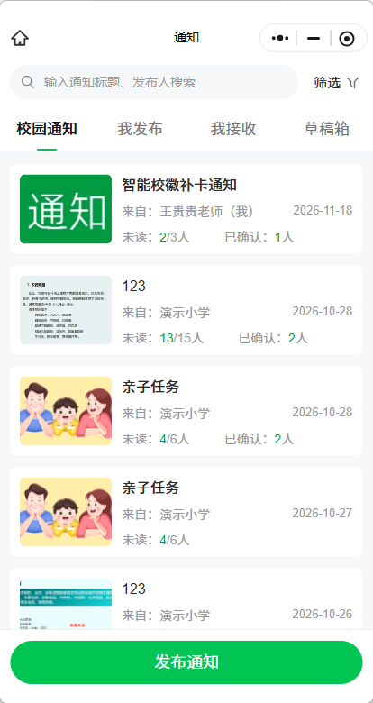
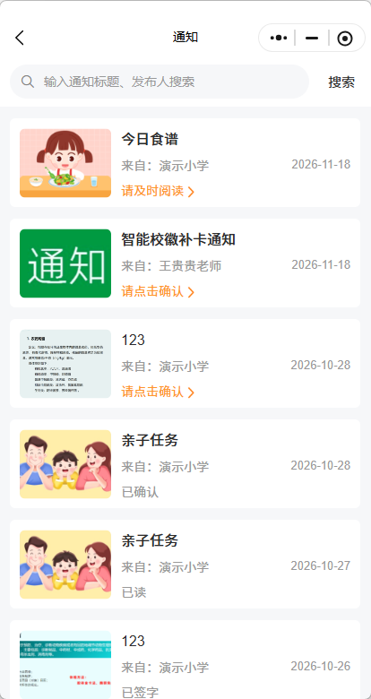

### 家校通知一期产品需求文档｜家长小程序

需求范围：第一期新增（产品版本待定）  
文档编号：PRD-FN-20261118-PAR  
文档版本：V0.1（修改中）  
文档状态：第一期新增，修改中，未定版  
适用端：家长小程序｜学生关联家长  
原型状态：家长端页面与资料沿用本地 V18 继承内容；本轮用户明确要求保留资料，不修改、不上传。  
共通规则：见[全端共通规则](家校通知一期产品需求文档-全端共通规则.md)；版本对应及后续同步规则见[原型映射与同步规则](原型映射与同步规则.md)。

#### 1. 原型与来源

| 项目 | 当前值 |
|---|---|
| 当前本地入口 | 家长小程序保留本地独立评审入口；本次未更新或发布，不提供 GitHub 在线原型链接 |
| 保留的功能原型源 | 任务/T-20261118-02-Web查收方式和日期状态/端-通知功能/版本-V20/parent；家长端在 V20 中未修改 |
| 小程序基线 | 继承任务/T-20261117-08-老师端通知模块对齐中的 V18 资料及此前家长端页面 |
| GitHub 发布 | 本轮无家长小程序 GitHub 版本或远端链接；Web GitHub 版本不作为小程序发布物。 |

以下图片是用户提供的家长小程序视觉参考，不是本轮采集的当前版本截图。展示的是当前登录学生的通知卡片与列表，不能解释为支持切换孩子。

#### 2. 页面清单

| 需求编号 | 页面/区域 | 主要内容 | 验收 |
|---|---|---|---|
| PAR-01 | 通知首页 | 当前登录学生通知、搜索、全部/待办页签 | AT-PAR-01 |
| PAR-02 | 通知卡片 | 封面、标题、来源、日期、操作状态 | AT-PAR-02 |
| PAR-03 | 通知详情 | 通知正文、附件、阅读状态 | AT-PAR-03 |
| PAR-04 | 确认/签字 | 按通知查收方式完成确认或签字 | AT-PAR-04 |

#### 3. 通知首页（PAR-01）

家长进入后只看当前登录的学生通知。页面不展示“切换孩子”模块，也不在同一列表混入其他孩子消息。通知日期及内容以当前已授权通知为准。页头返回按钮只显示左箭头符号，不附“返回”文字。字体大小与智能校徽页面对齐。

| 控件 | 规则 |
|---|---|
| 搜索 | 支持按通知标题、发布人搜索；按钮和输入框按现有小程序样式 |
| 全部 | 显示当前学生全部可访问通知 |
| 待办 | 显示当前学生尚未完成当前查收要求的通知 |
| 页签计数 | 采用括号计数样式；数量以对应列表未读/待办统计口径为准 |
| 通知卡片 | 仅显示封面、标题、来源、日期与操作状态 |

#### 4. 通知卡片状态（PAR-02）

| 查收方式/个人状态 | 卡片状态文案 |
|---|---|
| 只需阅读，未读 | 请阅读通知 |
| 需要确认，未确认 | 请点击确认 |
| 需要签字，未签字 | 请签字确认 |
| 已确认 | 已确认 |
| 已阅读 | 已读 |
| 已签字 | 已签字 |

卡片只展示封面、标题、来源、日期和当前操作状态；不展示学生选择器、班级名称/人数、收件明细或多余提示。

#### 5. 通知详情与操作（PAR-03/PAR-04）

1. 家长打开通知卡片即记录已读。
2. 详情展示封面、标题、来源、日期、正文和附件；不显示教师/运营后台的发布设置。
3. “只需阅读查看”通知打开后完成阅读，不需要确认或签字。
4. “需确认收到”通知显示明确确认入口；确认后卡片显示已确认。
5. “需签字确认”通知显示签字入口；提交后卡片显示已签字。
6. 有效期后仍可查看通知与原状态，但不能再确认/签字；不改变历史阅读结果。
7. 对一个学生关联的多名家长，任一位家长完成当前通知要求，即计为学生汇总完成；其他家长仍保留个人状态。家长端仅显示当前登录学生的消息，不提供查看其他家长账号状态的能力。
8. 家长与学生解除关联后，已发布通知仍可访问并继续完成；有效期过后新关联家长不接收过期通知。

#### 6. 异常与恢复

| 场景 | 行为 |
|---|---|
| 通知已被发布端删除 | 家长列表不再显示该通知；没有已删除列表 |
| 当前账号无可用学生上下文 | 不展示其他学生消息；提示按账号/学校现有流程核查绑定 |
| 通知已截止 | 允许查看；确认/签字入口禁用或不显示 |
| 确认或签字提交结果未知 | 不重复提交并造成重复记录；根据该条通知当前状态核对 |
| 附件无法打开 | 保留详情页；可返回通知列表，不影响已读状态 |
| 提醒消息投递失败 | 家长端不显示提醒任务状态；系统不自动重试 |

#### 7. 验收场景

| AT | Given | When | Then |
|---|---|---|---|
| AT-PAR-01 | 家长已登录且当前学生为 A | 打开通知首页 | 只显示学生 A 的通知，无切换孩子模块 |
| AT-PAR-02 | 学生存在待办通知 | 查看通知卡片 | 卡片只展示封面、标题、来源、日期和对应状态 |
| AT-PAR-03 | 家长打开未读通知 | 进入详情 | 记为已读；返回后卡片状态更新 |
| AT-PAR-04 | 通知要求签字 | 完成签名提交 | 状态更新为已签字；学生汇总按任一家长完成规则处理 |
| AT-PAR-05 | 当前登录学生在两个班级有两个独立副本 | 打开全部列表 | 两条卡片分别展示并可辨识所属班级 |
| AT-PAR-06 | 通知已经截止 | 打开详情 | 可阅读历史内容；确认与签字操作不可继续 |

#### 8. 当前范围与限制

家长小程序本轮原型和资料不修改、不上传。本文是一期需求草案，对照本地保留的页面素材与用户截图记录；不是已完成的小程序实现。多学生家长关系、真实账号授权、微信消息、签名文件持久化和通知有效期拦截需要后端与小程序项目配合实现。未确认项见共通 PRD Q66–Q70。

#### 9. 页面级逻辑校验、异常与恢复细则

本端小程序本轮保留现有原型；以下将已确认的家长阅读、待办与回执规则拆成可验收场景。真实微信身份、学生绑定和回执存储尚未接入。

##### 9.1 登录上下文、首页与筛选（PAR-01）

1. 进入页面时读取当前登录家长关联的当前学生上下文；本功能不提供切换孩子入口。
2. 当前学生上下文缺失、账号过期或学生绑定已失效时，不显示其他学生的通知；按小程序已有账号/绑定流程提示重新核对。
3. 全部与待办是两个独立列表；切换页签时保持当前搜索词，但不混合数据。页签计数显示括号计数，精确统计口径按现有业务计数服务提供。
4. 搜索按通知标题、发布人匹配；搜索无结果展示空状态。刷新或切换条件时，不显示上一次学生的旧列表。
5. 列表加载失败与确实无通知分开呈现；可重试，不因读取失败清空服务端状态。
6. 返回按钮只显示箭头，不附“返回”文字；按小程序既有页面栈返回，不构造新的Web菜单页。

##### 9.2 通知卡片与状态（PAR-02）

1. 卡片只显示封面、标题、来源、日期和操作状态；不显示其他孩子切换控件、阅读人数或管理端设置。
2. 只阅读未读显示“请阅读通知”；确认型待确认显示“请点击确认”；签字型待签显示“请签字确认”；已处理时分别显示已读、已确认或已签字。
3. 卡片点击进入详情，并立即记录当前家长的阅读状态。重复打开只保持已读，不重复新增阅读事件。
4. 同一学生因多个班级产生通知副本时，卡片显示区分副本所需的班级标识；通知状态按该副本独立计算。
5. 当前学生任一关联家长完成通知要求后，学生统计汇总为完成；其他家长个人状态不在当前家长界面泄露。
6. 卡片内容资源加载失败时使用现有缺图/空内容样式；不影响标题、来源、日期及状态显示。

##### 9.3 通知详情与阅读（PAR-03）

1. 详情回显封面、标题、来源、日期、正文和可访问附件，不展示发布对象、查收方式后台设置、定时或发布者管理操作。
2. 打开详情后记录已读；如已截止，仍可查看内容和原回执状态。
3. 删除通知后家长端没有该条记录或已删除列表入口；直接访问旧通知参数也不得展示已删除内容。
4. 附件读取/下载失败时保持详情页和阅读状态，给出该资源无法打开的必要反馈；其他正文和附件仍可查看。
5. 图片/视频无法加载时不应阻塞整条通知；允许返回列表。

##### 9.4 确认收到与签字（PAR-04）

1. **只需阅读查看**：打开详情即完成阅读；不显示确认或签字操作。
2. **需确认收到**：未确认时展示明确确认入口；确认前检查通知未超出有效时间。完成后更新为“已确认”，再进入时显示现有状态。
3. **需签字确认**：未签字时展示签字入口；确认前检查通知未过期，并保存用户提交的签字。成功后显示已签字状态和详情。
4. **有效期截止**：可继续查看，但不允许新增确认或签字；已有状态保留，不因截止改为未读或清空签名。
5. **重复操作**：当前已确认或已签字时不再显示可重复提交的主操作；详情继续展示当前结果。前端连续点击时提交中暂时禁用操作。
6. **明确失败**：留在当前通知详情，保留用户输入的签字或当前页面上下文，提示提交失败并允许再次尝试；不提前显示已完成状态。
7. **结果未知/超时**：不重复创建新的确认或签字记录；刷新当前通知状态核验是否已完成。若未完成，再允许用户操作。
8. **通知发布方已删除**：通知从所有端消失，家长不显示删除状态；本地已打开的旧详情刷新时应停止展示已删除内容。

##### 9.5 家长关系与名单变化

1. 家长接收范围由学生关系决定；发布时不由发布者单独选择家长。
2. 班级全选通知有效纳入期内出现新学生时，学生及其所有关联家长按共通规则接收；仅选部分学生不自动纳入该班新生。
3. 新关联家长只在通知有效纳入窗口内接收；超过截止窗口后新绑定的家长不进入过期通知。
4. 家长解除与学生的关联后，仍可访问已经发布的通知并继续处理；后续通知按新关系处理。
5. 学生转班/离校后仍能访问已发布通知并完成回执；后续通知不再由旧班级关系纳入。
6. 如果学生名册、家长绑定或学校关系读取失败，不猜测关系并展示给无关账号；保留页面并提示重新加载/联系学校按既有绑定流程处理。

