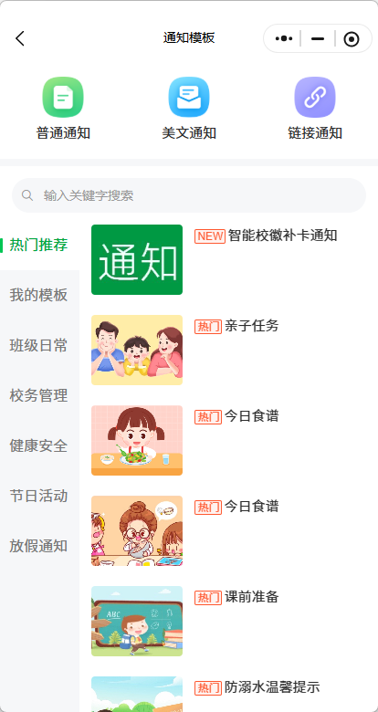
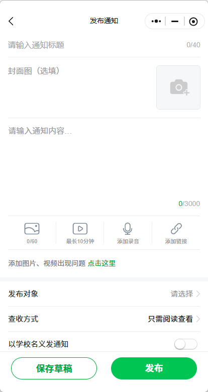
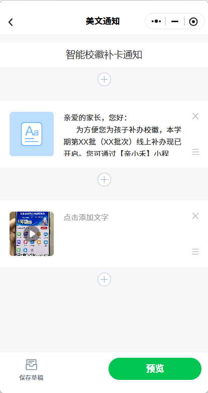

### 家校通知一期产品需求文档｜教师小程序

需求范围：第一期新增（产品版本待定）  
文档编号：PRD-FN-20261118-TCH  
文档版本：V0.1（修改中）  
文档状态：第一期新增，修改中，未定版  
适用端：教师小程序｜教师  
原型状态：小程序页面/模板资料沿用本地 V18 继承内容；本轮用户明确要求保留资料，不修改、不上传。  
共通规则：见[全端共通规则](家校通知一期产品需求文档-全端共通规则.md)；版本对应及后续同步规则见[原型映射与同步规则](原型映射与同步规则.md)。

#### 1. 原型与来源

| 项目 | 当前值 |
|---|---|
| 当前本地入口 | 教师小程序保留本地独立评审入口；本次未更新或发布，不提供 GitHub 在线原型链接 |
| 保留的功能原型源 | 任务/T-20261118-02-Web查收方式和日期状态/端-通知功能/版本-V20/teacher；教师端内容沿用此前版本，V20 未修改教师小程序 |
| 原小程序资料 | 任务/T-20261117-08-老师端通知模块对齐/端-通知功能/版本-V18 及其继承的模板目录 |
| GitHub 发布 | 本轮无教师小程序 GitHub 版本或远端链接；不得使用 Web 端 GitHub URL 代替小程序入口。 |

以下图片是用户提供的亲小禾小程序视觉参考，不是本轮采集的当前版本截图。截图中的“链接通知”入口仅反映旧界面；本期按用户明确要求移除独立链接通知类型，正文内嵌链接仍可用。

#### 2. 一期页面清单

| 需求编号 | 页面/区域 | 主要内容 | 验收 |
|---|---|---|---|
| TCH-01 | 通知首页 | 学校通知、我发布、我接收、草稿箱四个页签及计数 | AT-TCH-01 |
| TCH-02 | 我接收列表 | 通知卡片、查找、待办状态、通知详情 | AT-TCH-02 |
| TCH-03 | 普通通知编辑 | 标题、封面、内容、图片/视频/录音/链接等模块、发布设置 | AT-TCH-03 |
| TCH-04 | 美文通知编辑/预览 | 模块拼接、排序、背景选择、预览、发布设置 | AT-TCH-04 |
| TCH-05 | 发布对象选择 | 学生和教师受众选择 | AT-TCH-05 |
| TCH-06 | 草稿箱 | 只存通知内容草稿 | AT-TCH-06 |

#### 3. 首页、卡片与状态

##### 3.1 四个页签（TCH-01）

页签依次为：学校通知、我发布、我接收、草稿箱。页签计数使用括号计数样式。返回控件只显示箭头符号，不显示“返回”文字。字体大小以智能校徽页面视觉为准。

##### 3.2 我接收卡片（TCH-02）

| 卡片字段 | 规则 |
|---|---|
| 封面 | 显示通知封面；无封面使用当前占位样式 |
| 标题 | 显示通知标题 |
| 来源 | 显示学校或发布人来源 |
| 日期 | 显示通知日期 |
| 操作状态 | 显示且仅显示与当前状态对应的“请阅读通知”“请点击确认”“请签字确认”“已确认”“已读”“已签字”等状态 |

我接收页卡片不显示发布对象名单、人数统计、复杂提示或重复内容。点击通知进入详情后记录阅读；签字/确认操作依查收方式呈现。教师个人状态逐人统计。状态映射依查收方式，不同时显示互相冲突的操作按钮。

#### 4. 普通通知发布（TCH-03）

| 字段/区域 | 必填 | 规则 |
|---|---|---|
| 通知标题 | 是 | 小程序沿用其原型 40 字上限，不套用 Web 50 字上限；标题输入不显示 Web 版字数规则 |
| 封面 | 否 | 可上传封面图 |
| 通知内容 | 是 | 支持纯文本及图文/视频/链接等内容 |
| 发布对象 | 是 | 选择学生和教师，不直接选择家长；家长依据学生关联接收 |
| 查收方式 | 是 | 只需阅读查看、需确认收到、需签字确认 |
| 以学校名义通知 | 是 | 保存当前选择 |
| 定时发送 | 是 | 开启后选择发送时间；具体默认及验证遵循已确认规则 |
| 截止时间 | 否 | 可以为空；时间窗口规则见共通 PRD |

保留普通通知编辑形式及小程序操作布局；页面底部保留保存草稿与预览/发布相关操作，具体按各自小程序既有页面处理。背景音乐功能移除。独立“链接通知”类型移除，但正文中插入链接仍支持。

#### 5. 美文通知（TCH-04）

美文通知采用内容模块拼接，模块按用户调整后的顺序展示。支持文字、图片及可用媒体等模块；不提供独立链接通知类型或背景音乐。

1. 教师添加内容模块、填写/选择内容并按顺序排版。
2. 可保存内容草稿并打开预览。
3. 预览页可打开底部背景选择弹层。
4. “上一步”回到内容编辑；“下一步”进入发布设置。
5. 发布设置复用普通通知的受众、查收方式、学校名义、定时发送等字段。
6. 发布后根据查收方式在接收端展示阅读、确认或签字入口。

#### 6. 受众与模板（TCH-05/TCH-06）

受众选择继承共通对象规则：学生和教师两个页签，教师按姓名 A-Z，可全选或单选；学生按年级/班级/学生选择，年级与班级默认收起，班内姓名 A-Z。点击确定后所选对象及人数回显。

草稿箱只保存通知内容，不保存定时任务。教师草稿留在教师角色端，运营、代理商、学校 Web 和家长端不可见；离开页面后不应自动发布。

模板目录素材记录：134 条模板记录、132 个不同标题、154 个分类卡位；现有转录资料中 18 条有正文、116 条仅有标题。模板原封面插画和部分正文图片尚未完整复制，不能在 PRD 宣称所有模板图文内容均已还原。套用模板后仍可编辑通知内容。

#### 7. 小程序异常与恢复

| 场景 | 处理 |
|---|---|
| 未填写标题或内容 | 阻止预览/发布，保留当前编辑内容 |
| 发布对象未选择 | 不允许发布，返回发布设置继续选择 |
| “全选教师” | 所有教师都显示选中；确认后发布对象区域更新数量 |
| 用户取消对象选择 | 不回填更改，保留原已保存对象 |
| 保存草稿 | 只保存内容草稿，不创建待发送任务 |
| 小程序提醒下发失败 | 不展示任务状态，不自动重试 |
| 过期通知 | 可查看；不允许确认/签字；详情仍保留历史状态 |

#### 8. 验收场景

| AT | Given | When | Then |
|---|---|---|---|
| AT-TCH-01 | 教师进入通知模块 | 查看首页 | 依次看到四个指定页签和括号计数；返回只显示箭头 |
| AT-TCH-02 | 教师打开我接收 | 查看任一通知卡片 | 卡片只展示封面、标题、来源、日期和操作状态 |
| AT-TCH-03 | 教师新建普通通知 | 添加链接/图片/视频或纯文本 | 内容可编辑，发布流程能继续；没有独立链接类型和音乐字段 |
| AT-TCH-04 | 教师创建美文通知 | 预览并选择背景 | 背景通过底部弹层选择，能返回编辑或进入发布设置 |
| AT-TCH-05 | 教师选择全部教师 | 点击全选再确定 | 全部教师处于选中状态，人数和所选对象回显一致 |
| AT-TCH-06 | 教师保存草稿 | 进入草稿箱 | 草稿只含内容，不产生定时发送任务，其他端不可见 |

#### 9. 当前范围与限制

本轮不修改教师小程序页面、不调整小程序主框架、不上传小程序原型。该 PRD 记录先前已确认的目标交互，并指出本地留存素材的现状；它不是本轮完成的 mini prototype 更新。日期插件的原生小程序栈表现、真实模板图片、消息投递和后端接收名单均未在本轮验收。其他未确认项见共通 PRD Q66–Q70。

#### 10. 页面级逻辑校验、异常与恢复细则

本端原型本轮不变；以下为根据已有确认整理的需求校验。由于当前没有小程序更新版，凡原型尚未体现的状态均标为待后续评审，不宣称已实现。

##### 10.1 通知首页、页签计数与卡片（TCH-01/TCH-02）

1. 首次进入校验当前教师身份与学校上下文；没有有效身份时不读取其他教师/学校通知。
2. 四页签顺序固定为学校通知、我发布、我接收、草稿箱；每个页签显示括号计数。页签切换仅更换该页数据，不改变其他页签数据。
3. “我接收”卡片字段限封面、标题、来源、日期和个人操作状态；不把通知正文、收件人数或学校内部统计拼入卡片。
4. 卡片状态由通知查收方式和当前教师个人回执决定。阅读型未读为“请阅读通知”；确认型待确认显示“请点击确认”；签字型待签显示“请签字确认”；已完成状态展示“已读/已确认/已签字”。
5. 搜索标题/发布人无结果时显示空结果；搜索不应把学校通知、我发布、我接收和草稿箱内容混合。
6. 通知详情打开后记已读；重复打开不重复增加阅读人数。列表刷新失败时不把失败读取展示成“无通知”。
7. 过期通知仍可打开查看内容和当前记录，但确认/签字入口不可继续操作；原状态留存。

##### 10.2 普通通知内容步骤（TCH-03）

1. **标题**：必填，使用小程序40字上限；空标题或超过上限阻止预览/发布；不套用Web端50字规则。
2. **封面**：可空；封面选择取消不改变原有图片。图片读取失败时保留标题和正文。
3. **正文类型**：支持纯文本、图文、视频、链接等内容；不提供独立链接通知类型。正文为空时阻止预览/发布。附件图片和正文图片区分为当前原型字段，不混用规格。
4. **内容模块**：新增模块后按当前顺序展示；删除/移动模块只影响未发布编辑稿。支持顺序调整；空模块不得被当成有效正文。
5. **模板**：搜索和分类只筛选当前目录，输入无结果显示空结果。套用模板前确认替换范围；模板套用后正文仍可编辑。未转录正文的模板只展示现有标题和“正文资料未完整”状态，不伪造缺失模板正文或图片。
6. **预览**：只读预览，不提交通知；关闭回原编辑状态。预览打不开时保留当前正文并允许重试。
7. **返回/离开**：普通通知的内容暂存/草稿规则按本端草稿箱处理；不因离开页面创建定时任务。

##### 10.3 美文通知内容与背景（TCH-04）

1. 美文通知内容由教师添加模块并按顺序排版；无有效模块或所有模块空时禁止预览/进入发布设置。
2. 添加图片/视频/链接模块时，取消选择不清除其他已填写模块。无法读取的单个资源不应清空整个美文内容。
3. 预览背景选择通过底部弹层打开；点击取消或下滑关闭时保持上次已选背景；点击某背景后预览对应背景。
4. “上一步”从发布设置返回美文内容，“下一步”进入发布设置；返回时保留模块内容和排序。
5. 背景音乐控件不显示；独立链接通知模块不显示，正文模块仍可以包含链接。
6. 背景素材读取失败时保留原内容和当前背景，不把失败渲染为用户主动清除。

##### 10.4 受众与发布设置（TCH-05）

1. 学生、教师列表按学校上下文加载；学生按年级/班级/姓名组织，教师按姓名 A-Z。年级与班级默认折叠。
2. 全选教师后所有教师行必须同步选中；再点击取消全选后全部清空。部分取消后的部分选择状态需要与实际选择集合一致。
3. 点击确定前检查选择集合非空；确认后回到发布设置，学生/教师人数和选择状态一致。取消不覆盖上次确定的对象。
4. 名册读取失败和名单为空应区分；失败时可重试，不允许把失败结果作为“未选任何对象”静默通过。
5. 查收方式只接受三种有效值；定时发送及截止时间使用所选日期，过期后不允许完成确认/签字。
6. 发布时只能创建小程序通知，不得调用 Web 或运营后台发布入口；学校与家长的跨端通知状态以后端接收范围为准，当前原型不接真实投递服务。
7. 发布按钮提交中禁用，防连续点击产生重复通知；明确失败保留内容及对象；结果未知先核对是否已创建，避免重复发送。
8. 发布成功后通知进入“我发布/学校通知”对应可见范围，接收教师与家长端按权限显示；不自动变更已确认的对象和查收方式。

##### 10.5 草稿箱（TCH-06）

1. 草稿只保存通知内容字段，不含受众、查收方式、学校名义、发送时间、定时任务或通知状态。
2. 保存草稿不向任何接收者发送消息，不生成待发送通知。
3. 重新打开草稿回填内容；若模板素材或图片不可用，保留文字并标记缺失资源，允许重新添加。
4. 草稿仅在教师端本角色下可见；学校 Web、代理商、运营、家长端不显示。
5. 草稿删除或覆盖确认行为未在本轮资料中明确，不擅自增加自动删除或自动覆盖规则。
6. 草稿保存接口失败时保留编辑内容，不提示保存成功；响应未知时先核对草稿版本再允许重试。

