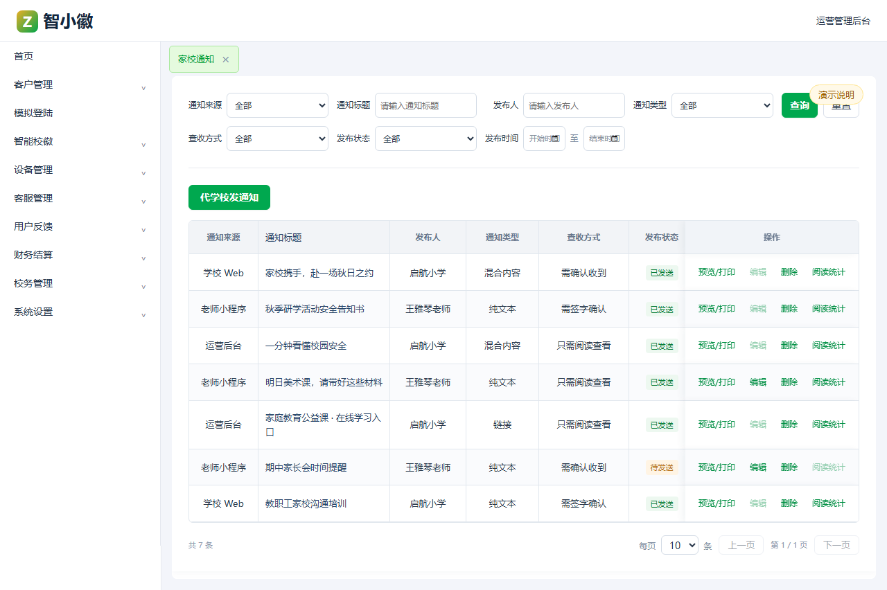

### 家校通知一期产品需求文档｜运营后台

需求范围：第一期新增（产品版本待定）  
文档编号：PRD-FN-20261118-OPS  
文档版本：V0.1（修改中）  
文档状态：第一期新增，修改中，未定版  
适用端：运营后台｜具备家校通知代发权限的运营人员  
共通规则：见[全端共通规则](家校通知一期产品需求文档-全端共通规则.md)；版本对应及后续同步规则见[原型映射与同步规则](原型映射与同步规则.md)。

#### 1. 原型入口与来源

| 项目 | 当前值 |
|---|---|
| 当前页面 | [运营后台家校通知](https://guozi0718.github.io/codex-projects/%E8%BF%90%E8%90%A5%E5%90%8E%E5%8F%B0/index.html?page=family-notice) |
| 固定发布版本 | [运营后台 v0.62-2ee13b0246](https://guozi0718.github.io/codex-projects/%E8%BF%90%E8%90%A5%E5%90%8E%E5%8F%B0/versions/v0.62-2ee13b0246/index.html?page=family-notice) |
| GitHub 提交 | 5b4bf62457ae04da3b04eb7a1b1de8867b7bbe6d |
| 通知功能依赖 | 家校通知 V20；发布包 notice/index.html |
| 运营基线 | 运营后台 v0.61 基线菜单/框架；通知版本随 v0.62-2ee13b0246 发布。 |
| 菜单 | 校务管理 → 家校通知；运营后台项目拥有本端菜单、页签与外层框架。 |

运营人员代直营学校发布通知。页面不展示“代理商模式/直营模式”业务切换控件，场景切换由全局小红点入口管理。

#### 2. 页面与流程清单

| 需求编号 | 页面 | 主要信息与动作 | 验收 |
|---|---|---|---|
| OPS-01 | 家校通知列表 | 授权学校范围内筛选、查询、重置、列表操作 | AT-OPS-01 |
| OPS-02 | 发布通知—选择学校 | 地区级联、学校名称模糊查询、选择目标学校 | AT-OPS-02 |
| OPS-03 | 发布通知—填写内容 | 标题、封面、正文、附件、预览、上一步/下一步 | AT-OPS-03 |
| OPS-04 | 发布通知—准备发布 | 发布对象、查收方式、学校名义、定时发送、可选截止 | AT-OPS-04 |
| OPS-05 | 选择发布对象 | 学生与教师选择 | AT-OPS-05 |
| OPS-06 | 预览/打印和阅读统计 | 预览、PDF、学生/教师统计 | AT-OPS-06 |
| OPS-07 | 编辑和删除 | 编辑资格、允许字段、删除确认 | AT-OPS-07 |

#### 3. 学校选择（OPS-02）

运营代发必须明确选择通知归属学校，流程顺序为“选择学校 → 填写内容 → 准备发布”。

| 字段/控件 | 交互与校验 |
|---|---|
| 所在地区 | 省/市/区级联筛选 |
| 学校名称 | 可独立模糊查询，不要求先选地区 |
| 学校结果 | 显示匹配的授权学校及所在地区 |
| 选择学校 | 单选一所；确认后显示学校名称 |
| 下一步 | 未选学校时不可进入内容步骤 |

地区筛选与学校名称筛选同时填写时取交集；名称可单独查询。候选集合受现有运营授权限制。实际学校目录、区域数据和用户权限由后端提供，本原型静态数据不能证明已经授权。

#### 4. 通知内容和发布设置

##### 4.1 第二步：填写内容（OPS-03）

| 字段 | 必填 | 规则 |
|---|---|---|
| 通知标题 | 是 | 最多 50 字；Web 不显示字数计数 |
| 封面 | 否 | 可选；标题标签不写“选填”；内容左边与标题对齐，不换行 |
| 通知内容 | 是 | Web 富文本框；支持纯文本、图文、视频、链接 |
| 附件 | 否 | PDF、Word、Excel、JPEG/JPG/PNG；最多9份，每份≤20MB |

Web 只发布普通通知；正文可采用链接内容，不提供独立链接通知类型。填写内容后可预览，支持上一步/下一步。标题等单行输入框和附件字段样式遵循共通 PRD 及用户提供的反馈表单截图；附件使用绿色描边“选择文件”按钮及格式/数量/大小说明。通知正文富文本编辑区和工具栏沿用 V20，不调整尺寸。

##### 4.2 第三步：准备发布（OPS-04）

| 字段 | 必填 | 默认/交互 |
|---|---|---|
| 发布对象 | 是 | 学生/教师对象选择；按钮回显所选人数，移除下方重复人数提示 |
| 查收方式 | 是 | 下拉框；默认只需阅读查看，另有需确认收到、需签字确认 |
| 以学校名义通知 | 是 | 保存用户所选开关值；当前原型初始值为开启，此处仅记录原型现状 |
| 定时发送 | 是 | 可立即发送或开启定时；开启后默认次日 09:00:00 |
| 截止时间 | 否 | 默认空；占位“请选择”；日期时间插件 |
| 提交 | — | 上一步、发布；不展示保存草稿 |

时间统一 YYYY-MM-DD HH:mm:ss。发送时间不得为过去时间。截止时间、有效接收窗口和过期后的阅读/确认规则见共通 PRD。

#### 5. 发布对象与通知列表

发布对象选择规则、名单动态接收、学生和家长状态聚合、无关联家长提示等以共通 PRD 为准。当前对象弹层须满足：

- 学生与教师分开选择；年级/班级默认收起。
- 教师列表 A-Z；全选后每名教师均为选中状态。
- 学生按年级/班级/学生选择，班内 A-Z。
- 点击确定后，发布设置显示已选学生人数和教师人数；取消不改原字段。

列表筛选字段：通知来源、通知标题、发布人、通知类型、查收方式、发布状态、发布时间。文本占位文字为“请输入通知标题”“请输入发布人”；枚举筛选默认全部；发布时间使用现有时间占位。查询/重置对齐筛选第一行，筛选区下方靠左放“发布通知”按钮，不带加号。

列表各字段分列显示：目标学校、通知来源、通知标题、发布人、通知类型、查收方式、发布状态、发布时间、未读/已读/已确认/已签字人数、创建时间和操作。标题左对齐，其余字段居中，不显示完成率。数据列容器左右滑动，操作列固定；预览/打印、编辑、删除、阅读统计一行展示。

#### 6. 预览、统计、编辑与删除

##### 6.1 预览/打印和 PDF（OPS-06）

预览为独立页面，显示通知信息与查收方式对应的阅读/确认/签字统计，不展示发布设置。底部操作靠右。导出 PDF 只含本页内容，不含顶部栏或“演示说明”，按 A4 页面设置上37mm、右26mm、下35mm、左28mm页边距。签字通知显示签字图片/时间等当前原型字段。

##### 6.2 阅读统计

Web 统计为子页面，不是学生很多时仍使用弹窗。学生与教师统计分开，10人/页；学生行不显示具体年级/班级；详情页展示学生所有关联家长各自状态。统计限当前原型已有字段，不新增完成率。

##### 6.3 编辑和删除（OPS-07）

- 编辑按钮仅在允许编辑时可用；任一接收人已读、确认、签字或通知已过有效期，编辑置灰并在提交端复验。
- 允许编辑时只改通知内容、封面和学校名义；发布对象、查收方式、发送时间、定时发送任务时间不能修改。编辑前重新核对发布设置。
- 编辑不向接收对象发送修改提醒；历史留存不在前端提供操作日志页面。
- 删除参考运营后台合同管理确认弹窗；已发布通知允许删除，删除后从所有前端消失，无恢复入口、无已删除状态，也不向接收者发消息。
- 后端保存内容快照、回执状态、删除人和删除时间，由技术侧实现。

#### 7. 权限与失败恢复

| 操作 | 前置条件 | 失败/未知结果 |
|---|---|---|
| 选择学校 | 运营账号已登录并有相应学校权限 | 无结果时允许调整筛选，不展示未授权学校 |
| 发布 | 学校、标题、正文及必填设置齐全 | 提交时复验运营权限、学校关系和对象版本；失败保留内容 |
| 编辑 | 有编辑权限，未超期，且无接收人已读/回执/签字 | 再次核验版本与状态；拒绝时不覆盖数据 |
| 删除 | 有删除权限，用户确认 | 网络结果未知时按记录查询，避免重复删除或误报 |
| 导出 PDF | 有权查看通知 | 导出失败保持在预览页，不改通知数据 |

#### 8. 验收场景

| AT | Given | When | Then |
|---|---|---|---|
| AT-OPS-01 | 运营账号从自己的主菜单进入 | 打开家校通知 | 菜单/页签仍由运营基线控制，进入实际通知列表 |
| AT-OPS-02 | 用户有多个学校权限 | 独立输入学校名称 | 仅回显权限内模糊匹配学校；选定后进入下一步 |
| AT-OPS-03 | 目标学校已确定 | 填写内容并预览 | 内容与目标学校上下文关联，流程处于第2步 |
| AT-OPS-04 | 目标与发布设置有效 | 点击发布 | 完成三步流程并生成目标学校通知 |
| AT-OPS-05 | 用户点击全选教师并确认 | 回到发布设置 | 每位教师显示选中，所选人数回显正确 |
| AT-OPS-06 | 该通知要求签字 | 打开统计和打印页 | 统计呈现签字字段；PDF只输出预览页并保持公文边距 |
| AT-OPS-07 | 通知已有回执 | 点击编辑 | 按钮置灰且不能通过直接链接提交修改；删除仍可用 |

#### 9. 原型与待实现边界

运营后台发布为 v0.62-2ee13b0246，通知依赖 V20。该端根级主活动指针还承载其他功能，因此本任务只登记家校通知发布映射，不把其他功能的主页面改成家校通知。真实学校选择、运营授权、实时名单、后端快照、消息投递和 PDF 文件服务均未在静态原型中接通。

未定项见共通 PRD Q66–Q70；用户确认前不得把任何建议写入已确认规则。

#### 10. 页面级逻辑校验、异常与恢复细则

本节将运营代发路径按步骤列出；学校、用户授权、通知对象、附件、时限等实际数据需服务端复验。当前原型静态数据仅用于评审。

##### 10.1 运营选择学校（OPS-02）

1. **权限初始化**：取得登录运营账号及其学校授权范围后加载选择器；身份失效或范围读取失败时不得展示全量学校。
2. **地区级联**：变更省份清空市区，变更城市清空区县；上级候选加载失败可重试，不将旧下级条件误带入新地区。
3. **名称模糊查找**：允许学校名称单独查询；地区与名称同时填写时使用交集。新输入与已选学校不匹配时，清除选中标识，避免使用旧学校继续。
4. **候选结果**：只显示运营有权限且处于有效状态的学校；空结果、加载失败、无访问权限三种状态分别呈现。
5. **选择确认**：单选一校；未选或失效学校不能进入内容步骤。不会默认选中搜索结果第一项。
6. **候选变化**：进入后续步骤时验证所选学校授权仍有效；授权撤销后拒绝继续，重新读取授权学校候选。已填写内容留给用户核对，不自动转至另一学校。
7. **当前全局场景**：代理商/直营演示场景由全局小红点切换；本页不另加模式标签或选项，不将页面模式控件作为发布权限。

##### 10.2 通知内容编辑（OPS-03）

1. 标题必填、最多50字且无字数计数；正文必填；在“下一步”和最终发布时双重校验。
2. 封面选填；内容显示不换行并和标题输入框内容起始位置对齐。
3. 附件最多9份，每份不超过20MB；支持PDF、Word、Excel、JPEG/JPG/PNG。格式/大小/数量错误时拒绝单个不合格文件，其他已选附件保留。
4. 用户取消系统文件选择不改当前附件；预览仅用于查看，关闭后返回同一内容和滚动上下文。
5. 内容缺失时无法进入准备发布；附件非法时不得通过直接设置下一步路由绕过校验。
6. 内容提交/上传结果未确认时不显示“已保存”；真实上传接口失败时保留当前可恢复文本，附件是否需重新选取由后端上传能力定义，不在静态 PRD 虚构。

##### 10.3 学生/教师对象（OPS-05）

1. 确认运营选中学校后再加载该校当前学生、教师；不能混用其他学校数据。
2. 学生年级/班级默认折叠，教师按姓名 A-Z；同名教师、学生必须仍是不同对象，不按姓名去重。
3. 全选教师后每名教师的勾选框显示选中，部分取消后显示部分选中；确认回传选择集合与人数一致。
4. 学生整班选择按班级对象；单独去掉个别学生后转换为个人名单。新生纳入依据对象类型、当前名单及有效窗口；整年级新增班级边界见 Q70。
5. 选择对象为空、名单读取失败、学校权限失效时分别拒绝确认/提交；不把服务读取失败误显示成学校没有学生/教师。
6. 点击确定后回发布设置显示所选学生及教师人数，控件下方不重复人数；取消不改变已确认对象。
7. 提交发布前重新读取该校范围和对象有效状态；并发名单变更时依据共通动态规则判断纳入，不因静态弹层旧快照漏掉整班新增学生。

##### 10.4 发布设置和发布结果（OPS-04）

1. **必填检查**：发布对象、查收方式、学校名义、发送设置必填；截止时间可空。红色星号与必填规则一致。
2. **查收方式**：有效值仅三种；默认只需阅读查看。空值、非法值或被路由参数篡改值均阻止提交。
3. **发送时间**：开启定时发送后必须有未来日期时间，格式到秒，默认次日09:00:00；过去/当前时间拒绝；关闭定时发送时按即时发送处理。
4. **截止时间**：默认无值，显示“请选择”；有值时必须合法，并与计划发送时间顺序一致。若截止早于计划发送时间，拒绝发布。
5. **学校名义**：要求用户有明确开关状态；当前静态原型默认开启，发布时保存用户所选状态。
6. **发布前复验**：运营账号、目标学校、对象权限、对象版本、标题内容和全部必填设置逐项复验；任何一项不通过则整个通知不发布。
7. **提交中/重复点击**：发布按钮显示处理中并禁用；键盘重复触发不能创建多条通知。处理时留在步骤3。
8. **明确失败**：显示必要错误说明；保留已填各步骤内容和选择，不创建局部通知/名单。
9. **超时、响应丢失或结果未知**：先按操作记录核对服务端是否已生成通知；不能将“未收到响应”当作失败而无条件再发。确认无记录后由用户主动重试。
10. **成功**：只在服务端确认成功后退出向导并刷新对应学校列表；通知归属按已选学校显示，状态按实际计划/发送时间计算。

##### 10.5 列表、编辑、删除和统计

1. **列表查询**：每次换筛选条件回到第1页；请求竞态以最后一次用户条件为准。加载失败时不显示旧学校结果。文本空值与枚举“全部”按无条件处理。
2. **列表布局**：通知标题左对齐、其他字段居中；每个属性单独一列。固定操作列与横向滚动数据区对齐；无完成率字段。
3. **查看/打印**：只读展示通知正文及对应查收统计，不回显发布设置。通知被删除/无权后直接URL也不能通过旧页面继续读取正文。
4. **编辑锁**：存在任何已读/确认/签字、通知已截止或操作者无权限时，编辑入口置灰并在最终提交再次检查。只允许正文、封面和学校名义变更，其他字段不接受绕过前端的修改值。
5. **编辑冲突**：编辑期间新增回执或记录版本变化，提交整体拒绝并保留当前编辑内容；提示重新加载核对，不能覆盖状态较新的通知。
6. **删除确认**：确认文案明确操作目标；用户取消不修改记录。确认后请求中禁止重复提交，只有确认成功才从当前列表移除。
7. **删除结果未知**：重新查询目标状态；已删除则刷新移除，仍存在则允许重新确认，不将待核验结果冒充成功/失败。
8. **阅读统计子页**：学生与教师分别统计、10人/页；统计行不显示年级班级。学生详情展示每位家长状态，教师逐人显示状态；不增加完成率。
9. **提醒**：有效时限到期后不可触发。发送按钮/动作只触发小程序通知；不展示任务状态，不因失败重试；对象范围依Q69最终确认。
10. **PDF 导出**：仅导出预览页面内容；A4公文页边距上37mm、右26mm、下35mm、左28mm；顶部栏和演示说明隐藏。导出失败停留页面、不改变通知状态。

