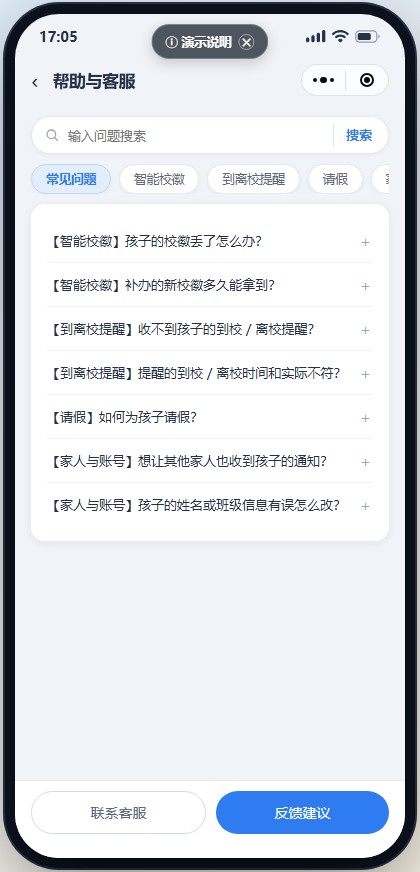
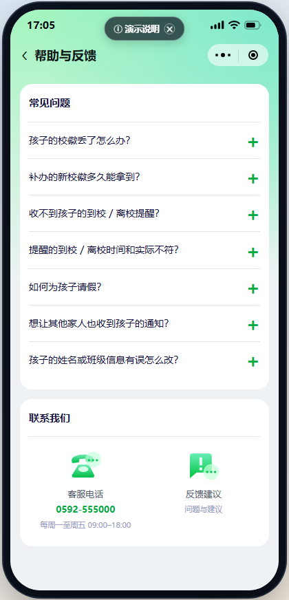
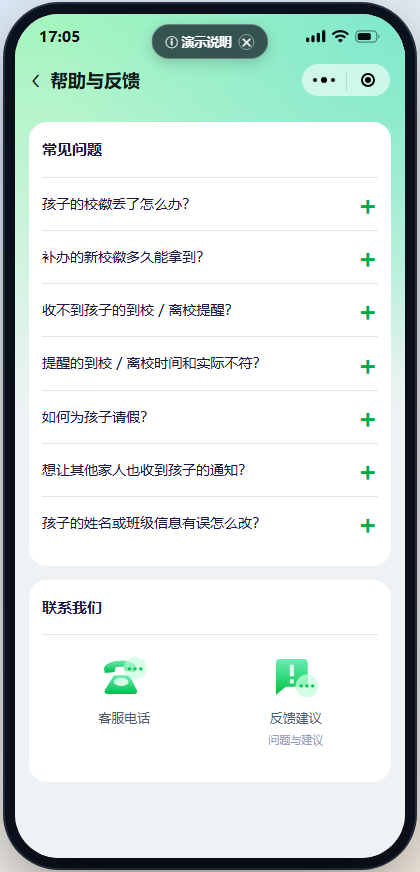
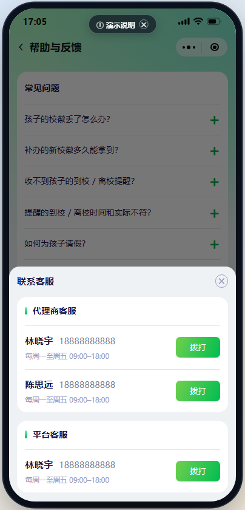

# 智小徽小程序客服电话展示优化（优化第一期）

## 优化范围

- **端：**教师小程序、家长小程序。
- **页面：**“我的”→“帮助与反馈”→“联系我们”中的客服电话区域。
- **规则：**两端展示结构和交互一致，客服信息按当前教师或家长角色对应的数据展示。截图以家长端原型为例。

## 优化内容

### 场景一：学校只有一位客服

**原：**帮助页只有“联系客服”入口，不显示电话号码和工作时间；点击为原型提示。

**现：**客服电话卡片显示电话和工作时间，不显示客服姓名；点击卡片直接拨打该号码。

| 原（第一期） | 现（单客服） |
|---|---|
|  |  |

### 场景二：学校有多位客服

**原：**帮助页只有统一的“联系客服”入口，没有按客服数量切换展示，也没有联系人选择弹窗。

**现：**客服电话入口不显示电话号码和工作时间；点击后打开“联系客服”弹窗，按“代理商客服”“平台客服”分组，展示联系人姓名、电话、工作时间及“拨打”按钮；点击联系人对应按钮直接拨打该号码。

| 原（第一期） | 现（多客服入口） |
|---|---|
|  |  |

**现：点击多客服入口后的弹窗**

> 截图中的电话、姓名和工作时间为原型演示数据；原型画面不代表生产数据或真实系统拨号已接入。