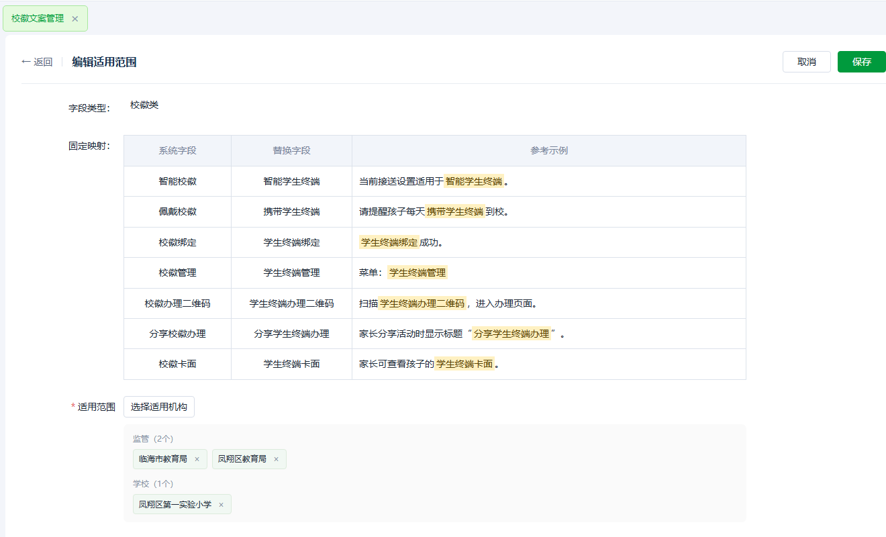
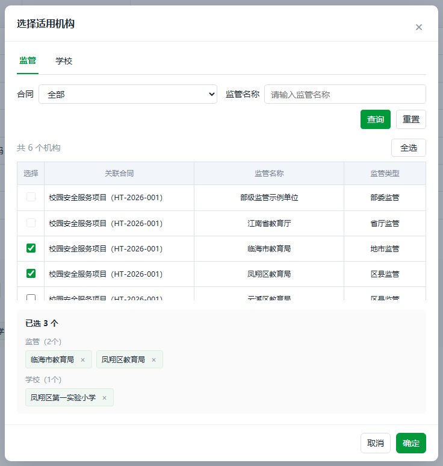
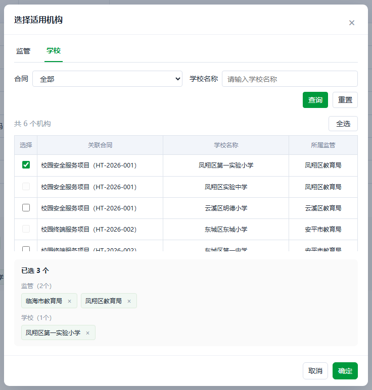
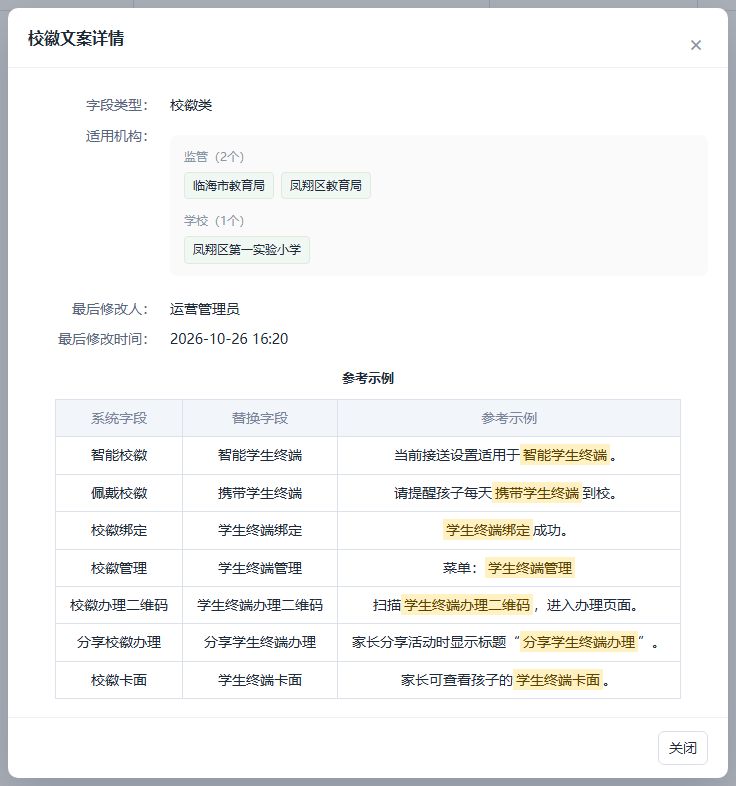

### 校徽文案管理产品需求文档

需求阶段：第一期新增功能  
文档状态：修改中，未定版  
管理端：运营后台 Web  
入口：运营后台主菜单“系统设置 → 校徽文案管理”，位于承运商管理之前  
影响端：监管多端、学校端、教师小程序、家长小程序、电子班牌  
交付边界：本机与 GitHub Pages 原型仅作静态评审；未接生产权限、接口、持久化或跨端分发

#### 1. 需求背景

运营人员需要为不同监管机构或学校指定校徽相关文案的统一替换方式。第一期只提供运营后台 Web 管理页面。字段清单和两种替换方案固定，运营人员只能调整每种方案的适用机构范围，不能新增、删除或改动字段映射。

合同只用于在适用机构弹窗内定位已开通机构。配置按机构稳定 ID 绑定，不绑定合同、行政区划或个人账号。

#### 2. 需求目标与范围

##### 2.1 目标

- 在运营后台菜单下提供“校徽文案管理”页面，菜单页签与页面标题使用同名。
- 固定展示“学生终端”和“学生卡”两条校徽文案方案；每条方案均包含相同的七个系统字段。
- 运营人员可编辑方案适用机构范围；通过机构唯一性校验避免同一机构同时落入两条方案。
- 将菜单列表、编辑范围、机构选择、详情、日志和异常反馈写入同一份 PRD，并与原型一致。

##### 2.2 范围边界

- 仅修改运营后台的校徽文案管理页面及该页面的子页面、详情和弹窗。
- 运营后台其他菜单、页面和交互保持原样。
- 学校端、监管端、教师小程序、家长小程序、电子班牌不提供该管理页面或管理操作。
- 产品规则仅覆盖用户提供的各端字段位置清单；产品不新增缺字段提示、选择或回退分支。
- 正式菜单权限、服务端保存、生产数据和跨端分发不在本期原型交付范围内。

#### 3. 文档说明

##### 3.1 名词解释

| 名词 | 说明 |
|---|---|
| 系统字段 | 当前七项固定源词：智能校徽、佩戴校徽、校徽绑定、校徽管理、校徽办理二维码、分享校徽办理、校徽卡面。 |
| 固定方案 | “学生终端”方案或“学生卡”方案。每种方案各一条固定记录，字段类型均为校徽类，映射内容只读。 |
| 适用机构 | 以稳定机构 ID 记录的监管机构或学校。监管选择只作用于该监管机构，不自动扩展下级；学校选择作用于该学校及其关联的各影响端。 |
| 合同筛选 | 适用机构弹窗中用于定位机构的合同名称筛选。合同不参与配置唯一性，也不成为已保存配置的绑定对象。 |
| 参考示例 | 将替换字段放入实际文案语境的短句；只作理解示例，不代表字段清单之外的位置已接入。 |

##### 3.2 编写与实现边界

本文件是唯一产品需求文档，格式为 Markdown。正文标题仅使用三级、四级、五级、六级标题，不使用一级或二级标题。每个页面原型链接后紧接该页面的真实原型截图，截图直接出现在对应章节，不集中放在附录。

本机数据是评审演示数据。稳定路由仍为 system-field-management；菜单展示名称和页签名称为“校徽文案管理”。页面与文档只描述产品侧规则，不代表生产能力已部署。

##### 3.3 第一期业务规则

| 主题 | 已确认规则 |
|---|---|
| 管理端与菜单 | 只在运营后台 Web 提供管理页面。菜单为“系统设置 → 校徽文案管理”，位于承运商管理之前。其余影响端无管理入口。 |
| 固定方案 | 校徽类固定有两条记录：学生终端方案、学生卡方案。每种方案一条记录，不提供新增、删除或停用。 |
| 固定映射 | 七个系统字段按方案预置一一映射。字段类型、系统字段、替换字段及示例只读；不支持逐字段修改、混用、恢复默认或把整条记录切换成另一方案。 |
| 可编辑内容 | 只允许编辑记录的适用机构范围。至少保留一个适用机构；候选机构范围受当前账号授权范围限制，不设产品数量上限。 |
| 唯一性 | 按字段类型和机构 ID 校验。同一机构不能同时属于学生终端与学生卡方案；冲突时阻止整次保存并列出机构名称。不同字段类型不互相占用。 |
| 方案切换 | 要将机构从一个方案切换到另一个方案，先从当前方案移出并保存，再加入另一方案。保存移出后该机构恢复系统原词；不允许同一机构同时留在两条方案中。 |
| 名称展示 | 展示名称不显示机构 ID。名称按稳定 ID 取当前最新名称；学校“所属监管”也按监管 ID 取最新名称。 |
| 合同关系 | 合同只用于筛选/定位候选机构。合同续约、到期、解除关联不改变已保存配置；只要机构仍正常开通，配置继续绑定该机构 ID。 |
| 停用启用 | 机构停用/启用不自动改动方案或范围。已停用机构不能作为新的有效候选；服务端重新校验当前机构状态。 |
| 跨端读取 | 配置影响监管多端、学校端、教师小程序、家长小程序和电子班牌。保存后配置更新，相关端下次打开或刷新读取新结果。单校数据按学校配置；监管跨校汇总按监管机构配置。 |
| 日志 | 成功修改适用范围时记录前后范围、最后修改人 ID、操作时名称快照和时间；失败、取消、无改动不记。留存沿用运营后台平台规则。 |
| 页面状态 | 不展示端侧生效状态、同步状态、手动重试或回滚入口。产品不增加缺字段提示或回退分支。 |

#### 4. 交互与设计链接

| 项目 | 说明 |
|---|---|
| 页面入口 | 运营后台左侧主菜单“系统设置 → 校徽文案管理”。 |
| 页面风格 | 列表、筛选控件、按钮和表格参照运营后台合同管理页；表单按当前运营后台内容页结构展示。 |
| 需求范围 | 仅本 PRD 所述页面、弹窗、详情、日志；运营后台其他页面保持原样。 |
| 评审方式 | 从运营后台统一菜单进入，不将独立模块页作为产品入口。 |
| 生产边界 | GitHub Pages 和本机均为静态评审原型，不代表生产发布。 |

#### 5. 第一期功能范围

| 功能 | 页面 / 入口 | 规则 |
|---|---|---|
| 固定方案列表 | 运营后台菜单页 | 固定显示学生终端、学生卡两行；不显示筛选、新增、分页或删除。 |
| 编辑适用范围 | 每条固定方案的编辑操作 | 仅修改机构范围；其他字段只读。移出机构保存成功后恢复系统原词。 |
| 适用机构选择 | 编辑页弹窗 | 监管、学校两个页签；筛选位于页签下，每个页签独立保留合同和名称条件；无客户筛选。 |
| 详情 | 每条记录的详情操作 | 展示方案、范围、最后修改人快照、最后修改时间及七项参考示例。 |
| 日志 | 每条记录的日志操作 | 按固定记录 ID 查看成功范围变更日志。 |
| 异常处理 | 菜单、页面、弹窗、保存 | 覆盖加载/失败/空态、无权限、机构被占用、机构停用或失效、并发更新、未知提交结果、离开未保存等情况。 |

#### 6. 功能详细说明

##### 6.1 菜单入口与固定方案列表

[运营后台菜单中的校徽文案管理列表页](../index.html?page=system-field-management)

###### 6.1.1 菜单、页签和页面进入

| 项目 | 规则 |
|---|---|
| 菜单显示名 | 系统设置 → 校徽文案管理；放在承运商管理之前。 |
| 页签显示名 | 页签和页面标题统一显示校徽文案管理；关闭、刷新或重新进入时保持该名称。 |
| 路由 | 稳定路由 system-field-management；不因展示名称修改路由键。 |
| 进入行为 | 菜单首次点击、直达路由、刷新、从其他页签切回及仅剩该页签时，均渲染列表内容，不出现空白页。 |
| 权限 | 菜单、查看、编辑权限遵循运营后台统一权限。无查看权限时不返回配置详情；只有查看权限时保留列表、详情、日志，隐藏编辑入口。 |

###### 6.1.2 列表字段及展示规则

列表固定两条数据，按学生终端、学生卡顺序显示。列表不展示筛选区、新增按钮、分页器、删除按钮；序号列保持窄宽，不挤占字段内容。

| 列 | 显示规则 |
|---|---|
| 序号 | 两条固定记录依序显示 1、2。 |
| 字段类型 | 两行均显示校徽类。 |
| 系统字段 | 按七项字段原顺序展示前三项，使用顿号分隔，后接三个英文句点；示例：智能校徽、佩戴校徽、校徽绑定...。悬停可查看完整七项。 |
| 替换字段 | 按当前固定方案展示前三项，使用顿号分隔，后接三个英文句点；悬停可查看完整七项。 |
| 适用范围 | 显示监管机构数量和学校数量；点击打开该条记录详情。范围名称不在列表重复展开。 |
| 最后修改时间 | 展示最后一次成功范围修改时间，格式为 YYYY-MM-DD HH:mm；缺失显示 --。 |
| 操作 | 按顺序显示详情、编辑、日志。写权限不足时隐藏编辑；不提供删除或新增。 |

固定方案数据缺失、重复或无法识别时，不将错误数据伪装成空列表或正常列表：保留页面结构，显示配置读取失败和“重新加载”入口；重新读取后仍异常则继续阻止编辑，不临时生成第三条记录、不允许新建，也不猜测替换方案。

###### 6.1.3 列表加载、权限与异常

| 场景 | 处理规则 |
|---|---|
| 首次加载 | 显示加载态；加载完成后展示两条固定方案。 |
| 加载失败 | 显示读取失败和重试入口；保留最后一次成功读取的数据（若有），不把失败误显示为“无配置”。 |
| 无查看权限 | 显示统一无权限态，不暴露机构名称、方案范围或日志。 |
| 仅查看权限 | 可打开详情和日志；不显示编辑操作。 |
| 菜单缺失但直达页面 | 服从运营后台统一权限；无权限时展示统一拒绝态，不从学校端或其他端补入口。 |
| 记录异常 | 发现记录缺失、重复或方案类型异常时禁用编辑并提示刷新/联系管理员，不自动修复或写入另一条记录。 |

##### 6.2 编辑固定方案适用范围

[运营后台校徽文案管理编辑适用范围页](../index.html?page=system-field-management&view=form&id=1)

###### 6.2.1 页面结构

| 区域 | 规则 |
|---|---|
| 页头 | 左侧返回按钮、分隔线和“编辑适用范围”；右侧取消、保存。按运营后台合同管理的内容页结构展示，不增加字段页独立边框。 |
| 字段类型 | 只读文字“校徽类”，不显示下拉框或输入边框。 |
| 固定映射 | 展示系统字段、替换字段、参考示例三列。字段值只读，无一键选择或单行编辑控件。 |
| 适用范围 | 展示监管（N个）、学校（N个）及已选机构标签；通过选择适用机构打开弹窗。 |
| 保存 | 只提交当前记录 ID 和适用机构 ID 集合。前端不提交替换映射值，服务端也不得根据页面参数改写固定映射。 |

###### 6.2.2 七项固定字段与两种方案

表格按下列顺序展示。替换方案 A 与 B 是固定值，参考示例以最终替换字段代入短句。

| 系统字段 | 学生终端方案 | 学生卡方案 | 参考示例 |
|---|---|---|---|
| 智能校徽 | 智能学生终端 | 智能学生卡 | 当前接送设置适用于智能学生终端 / 智能学生卡。 |
| 佩戴校徽 | 携带学生终端 | 携带学生卡 | 请提醒孩子每天携带学生终端 / 携带学生卡到校。 |
| 校徽绑定 | 学生终端绑定 | 学生卡绑定 | 学生终端绑定 / 学生卡绑定成功。 |
| 校徽管理 | 学生终端管理 | 学生卡管理 | 菜单：学生终端管理 / 学生卡管理。 |
| 校徽办理二维码 | 学生终端办理二维码 | 学生卡办理二维码 | 扫描学生终端办理二维码 / 学生卡办理二维码，进入办理页面。 |
| 分享校徽办理 | 分享学生终端办理 | 分享学生卡办理 | 家长分享活动时显示标题“分享学生终端办理” / “分享学生卡办理”。 |
| 校徽卡面 | 学生终端卡面 | 学生卡面 | 家长可查看孩子的学生终端卡面 / 学生卡面。 |

映射规则：每一行均只读。学生终端方案对应全部 A 值，学生卡方案对应全部 B 值；不允许出现部分采用 A、部分采用 B、恢复默认或第三种值。编辑任何范围时，当前记录的映射保持原值不变。

###### 6.2.3 编辑、保存与离开保护

| 场景 / 操作 | 处理规则 |
|---|---|
| 打开编辑 | 按固定记录 ID 加载当前范围、固定方案映射、最后修改人快照和版本号。记录不存在或方案类型不匹配时阻止编辑并提示刷新。 |
| 打开选择机构 | 复制当前已保存范围为弹窗临时集合。取消、关闭或按 Esc 不回写已保存范围。 |
| 选择机构后保存 | 至少保留一个适用机构；校验机构 ID、授权范围、开通状态及同字段占用；通过后保存范围。 |
| 移出部分机构 | 保存前展示确认：“保存后，所选移出机构将恢复系统字段。确认保存吗？”取消则继续编辑；保存成功后只移出部分恢复系统原词，留在范围内的机构继续应用本方案。 |
| 全部移出 | 阻止保存并提示“至少保留一个适用机构”。 |
| 未修改保存 | 不提交、不更新时间、不写日志，提示未修改内容。 |
| 保存成功 | 更新范围、最后修改人 ID、操作者名称快照、最后修改时间及记录版本；仅记录范围前后值，提示保存成功。 |
| 保存失败 | 不改变原配置、时间、操作者和日志；保留草稿，显示失败原因，允许用户修正或重试。 |
| 结果未知 | 不重复提交；显示待核实提示，按原请求 ID 查询。查询处理中或失败时维持待核实态；确认未执行后才允许重试。不得显示端侧生效状态。 |
| 并发修改 | 提交前按记录版本复核；版本变化时阻止覆盖，保留当前草稿，提示重新打开最新记录。 |
| 权限变化 | 保存时再次校验写权限；失权后拒绝提交、保留草稿并隐藏后续写操作。 |
| 机构变化 | 当前机构被停用、删除或不在授权集合时阻止提交并标出机构；名称变化时按同一机构 ID 展示最新名称，不按同名名称重新匹配。 |
| 离开未保存 | 返回、取消、切换菜单或关闭页签时提示确认；选择继续编辑则停留，确认离开则丢弃未保存草稿。提交处理中或结果未知时禁止重复离开/提交。 |

固定方案不支持新增、删除或停用。操作者不能把一条映射改成另一条；跨方案调整机构需先在原方案保存移出，再在目标方案加入，避免同一机构重复占用。若原方案仅剩待转移的一个机构，直接移出会违反至少保留一个机构的规则；需先为原方案加入其他有效机构并保存，再移出待转移机构。若没有其他可选机构，本期规则下不能完成转移，不得通过短暂双重占用绕过冲突校验。

##### 6.3 选择适用机构弹窗

[监管页签：选择适用机构原型](../index.html?page=system-field-management&view=form&id=1&dialog=scope)

[学校页签：选择适用机构原型](../index.html?page=system-field-management&view=form&id=1&dialog=scope)

###### 6.3.1 打开、页签和筛选状态

| 区域 | 规则 |
|---|---|
| 页签顺序 | 监管、学校。机构名称筛选区位于当前页签下方，候选表格在筛选区下方。 |
| 过滤字段 | 不显示客户筛选。每个页签仅显示合同和当前类型名称两个条件：监管名称或学校名称。 |
| 合同 | 单选下拉，默认“全部”；下拉只显示合同名称，内部按稳定合同 ID 过滤。同名合同仍区分 ID。 |
| 名称 | 监管页签输入监管名称；学校页签输入学校名称。按输入文本匹配名称。 |
| 查询 | 点击查询应用当前页签的合同和名称条件；按 Enter 等同点击查询。未执行查询的输入值不得改变当前候选结果。 |
| 重置 | 只清空当前页签的合同和名称条件，合同恢复“全部”；保留监管、学校两个页签已选的机构集合。 |
| 独立状态 | 监管、学校页签分别保存各自的合同、名称及已应用结果；切换页签不把一类筛选值带到另一类，也不清空跨页签已选机构。关闭后再次打开，从表单当前已确认范围重建选择集，临时筛选不保留。 |

###### 6.3.2 候选表格和名称展示

| 列 | 监管页签 | 学校页签 | 规则 |
|---|---|---|---|
| 选择 | 选择框 | 选择框 | 按稳定机构 ID 更新临时集合；不能仅按名称匹配。 |
| 关联合同 | 合同名称（合同编号） | 合同名称（合同编号） | 放在名称列之前；仅展示机构直接关联的合同。无关联合同显示 --。 |
| 名称 | 监管名称 | 学校名称 | 居中显示最新主数据名称，不显示内部 ID。 |
| 类型/归属 | 监管类型 | 所属监管 | 监管类型居中窄列，值为部委监管、省厅监管、地市监管、区县监管；学校所属监管按监管机构 ID 取最新名称，居中且不设置过宽列。缺失/未知显示 --。 |

名称、合同或关联数据变更时，列表刷新后按稳定 ID 取新值；不得因为同名机构或同名合同合并记录。学校所属监管无法解析时仍保留学校行，归属显示 --。

###### 6.3.3 选择、批量操作与确认

| 操作 | 规则 |
|---|---|
| 单行选择 | 只允许选择当前账号可操作、已开通且未被另一固定方案占用的机构。被占用或停用的行禁用并展示原因。 |
| 全选 / 全不选 | 单个切换按钮。只作用于当前页签已应用筛选结果中可选择的机构；当前可选结果全已选时显示“全不选”，否则显示“全选”。不会清除另一页签或筛选外机构。 |
| 已选区域 | 按监管（N个）、学校（N个）分组展示临时已选机构和移除控件；仅显示名称，不显示 ID。切换页签后仍保留。 |
| 确定 | 至少选一个机构且所有 ID 有效、未重复、仍在授权范围时启用。点击时再校验；成功将临时集合写回表单并关闭弹窗。 |
| 取消、叉号、Esc | 丢弃弹窗临时变更，表单保留打开弹窗前的范围。 |
| 已选记录 | 本方案原有机构在本方案中保持可选状态；同一机构被另一方案占用时不得重复选择。 |

###### 6.3.4 空态、失败及异常

| 场景 | 展示与行为 |
|---|---|
| 具体合同在当前机构类型下无关联机构 | 空态显示“该合同暂无机构”。 |
| 合同有关联机构，但当前名称条件无匹配 | 空态显示“暂无符合条件的已开通机构”。 |
| 全部合同且筛选无匹配 | 同上，显示“暂无符合条件的已开通机构”。 |
| 查询加载中 | 候选区显示加载中；不得把旧结果误认为新条件结果；查询失败时保留上次成功结果并显示重试提示。 |
| 机构被另一方案占用 | 行禁用并说明已被其他配置占用；后端保存再次校验，避免两个方案同时持有机构。 |
| 机构停用/失效/超出权限 | 禁止新增选择；现有配置不因停用启用自动改变。编辑提交发现无效机构时阻止保存并提示移除或刷新。 |
| 同名 ID 不同 | 按 ID 独立选择、计数、冲突和写回；不按名称去重。 |
| 选择时发生状态变化 | 确定及保存时重新拉取或复核候选状态；已被占用、停用或无权限的 ID 从确认中阻断，不静默自动选其他机构。 |

##### 6.4 校徽文案详情

[校徽文案管理详情原型](../index.html?page=system-field-management&dialog=detail&id=1)

详情字段顺序：字段类型、适用机构、最后修改人、最后修改时间、参考示例。每个字段标题带冒号并右对齐，值左对齐；参考示例表格内容居中，列宽按内容收紧，表头高度一致。

- 字段类型显示校徽类。
- 适用机构分监管（N个）、学校（N个）及机构名称标签；不展示机构 ID。
- 最后修改人取最后操作人 ID 对应的操作时名称快照；缺失显示 --，不随人员改名回写历史记录。
- 最后修改时间取该固定方案最近一次成功变更时间；失败、取消、无改动不更新。
- 参考示例表列为系统字段、替换字段、参考示例；七项顺序与编辑页一致。
- 详情只读，不出现恢复、编辑或删除映射的控件。记录不存在、权限被撤销或读取失败时显示错误并允许返回列表，不展示其他记录数据。

##### 6.5 日志

[校徽文案管理日志原型](../index.html?page=system-field-management&dialog=logs&id=1)

日志按固定记录 ID 隔离，不按序号或名称查询。每条日志展示操作时间、操作人名称快照、操作内容及适用范围前后值。

| 事件 | 是否记日志 | 记录内容 |
|---|---|---|
| 成功修改适用范围 | 是 | 操作者 ID、操作时名称快照、时间、固定方案、原范围和新范围；移出机构注明保存成功后恢复系统字段。 |
| 打开、查看、筛选、取消 | 否 | 不产生配置变更，不写操作日志。 |
| 无改动保存 | 否 | 不更新最后修改人/时间，不记日志。 |
| 保存失败、权限拒绝、并发冲突、未知结果待核实 | 否 | 未确认成功前不记录成功操作；未知结果按请求 ID 查询确认。 |
| 固定映射、字段示例 | 不存在可编辑事件 | 映射不可修改，不记录映射变更、恢复默认或删除。 |

日志读取失败时保留当前详情并展示重试提示；无日志时显示空态；无查看权限时不返回日志内容。留存期限沿用运营后台平台规则。

##### 6.6 跨端规则、唯一性与整体异常

页面配置仅表达机构与固定方案的绑定。端侧读取和运营后台管理权限由现有平台能力承担；本原型不代表真实服务已接入。

| 场景 | 规则与异常处理 |
|---|---|
| 多端读取 | 学校配置按学校机构 ID 供学校端、教师小程序、家长小程序、电子班牌及监管端单校数据读取；监管跨校汇总按当前监管机构 ID 读取监管方案。账号切换学校、班牌切换学校时按当前业务学校 ID 读取，避免租户串用。 |
| 方案冲突 | 同一校徽类字段类型和机构 ID 只能被一条方案占用。保存任一方案范围时若机构属于另一条记录，整次保存阻止并列出机构名称；不同字段类型独立校验。客户端预校验不能取代服务端原子复核。 |
| 机构范围 | 监管机构选择不扩展到下级；学校选择只按该学校 ID 生效。按 ID 去重；不设产品上限，受当前账号授权候选范围限制。 |
| 范围移除 | 只有保存成功后，移出的机构才恢复系统字段；取消、失败或未知结果不提前改原配置。仍在范围内的机构继续使用该固定方案。 |
| 停用与启用 | 机构停用/启用时，保存的固定方案和范围保持不变。停用机构不作为新候选；编辑期间状态变化时提交校验阻止无效范围写入。 |
| 合同变化 | 合同到期、解除、改名或删除关联不自动改动仍正常开通机构的已保存方案；合同筛选只影响弹窗候选，不回写或删除配置。 |
| 连续范围变更 | 对同一机构连续变更方案时按保存提交顺序执行：先确认原方案移出成功，再允许目标方案加入；不并行覆盖，不允许同机构双重占用。 |
| 服务端保存失败 | 不改变原范围、更新时间、最后修改人和日志，页面保留草稿并说明失败。 |
| 提交结果未知 | 按原请求 ID 查询，防止重复提交。确认执行成功后更新范围与日志；确认未执行才可重试；查询处理中或失败继续保持待核实，不显示端侧应用状态。 |
| 登录或权限变化 | 读取和保存按运营后台统一权限及授权机构集合校验。前端禁用只作提示；无权 ID、伪造 ID、停用 ID或冲突 ID由服务端拒绝。 |
| 字段位置清单 | 只应用于用户提供清单登记的位置。产品不对数据库原文、历史合同、自由输入、附件、已发消息、账号 ID 或设备序列号做全局替换；未在清单中的位置不宣称已覆盖。 |
| 缺失字段 | 用户已确认按其提供的位置清单作为产品范围；产品不增加缺字段提示、选择、回退或端侧状态。实现清单匹配的技术核验由后续对接负责。 |
| 端侧状态与回滚 | 页面不展示端级状态、失败端、同步进度，不提供手动重试或回滚。配置保存成功后，相关端下次打开或刷新读取；本期不声明具体生效耗时。 |

##### 6.6.1 页面文案和状态清单

| 位置 | 文案 |
|---|---|
| 方案一 | 学生终端 |
| 方案二 | 学生卡 |
| 无合同关联机构 | 该合同暂无机构 |
| 当前机构筛选无结果 | 暂无符合条件的已开通机构 |
| 页面无固定方案数据 | 配置读取失败，请重新加载 |
| 列表加载失败 | 配置读取失败，请重试 |
| 无效适用范围 | 至少保留一个适用机构 |
| 固定方案冲突 | （机构名称）机构已被其他规则配置占用，请解绑后重试。 |
| 移出范围确认 | 保存后，所选移出机构将恢复系统字段。确认保存吗？ |
| 未保存离开 | 当前内容尚未保存，确认离开？ |
| 并发更新 | 记录已更新，请重新打开编辑。当前填写保留，可查看后重新打开。 |
| 保存结果未知 | 提交结果待核实，请查询提交结果，勿重复提交。 |

本期产品需求保持修改中、未定版。正式权限、接口、数据持久化、日志事务与跨端读取实现不由该静态原型代替。